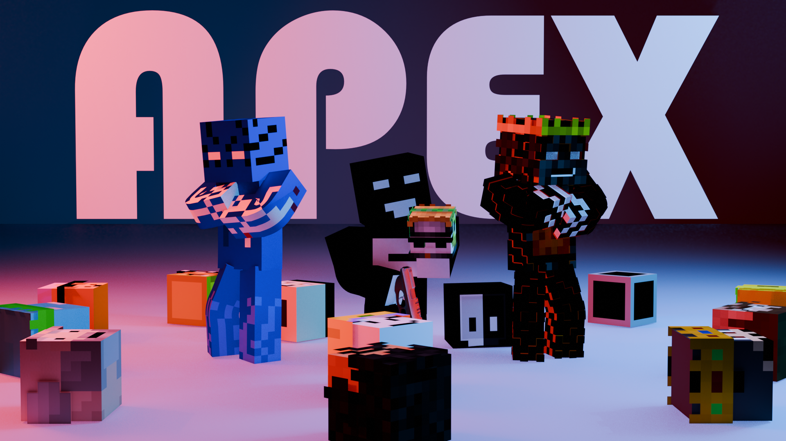
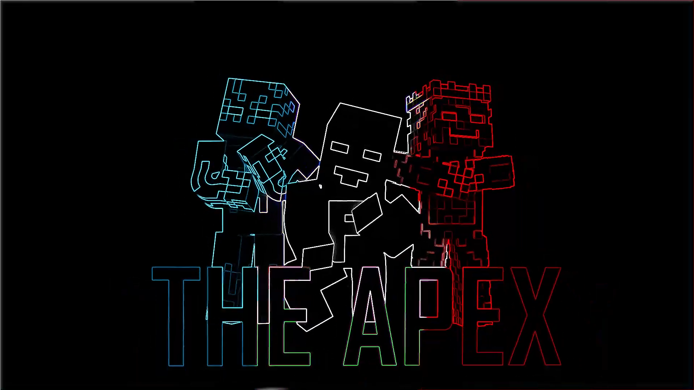

# एनीमेशन और दृश्य पोर्टफ़ोलियो

**Bardiya Alizadeh (Kabir) · Farland_game**

<!-- ROBLOX_ENTRY_START -->
### [Roblox Studio शोकेस · 11 🎮🎬](https://github.com/FarlandGame/Animation-Portfolio/blob/main/collections/hi/roblox.md)

नीचे अंश देखें और हर लिंक से पूरा मूल वीडियो खोलें।
<!-- ROBLOX_ENTRY_END -->

<!-- BLENDER_ENTRY_START -->
 [Blender · 3D 🎬](https://github.com/FarlandGame/Animation-Portfolio/blob/main/collections/hi/main.md) · [← Farland_game](https://github.com/FarlandGame#portfolio-directory)
<!-- BLENDER_ENTRY_END -->

[English](https://github.com/FarlandGame/Animation-Portfolio/blob/main/README.md) · [日本語](https://github.com/FarlandGame/Animation-Portfolio/blob/main/docs/README.ja.md) · [فارسی](https://github.com/FarlandGame/Animation-Portfolio/blob/main/docs/README.fa.md) · [Deutsch](https://github.com/FarlandGame/Animation-Portfolio/blob/main/docs/README.de.md) · [Français](https://github.com/FarlandGame/Animation-Portfolio/blob/main/docs/README.fr.md) · [Español](https://github.com/FarlandGame/Animation-Portfolio/blob/main/docs/README.es.md) · [Português (Brasil)](https://github.com/FarlandGame/Animation-Portfolio/blob/main/docs/README.pt-BR.md) · [Italiano](https://github.com/FarlandGame/Animation-Portfolio/blob/main/docs/README.it.md) · [Nederlands](https://github.com/FarlandGame/Animation-Portfolio/blob/main/docs/README.nl.md) · [Polski](https://github.com/FarlandGame/Animation-Portfolio/blob/main/docs/README.pl.md) · [Українська](https://github.com/FarlandGame/Animation-Portfolio/blob/main/docs/README.uk.md) · [Türkçe](https://github.com/FarlandGame/Animation-Portfolio/blob/main/docs/README.tr.md) · [Русский](https://github.com/FarlandGame/Animation-Portfolio/blob/main/docs/README.ru.md) · [简体中文](https://github.com/FarlandGame/Animation-Portfolio/blob/main/docs/README.zh-CN.md) · [繁體中文](https://github.com/FarlandGame/Animation-Portfolio/blob/main/docs/README.zh-TW.md) · [한국어](https://github.com/FarlandGame/Animation-Portfolio/blob/main/docs/README.ko.md) · [हिन्दी](https://github.com/FarlandGame/Animation-Portfolio/blob/main/docs/README.hi.md) · [Bahasa Indonesia](https://github.com/FarlandGame/Animation-Portfolio/blob/main/docs/README.id.md)

<!-- PLAYFUL_INTRO_START -->

> ब्लॉक वाले किरदार, बड़े-बड़े आइडिया और हर ऐनिमेटर का साझा साइड क्वेस्ट: रेंडर पूरा होने का इंतज़ार। 🎬🍿

[मिलिए Kabir से: मेरी कहानी, रचनात्मक शुरुआत और जापान की योजनाएँ](https://github.com/FarlandGame/FarlandGame/blob/main/docs/story.hi.md)
<!-- PLAYFUL_INTRO_END -->

<!-- EARLY_PHONE_LINK_START -->

[शुरुआती फ़ोन-आधारित रचनाओं का संग्रह 📱🎬](https://github.com/FarlandGame/Animation-Portfolio/blob/main/history/phone-era/hi/index.md) · [स्कूल-स्थलों की संदर्भ गैलरी](https://github.com/FarlandGame/Animation-Portfolio/blob/main/history/phone-era/hi/school-01.md) · [13 छोटे नमूने देखें](https://github.com/FarlandGame/Animation-Portfolio/issues/2)

<!-- EARLY_PHONE_LINK_END -->

[मुख्य एनीमेशन शृंखला](https://github.com/FarlandGame/Animation-Portfolio/blob/main/collections/hi/main.md) · [Roblox एनीमेशन और संपादित क्लिप](https://github.com/FarlandGame/Animation-Portfolio/blob/main/collections/hi/roblox.md) · [शुरुआती छोटे अभ्यास](https://github.com/FarlandGame/Animation-Portfolio/blob/main/collections/hi/early.md) · [पूरी दृश्य गैलरी](https://github.com/FarlandGame/Animation-Portfolio/blob/main/gallery/hi/index.md)

लगातार बढ़ता एक रचनात्मक संग्रह, जिसमें शुरुआती फ़ोन-आधारित 2D काम, Minecraft में कहानी कहना, बाद के 3D एनीमेशन, Roblox संपादन, पोस्टर, पात्रों की कलाकृतियाँ और प्रोजेक्ट तथा स्थानों की संदर्भ सामग्री शामिल हैं। हर संग्रह के भीतर विकास को देखें; पुराने काम की क्रम-संख्या का अपवाद फ़ोन वाले दौर के संग्रह में समझाया गया है।

Bardiya Alizadeh (Kabir / Farland_game) द्वारा बनाया और संकलित किया गया। बाद के 3D संग्रह में Blender का इस्तेमाल हुआ है; मुख्य संग्रह की प्रविष्टियों 07 और 08 में After Effects से किया गया संपादन भी शामिल है। रचनाकार फ़ोन वाले दौर की 1–8 रचनाओं को StickNodes से जोड़ता है; 9 और 11 Minecraft की रिकॉर्डिंग हैं, जबकि शुरुआती मोबाइल 3D दृश्य 10 बनाने में इस्तेमाल हुए ऐप का नाम याद नहीं है।

 

## रचनात्मक सफ़र देखें

मूल तीन क्रमांकित वीडियो संग्रह अपने-अपने पुराने से नए का क्रम बनाए रखते हैं। जोड़ा गया फ़ोन वाले दौर का संग्रह दी गई क्रम-संख्याओं को सुरक्षित रखता है, साथ ही 12 को स्पष्ट रूप से सबसे पुरानी बची हुई रचना और 13 को ब्रांडिंग ओपनिंग के रूप में बताता है। तस्वीरें बिना क्रम की कैटलॉग संदर्भ सामग्री हैं। ये अलग-अलग संग्रह पूरे पोर्टफ़ोलियो के लिए एक सटीक समयरेखा या गुणवत्ता की रैंकिंग तय नहीं करते।

## इस संग्रह में क्या है?

चार संग्रहों में 35 वीडियो फ़ाइलें और 208 तस्वीरें। मूल मुख्य शृंखला में आठ वीडियो, Roblox में ग्यारह और शुरुआती अभ्यासों में तीन हैं; पुराने फ़ोन वाले दौर का संग्रह तेरह वीडियो फ़ाइलें और स्कूल-स्थलों की 46 तस्वीरें जोड़ता है, जबकि पहले की गैलरी में 162 तस्वीरें थीं। पुरानी फ़ाइलों में एनीमेशन, मिश्रित माध्यम, गेम की रिकॉर्डिंग और चैनल ओपनिंग शामिल हैं; हर फ़ाइल रेंडर की गई एनीमेटेड फ़िल्म नहीं है।

## तैयार फ़्रेम और जारी काम

रचनाकार के अनुसार **मुख्य शृंखला की 04 अधूरी है**। उनके अनुरोध पर इसे पूरी अवधि की **दोबारा संपीड़ित 1080p देखने योग्य प्रति** के रूप में प्रकाशित किया गया है, जबकि उपलब्ध कराई गई स्रोत फ़ाइल स्थानीय रूप से अपरिवर्तित रहती है। बाकी वीडियो उपलब्ध कराई गई पोर्टफ़ोलियो क्लिप हैं; निर्यात की गई कोई फ़ाइल अपने-आप पूर्ण निर्माण नहीं मानी जाती। परियोजना और संपादक के स्क्रीनशॉट को स्क्रीनशॉट या पूर्वावलोकन कहा गया है, अंतिम रेंडर की गई फ़िल्म नहीं। जिन फ़ाइलनामों में AI-निर्मित छवि होने का स्पष्ट उल्लेख है, उन्हें चित्र सूची में चिह्नित किया गया है; संदर्भ तस्वीरों को मौलिक एनीमेशन कलाकृति के रूप में नहीं दिखाया गया है।

## देखें, झलक पाएँ और डाउनलोड करें

क्रमांकित फ़िल्में, वास्तविक फ़्रेम के प्रीव्यू, अवधि, रिज़ॉल्यूशन और पूरे वीडियो के डाउनलोड लिंक देखें। छोटे चलने योग्य नमूने अंश हैं। पूरे डाउनलोड में 31 बिना बदली हुई मूल वीडियो फ़ाइलें और पूरी अवधि वाली चार दोबारा कंप्रेस की गई प्रतियाँ हैं: मुख्य संग्रह की 04 और फ़ोन वाले दौर की 8, 11 तथा 12, जिन्हें रचनाकार के अनुरोध पर दोबारा कंप्रेस किया गया है। उनकी मूल स्रोत फ़ाइलें स्थानीय रूप से बिना बदलाव के सुरक्षित हैं; स्रोत और प्रकाशित प्रतियों के हैश अलग-अलग दिए गए हैं। पूरी देखने योग्य प्रति बनाने के लिए किसी फ़ाइल की अवधि घटाई नहीं गई है। स्कूल की मूल तस्वीरें एक स्रोत पैक में दी गई हैं।

## शीर्षकों और श्रेय के बारे में

इस प्रदर्शनी के फ़िल्म शीर्षक वर्णनात्मक पोर्टफ़ोलियो शीर्षक हैं, जिन्हें रचनाकार की अनुमति से जोड़ा गया है। सूची में मूल फ़ाइलनाम और क्रमांक सुरक्षित हैं, ताकि हर प्रविष्टि को दी गई फ़ाइल से जोड़ा जा सके। पोस्टर और स्क्रीनशॉट को किसी फ़िल्म से तभी जोड़ा जाता है जब वह संबंध ज्ञात हो। पात्रों, खेलों, संगीत, तस्वीरों और तीसरे पक्ष के अन्य तत्वों के अधिकार और श्रेय उनके संबंधित धारकों के पास रहते हैं; इस संग्रह में किसी सामग्री का प्रदर्शन यह व्यापक दावा नहीं है कि उसका हर तत्व बिल्कुल शुरुआत से बनाया गया था।

## लगातार बढ़ सकने वाला संग्रह

शुरुआती StickNodes दौर की सामग्री अब बाद के काम के साथ सुरक्षित है। शुरुआती चरणों को मिटाए बिना भविष्य के रेंडर और दोबारा मिली फ़ाइलें जोड़ी जा सकती हैं। खोए या अधूरे प्रोजेक्ट, जिनकी कोई फ़ाइल नहीं बची, उपलब्ध फ़िल्मों की तरह दिखाने के बजाय अनुपलब्ध बताए गए हैं। परिचय और नेविगेशन 18 भाषाओं में हैं; नई फ़िल्मों की विस्तृत टिप्पणियाँ अंग्रेज़ी, फ़ारसी और जापानी में हैं। इसका अर्थ यह नहीं कि हर वीडियो की आवाज़ और पाठ का अनुवाद किया गया है।

[मुख्य एनीमेशन शृंखला](https://github.com/FarlandGame/Animation-Portfolio/blob/main/collections/hi/main.md) · [Roblox एनीमेशन और संपादित क्लिप](https://github.com/FarlandGame/Animation-Portfolio/blob/main/collections/hi/roblox.md) · [शुरुआती छोटे अभ्यास](https://github.com/FarlandGame/Animation-Portfolio/blob/main/collections/hi/early.md) · [पूरी दृश्य गैलरी](https://github.com/FarlandGame/Animation-Portfolio/blob/main/gallery/hi/index.md)

[SHA-256 चेकसम](https://github.com/FarlandGame/Animation-Portfolio/blob/main/checksums/SHA256SUMS-videos.txt) · [मशीन द्वारा पढ़ी जा सकने वाली सूची](https://github.com/FarlandGame/Animation-Portfolio/blob/main/catalogue.json)

[पूरा रचनात्मक और सॉफ़्टवेयर पोर्टफ़ोलियो](https://github.com/FarlandGame)
