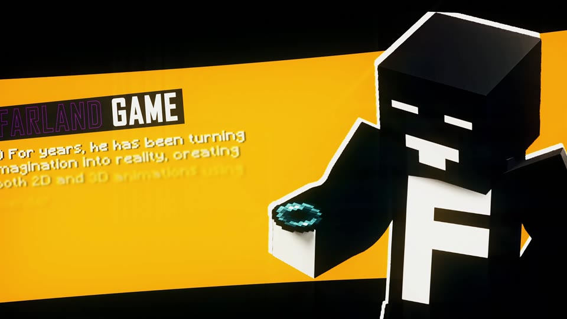

# Animatie- en beeldportfolio

**Bardiya Alizadeh (Kabir) · Farland_game**

[English](https://github.com/FarlandGame/Animation-Portfolio/blob/main/README.md) · [日本語](https://github.com/FarlandGame/Animation-Portfolio/blob/main/docs/README.ja.md) · [فارسی](https://github.com/FarlandGame/Animation-Portfolio/blob/main/docs/README.fa.md) · [Deutsch](https://github.com/FarlandGame/Animation-Portfolio/blob/main/docs/README.de.md) · [Français](https://github.com/FarlandGame/Animation-Portfolio/blob/main/docs/README.fr.md) · [Español](https://github.com/FarlandGame/Animation-Portfolio/blob/main/docs/README.es.md) · [Português (Brasil)](https://github.com/FarlandGame/Animation-Portfolio/blob/main/docs/README.pt-BR.md) · [Italiano](https://github.com/FarlandGame/Animation-Portfolio/blob/main/docs/README.it.md) · [Nederlands](https://github.com/FarlandGame/Animation-Portfolio/blob/main/docs/README.nl.md) · [Polski](https://github.com/FarlandGame/Animation-Portfolio/blob/main/docs/README.pl.md) · [Українська](https://github.com/FarlandGame/Animation-Portfolio/blob/main/docs/README.uk.md) · [Türkçe](https://github.com/FarlandGame/Animation-Portfolio/blob/main/docs/README.tr.md) · [Русский](https://github.com/FarlandGame/Animation-Portfolio/blob/main/docs/README.ru.md) · [简体中文](https://github.com/FarlandGame/Animation-Portfolio/blob/main/docs/README.zh-CN.md) · [繁體中文](https://github.com/FarlandGame/Animation-Portfolio/blob/main/docs/README.zh-TW.md) · [한국어](https://github.com/FarlandGame/Animation-Portfolio/blob/main/docs/README.ko.md) · [हिन्दी](https://github.com/FarlandGame/Animation-Portfolio/blob/main/docs/README.hi.md) · [Bahasa Indonesia](https://github.com/FarlandGame/Animation-Portfolio/blob/main/docs/README.id.md)

<!-- PLAYFUL_INTRO_START -->

> Blokkerige personages, grote ideeën en de vaste zijmissie van elke animator: wachten op de render. 🎬🍿

[Maak kennis met Kabir: mijn verhaal, creatieve begin en plannen voor Japan](https://github.com/FarlandGame/FarlandGame/blob/main/docs/story.nl.md)
<!-- PLAYFUL_INTRO_END -->

<!-- EARLY_PHONE_LINK_START -->

[Archief van mijn eerste jaren met een telefoon 📱🎬](https://github.com/FarlandGame/Animation-Portfolio/blob/main/history/phone-era/nl/index.md) · [Galerij met referenties van schoollocaties](https://github.com/FarlandGame/Animation-Portfolio/blob/main/history/phone-era/nl/school-01.md) · [De 13 korte voorbeelden bekijken](https://github.com/FarlandGame/Animation-Portfolio/issues/2)

<!-- EARLY_PHONE_LINK_END -->

[Hoofdreeks animaties](https://github.com/FarlandGame/Animation-Portfolio/blob/main/collections/nl/main.md) · [Roblox-animatie en montages](https://github.com/FarlandGame/Animation-Portfolio/blob/main/collections/nl/roblox.md) · [Vroege korte studies](https://github.com/FarlandGame/Animation-Portfolio/blob/main/collections/nl/early.md) · [Volledige beeldgalerie](https://github.com/FarlandGame/Animation-Portfolio/blob/main/gallery/nl/index.md)

Een groeiend creatief archief met vroeg 2D-werk op de telefoon, verhalen in Minecraft, latere 3D-animatie, Roblox-montages, posters, personage-illustraties en referenties voor projecten en locaties. Volg de ontwikkeling binnen elke collectie; de historische uitzondering op de nummering wordt uitgelegd in het archief van de telefoonperiode.

Gemaakt en samengesteld door Bardiya Alizadeh (Kabir / Farland_game). De latere 3D-collectie gebruikt Blender; de hoofditems 07 en 08 bevatten ook montage in After Effects. De maker koppelt de nummers 1–8 uit de telefoonperiode aan StickNodes; 9 en 11 zijn Minecraft-opnamen, terwijl hij niet meer weet welke app is gebruikt voor de vroege mobiele 3D-scène 10.

## Volg de creatieve ontwikkeling

De drie oorspronkelijke collecties met genummerde video's behouden elk hun eigen volgorde van oud naar nieuw. De aanvullende collectie uit de telefoonperiode bewaart de aangeleverde nummers, waarbij 12 uitdrukkelijk is aangeduid als het oudste bewaard gebleven werk en 13 is ingedeeld als intro voor de kanaalidentiteit. Afbeeldingen zijn ongeordende catalogusreferenties. Deze afzonderlijke collecties vormen geen enkele exacte tijdlijn of kwaliteitsrangschikking voor het hele portfolio.

## Wat bevat deze collectie?

35 videobestanden verdeeld over vier collecties en 208 afbeeldingen. De oorspronkelijke hoofdreeks bevat acht video's, Roblox elf en de vroege studies drie; het historische archief uit de telefoonperiode voegt dertien videobestanden en 46 foto's van schoollocaties toe aan de eerdere galerij met 162 afbeeldingen. De historische bestanden omvatten animatie, gemengde media, opnamen uit games en een kanaalintro; niet elk bestand is een gerenderde animatiefilm.

## Uiteindelijke beelden en werk in uitvoering

**Nummer 04 van de hoofdreeks is onvoltooid**, zoals de maker heeft aangegeven. Op verzoek van de maker wordt het gepubliceerd als een **opnieuw gecomprimeerde 1080p-kijkkopie met de volledige speelduur**, terwijl het aangeleverde bronbestand lokaal ongewijzigd blijft. De overige video's zijn aangeleverde portfolioclips; een aangeleverde export wordt niet automatisch een voltooide productie genoemd. Schermafbeeldingen van projecten en editors worden aangeduid als schermafbeeldingen of voorbeelden, niet als definitief gerenderde films. Bestandsnamen die expliciet naar AI-generatie verwijzen, zijn gemarkeerd in de beeldcatalogus; referentiefoto's worden niet gepresenteerd als oorspronkelijk animatiewerk.

## Bekijken, voorvertonen en downloaden

Bekijk de genummerde films, voorbeelden van echte frames, speelduur, resolutie en links naar volledige downloads. De korte afspeelbare voorbeelden zijn fragmenten. De volledige downloads bevatten 31 ongewijzigde originele videobestanden en vier opnieuw gecomprimeerde kopieën met de volledige speelduur: hoofdvideo 04 en de nummers 8, 11 en 12 uit de telefoonperiode, op verzoek van de maker. Hun originele bronbestanden blijven lokaal ongewijzigd bewaard; de hashes van de bron en van de gepubliceerde kopie worden onderscheiden. Geen enkel bestand is ingekort om een volledige kijkkopie te maken. De originele schoolfoto's worden samen in één bronpakket aangeboden.

## Over titels en bronvermeldingen

De filmtitels in deze presentatie zijn beschrijvende portfoliotitels, toegevoegd met toestemming van de maker. De oorspronkelijke bestandsnamen en nummering blijven in de catalogus bewaard, zodat elk onderdeel naar het aangeleverde bestand te herleiden is. Posters en schermafbeeldingen worden alleen aan een specifieke film gekoppeld als dat verband bekend is. Personages, games, muziek, foto's en andere elementen van derden behouden hun eigen rechten en bronvermeldingen; opname in dit archief betekent geen algemene claim dat elk element vanaf nul is gemaakt.

## Een archief dat kan blijven groeien

Het vroege materiaal uit de StickNodes-periode is nu samen met het latere werk bewaard. Toekomstige renders en teruggevonden bestanden kunnen worden toegevoegd zonder de eerdere fasen uit te wissen. Verloren of onvoltooide projecten zonder bewaard gebleven bestanden worden als ontbrekend beschreven en niet als beschikbare films gepresenteerd. Introducties en navigatie zijn in 18 talen beschikbaar; de gedetailleerde nieuwe filmnotities zijn in het Engels, Perzisch en Japans, zonder de claim dat de audio of tekst van elke video is vertaald.

[Hoofdreeks animaties](https://github.com/FarlandGame/Animation-Portfolio/blob/main/collections/nl/main.md) · [Roblox-animatie en montages](https://github.com/FarlandGame/Animation-Portfolio/blob/main/collections/nl/roblox.md) · [Vroege korte studies](https://github.com/FarlandGame/Animation-Portfolio/blob/main/collections/nl/early.md) · [Volledige beeldgalerie](https://github.com/FarlandGame/Animation-Portfolio/blob/main/gallery/nl/index.md)

[SHA-256-controlesommen](https://github.com/FarlandGame/Animation-Portfolio/blob/main/checksums/SHA256SUMS-videos.txt) · [Machineleesbare catalogus](https://github.com/FarlandGame/Animation-Portfolio/blob/main/catalogue.json)

[Volledig creatief en softwareportfolio](https://github.com/FarlandGame)
