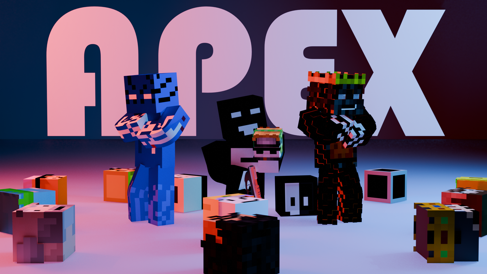
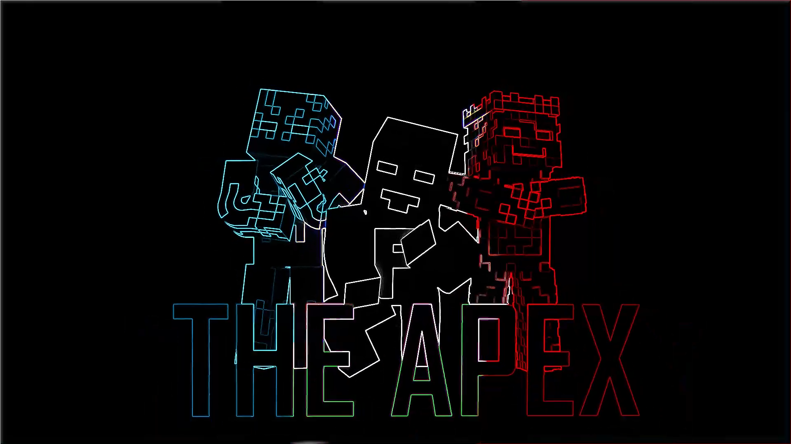

# Портфолио анимации и визуальных работ

**Bardiya Alizadeh (Kabir) · Farland_game**

<!-- ROBLOX_ENTRY_START -->
### [Витрина Roblox Studio · 11 🎮🎬](https://github.com/FarlandGame/Animation-Portfolio/blob/main/collections/ru/roblox.md)

Смотрите отрывки; ссылки ведут к полным оригиналам.
<!-- ROBLOX_ENTRY_END -->

<!-- BLENDER_ENTRY_START -->
 [Blender · 3D 🎬](https://github.com/FarlandGame/Animation-Portfolio/blob/main/collections/ru/main.md) · [← Farland_game](https://github.com/FarlandGame#portfolio-directory)
<!-- BLENDER_ENTRY_END -->

[English](https://github.com/FarlandGame/Animation-Portfolio/blob/main/README.md) · [日本語](https://github.com/FarlandGame/Animation-Portfolio/blob/main/docs/README.ja.md) · [فارسی](https://github.com/FarlandGame/Animation-Portfolio/blob/main/docs/README.fa.md) · [Deutsch](https://github.com/FarlandGame/Animation-Portfolio/blob/main/docs/README.de.md) · [Français](https://github.com/FarlandGame/Animation-Portfolio/blob/main/docs/README.fr.md) · [Español](https://github.com/FarlandGame/Animation-Portfolio/blob/main/docs/README.es.md) · [Português (Brasil)](https://github.com/FarlandGame/Animation-Portfolio/blob/main/docs/README.pt-BR.md) · [Italiano](https://github.com/FarlandGame/Animation-Portfolio/blob/main/docs/README.it.md) · [Nederlands](https://github.com/FarlandGame/Animation-Portfolio/blob/main/docs/README.nl.md) · [Polski](https://github.com/FarlandGame/Animation-Portfolio/blob/main/docs/README.pl.md) · [Українська](https://github.com/FarlandGame/Animation-Portfolio/blob/main/docs/README.uk.md) · [Türkçe](https://github.com/FarlandGame/Animation-Portfolio/blob/main/docs/README.tr.md) · [Русский](https://github.com/FarlandGame/Animation-Portfolio/blob/main/docs/README.ru.md) · [简体中文](https://github.com/FarlandGame/Animation-Portfolio/blob/main/docs/README.zh-CN.md) · [繁體中文](https://github.com/FarlandGame/Animation-Portfolio/blob/main/docs/README.zh-TW.md) · [한국어](https://github.com/FarlandGame/Animation-Portfolio/blob/main/docs/README.ko.md) · [हिन्दी](https://github.com/FarlandGame/Animation-Portfolio/blob/main/docs/README.hi.md) · [Bahasa Indonesia](https://github.com/FarlandGame/Animation-Portfolio/blob/main/docs/README.id.md)

<!-- PLAYFUL_INTRO_START -->

> Кубические персонажи, большие идеи и общий побочный квест всех аниматоров: ждать рендер. 🎬🍿

[Знакомьтесь с Кабиром: моя история, творческие истоки и планы на Японию](https://github.com/FarlandGame/FarlandGame/blob/main/docs/story.ru.md)
<!-- PLAYFUL_INTRO_END -->

<!-- EARLY_PHONE_LINK_START -->

[Архив первых работ на телефоне 📱🎬](https://github.com/FarlandGame/Animation-Portfolio/blob/main/history/phone-era/ru/index.md) · [Галерея референсов школьных локаций](https://github.com/FarlandGame/Animation-Portfolio/blob/main/history/phone-era/ru/school-01.md) · [Посмотреть 13 коротких образцов](https://github.com/FarlandGame/Animation-Portfolio/issues/2)

<!-- EARLY_PHONE_LINK_END -->

[Основная анимационная серия](https://github.com/FarlandGame/Animation-Portfolio/blob/main/collections/ru/main.md) · [Анимация и монтажи Roblox](https://github.com/FarlandGame/Animation-Portfolio/blob/main/collections/ru/roblox.md) · [Ранние короткие этюды](https://github.com/FarlandGame/Animation-Portfolio/blob/main/collections/ru/early.md) · [Полная визуальная галерея](https://github.com/FarlandGame/Animation-Portfolio/blob/main/gallery/ru/index.md)

Пополняемый творческий архив: ранние 2D-работы на телефоне, истории в Minecraft, более поздняя 3D-анимация, монтаж Roblox, постеры, изображения персонажей и референсы проектов и локаций. Следите за развитием внутри каждой коллекции; исключение из исторического порядка номеров объяснено в архиве телефонной эпохи.

Автор и составитель — Бардия Ализаде (Kabir / Farland_game). Более поздняя 3D-коллекция создана в Blender; основные работы 07 и 08 также включают монтаж в After Effects. По словам автора, телефонные работы 1–8 связаны со StickNodes; 9 и 11 — записи Minecraft, а название приложения для ранней мобильной 3D-сцены 10 он не помнит.

 

## Проследите творческий путь

Три первоначальные коллекции пронумерованных видео сохраняют свой порядок от старых работ к новым. Дополнительная коллекция телефонной эпохи сохраняет предоставленные номера, причём 12 прямо обозначен как самая ранняя сохранившаяся работа, а 13 выделен как заставка бренда. Изображения — неупорядоченные материалы каталога. Эти отдельные коллекции не задают единую точную хронологию или рейтинг качества всего портфолио.

## Что входит в коллекцию?

35 видеофайлов в четырёх коллекциях и 208 изображений. В исходной основной серии восемь видео, в Roblox — одиннадцать, а в ранних этюдах — три; исторический архив телефонной эпохи добавляет тринадцать видеофайлов и 46 фотографий школьных локаций к прежней галерее из 162 изображений. Среди исторических файлов есть анимация, смешанная техника, игровые записи и заставка канала; не каждый файл является отрендеренным анимационным фильмом.

## Готовые кадры и работы в процессе

**Работа 04 основной серии не завершена**, как указал автор. По его просьбе она публикуется как **повторно сжатая копия 1080p для просмотра, сохраняющая полную длительность**, а предоставленный исходный файл остаётся локально неизменным. Остальные видео — предоставленные клипы для портфолио; наличие экспортированного файла само по себе не означает, что его автоматически называют законченной работой. Снимки экрана проектов и редакторов обозначены как снимки или предварительные просмотры, а не как окончательные отрендеренные фильмы. Файлы, названия которых прямо указывают на создание изображения с помощью ИИ, отмечены в каталоге; фотографические референсы не выдаются за оригинальные анимационные работы.

## Просматривайте, знакомьтесь с фрагментами и скачивайте

Просматривайте пронумерованные фильмы, превью настоящих кадров, длительность, разрешение и ссылки на полные файлы. Короткие воспроизводимые образцы — это фрагменты. Полные загрузки включают 31 неизменённый оригинальный видеофайл и четыре повторно сжатые копии полной длительности: основной 04 и телефонные 8, 11 и 12 — по просьбе автора. Их исходные файлы сохранены локально без изменений; хеши исходников и опубликованных копий указаны раздельно. Ни один файл не сокращён для создания полной просмотровой копии. Оригиналы школьных фотографий доступны в одном архиве исходников.

## О названиях и авторских сведениях

Названия фильмов в этой подборке — описательные названия для портфолио, добавленные с разрешения автора. Исходные имена файлов и нумерация сохранены в каталоге, чтобы каждую работу можно было сопоставить с предоставленным файлом. Постеры и снимки экрана связываются с конкретным фильмом только тогда, когда эта связь известна. Персонажи, игры, музыка, фотографии и другие сторонние элементы сохраняют соответствующие права и сведения об авторстве; показ материала в этом архиве не является общим утверждением, что каждый элемент создан с нуля.

## Архив, который может расти

Ранние материалы эпохи StickNodes теперь сохранены рядом с более поздними работами. В будущем можно добавлять новые рендеры и найденные файлы, не стирая ранние этапы. Утраченные или незавершённые проекты без сохранившихся файлов описаны как отсутствующие, а не представлены доступными фильмами. Вступления и навигация доступны на 18 языках; подробные заметки о новых фильмах — на английском, персидском и японском, без утверждения, что звук и текст каждого видео переведены.

[Основная анимационная серия](https://github.com/FarlandGame/Animation-Portfolio/blob/main/collections/ru/main.md) · [Анимация и монтажи Roblox](https://github.com/FarlandGame/Animation-Portfolio/blob/main/collections/ru/roblox.md) · [Ранние короткие этюды](https://github.com/FarlandGame/Animation-Portfolio/blob/main/collections/ru/early.md) · [Полная визуальная галерея](https://github.com/FarlandGame/Animation-Portfolio/blob/main/gallery/ru/index.md)

[Контрольные суммы SHA-256](https://github.com/FarlandGame/Animation-Portfolio/blob/main/checksums/SHA256SUMS-videos.txt) · [Машиночитаемый каталог](https://github.com/FarlandGame/Animation-Portfolio/blob/main/catalogue.json)

[Полное творческое и программное портфолио](https://github.com/FarlandGame)
