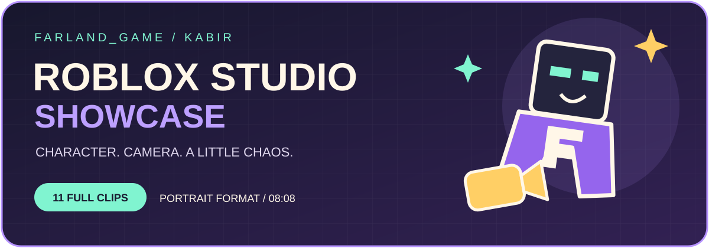
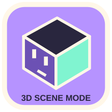

# Портфоліо анімації та візуальних робіт

**Bardiya Alizadeh (Kabir) · Farland_game**

<!-- ROBLOX_ENTRY_START -->
### [Добірка Roblox Studio · 11 🎮🎬](https://github.com/FarlandGame/Animation-Portfolio/blob/main/collections/uk/roblox.md)

Перегляньте уривки; за посиланнями доступні повні оригінали.
<!-- ROBLOX_ENTRY_END -->

<!-- BLENDER_ENTRY_START -->
 [Blender · 3D 🎬](https://github.com/FarlandGame/Animation-Portfolio/blob/main/collections/uk/main.md) · [← Farland_game](https://github.com/FarlandGame#portfolio-directory)
<!-- BLENDER_ENTRY_END -->

[English](https://github.com/FarlandGame/Animation-Portfolio/blob/main/README.md) · [日本語](https://github.com/FarlandGame/Animation-Portfolio/blob/main/docs/README.ja.md) · [فارسی](https://github.com/FarlandGame/Animation-Portfolio/blob/main/docs/README.fa.md) · [Deutsch](https://github.com/FarlandGame/Animation-Portfolio/blob/main/docs/README.de.md) · [Français](https://github.com/FarlandGame/Animation-Portfolio/blob/main/docs/README.fr.md) · [Español](https://github.com/FarlandGame/Animation-Portfolio/blob/main/docs/README.es.md) · [Português (Brasil)](https://github.com/FarlandGame/Animation-Portfolio/blob/main/docs/README.pt-BR.md) · [Italiano](https://github.com/FarlandGame/Animation-Portfolio/blob/main/docs/README.it.md) · [Nederlands](https://github.com/FarlandGame/Animation-Portfolio/blob/main/docs/README.nl.md) · [Polski](https://github.com/FarlandGame/Animation-Portfolio/blob/main/docs/README.pl.md) · [Українська](https://github.com/FarlandGame/Animation-Portfolio/blob/main/docs/README.uk.md) · [Türkçe](https://github.com/FarlandGame/Animation-Portfolio/blob/main/docs/README.tr.md) · [Русский](https://github.com/FarlandGame/Animation-Portfolio/blob/main/docs/README.ru.md) · [简体中文](https://github.com/FarlandGame/Animation-Portfolio/blob/main/docs/README.zh-CN.md) · [繁體中文](https://github.com/FarlandGame/Animation-Portfolio/blob/main/docs/README.zh-TW.md) · [한국어](https://github.com/FarlandGame/Animation-Portfolio/blob/main/docs/README.ko.md) · [हिन्दी](https://github.com/FarlandGame/Animation-Portfolio/blob/main/docs/README.hi.md) · [Bahasa Indonesia](https://github.com/FarlandGame/Animation-Portfolio/blob/main/docs/README.id.md)

<!-- PLAYFUL_INTRO_START -->

> Кубічні персонажі, великі ідеї та спільний побічний квест усіх аніматорів: чекати на рендер. 🎬🍿

[Знайомтеся з Кабіром: моя історія, творчі початки та плани щодо Японії](https://github.com/FarlandGame/FarlandGame/blob/main/docs/story.uk.md)
<!-- PLAYFUL_INTRO_END -->

<!-- EARLY_PHONE_LINK_START -->

[Архів перших років творчості на телефоні 📱🎬](https://github.com/FarlandGame/Animation-Portfolio/blob/main/history/phone-era/uk/index.md) · [Галерея референсів шкільних місць](https://github.com/FarlandGame/Animation-Portfolio/blob/main/history/phone-era/uk/school-01.md) · [Переглянути 13 коротких зразків](https://github.com/FarlandGame/Animation-Portfolio/issues/2)

<!-- EARLY_PHONE_LINK_END -->

[Головна анімаційна серія](https://github.com/FarlandGame/Animation-Portfolio/blob/main/collections/uk/main.md) · [Анімація й монтажі Roblox](https://github.com/FarlandGame/Animation-Portfolio/blob/main/collections/uk/roblox.md) · [Ранні короткі етюди](https://github.com/FarlandGame/Animation-Portfolio/blob/main/collections/uk/early.md) · [Повна візуальна галерея](https://github.com/FarlandGame/Animation-Portfolio/blob/main/gallery/uk/index.md)

Творчий архів, що зростає й охоплює ранні 2D-роботи на телефоні, історії в Minecraft, пізнішу 3D-анімацію, монтажі Roblox, плакати, ілюстрації персонажів та референси для проєктів і локацій. Стежте за розвитком у межах кожної колекції; історичний виняток у нумерації пояснено в архіві періоду телефону.

Створив і впорядкував Bardiya Alizadeh (Kabir / Farland_game). Для пізнішої 3D-колекції використано Blender; основні роботи 07 і 08 також містять монтаж в After Effects. Автор пов'язує номери 1–8 періоду телефону зі StickNodes; 9 і 11 — це записи з Minecraft, а застосунок, використаний для ранньої мобільної 3D-сцени 10, він не пам'ятає.

## Простежте творчий шлях

Три початкові колекції пронумерованих відео зберігають власний порядок від старіших до новіших. Додаткова колекція періоду телефону зберігає надані номери: 12 прямо позначено як найдавнішу збережену роботу, а 13 віднесено до заставок для оформлення каналу. Зображення — це невпорядковані довідкові матеріали каталогу. Ці окремі колекції не встановлюють єдиної точної хронології чи рейтингу якості всього портфоліо.

## Що містить колекція?

35 відеофайлів у чотирьох колекціях і 208 зображень. Початкова основна серія містить вісім відео, Roblox — одинадцять, а ранні етюди — три; історичний архів періоду телефону додає тринадцять відеофайлів і 46 фотографій шкільних місць до попередньої галереї зі 162 зображень. Історичні файли охоплюють анімацію, змішані медіа, записи гри та заставку каналу; не кожен файл є відрендереним анімаційним фільмом.

## Готові кадри й роботи в процесі

**Робота 04 головної серії незавершена**, як зазначив автор. На його прохання її опубліковано як **повторно стиснену копію 1080p для перегляду, що зберігає повну тривалість**, а наданий вихідний файл залишається локально незміненим. Інші відео — це надані кліпи для портфоліо; сам факт наявності експортованого файлу не означає, що його автоматично названо завершеним твором. Знімки екрана проєктів і редакторів позначені як знімки чи попередні перегляди, а не як остаточні відрендерені фільми. Файли, назви яких прямо вказують на створення зображення за допомогою ШІ, мають відповідні позначки в каталозі; фотографічні референси не подаються як оригінальні анімаційні роботи.

## Переглядайте, знайомтеся зі зразками й завантажуйте

Переглядайте пронумеровані фільми, попередні перегляди справжніх кадрів, тривалість, роздільну здатність і посилання для завантаження повних версій. Короткі зразки для відтворення є уривками. Повні завантаження містять 31 незмінений оригінальний відеофайл і чотири повторно стиснені копії повної тривалості: основний 04, а також номери 8, 11 і 12 періоду телефону, на прохання автора. Їхні оригінальні вихідні файли залишаються локально без змін; хеші джерела й опублікованої копії розрізняються. Жоден файл не було скорочено для створення повної копії для перегляду. Оригінали шкільних фотографій надано одним пакетом вихідних матеріалів.

## Про назви й авторські відомості

Назви фільмів у цій добірці — описові назви для портфоліо, додані з дозволу автора. Початкові назви файлів і нумерацію збережено в каталозі, щоб кожну роботу можна було зіставити з наданим файлом. Постери й знімки екрана пов'язуються з конкретним фільмом лише тоді, коли цей зв'язок відомий. Персонажі, ігри, музика, фотографії та інші сторонні елементи зберігають відповідні права й відомості про авторство; показ матеріалу в цьому архіві не є загальним твердженням, що кожен елемент створено з нуля.

## Архів, який може зростати

Ранні матеріали періоду StickNodes тепер збережено поряд із пізнішими роботами. Майбутні рендери та відновлені файли можна додавати, не стираючи попередніх етапів. Загублені чи незавершені проєкти без збережених файлів описано як відсутні, а не представлено як доступні фільми. Вступи й навігація доступні 18 мовами; нові докладні примітки до фільмів — англійською, перською та японською, без твердження, що звук чи текст кожного відео перекладено.

[Головна анімаційна серія](https://github.com/FarlandGame/Animation-Portfolio/blob/main/collections/uk/main.md) · [Анімація й монтажі Roblox](https://github.com/FarlandGame/Animation-Portfolio/blob/main/collections/uk/roblox.md) · [Ранні короткі етюди](https://github.com/FarlandGame/Animation-Portfolio/blob/main/collections/uk/early.md) · [Повна візуальна галерея](https://github.com/FarlandGame/Animation-Portfolio/blob/main/gallery/uk/index.md)

[Контрольні суми SHA-256](https://github.com/FarlandGame/Animation-Portfolio/blob/main/checksums/SHA256SUMS-videos.txt) · [Машиночитаний каталог](https://github.com/FarlandGame/Animation-Portfolio/blob/main/catalogue.json)

[Повне творче й програмне портфоліо](https://github.com/FarlandGame)
