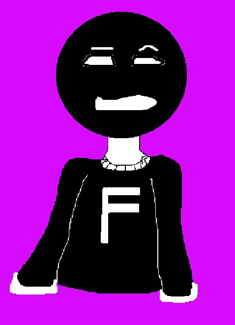
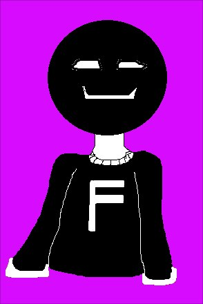
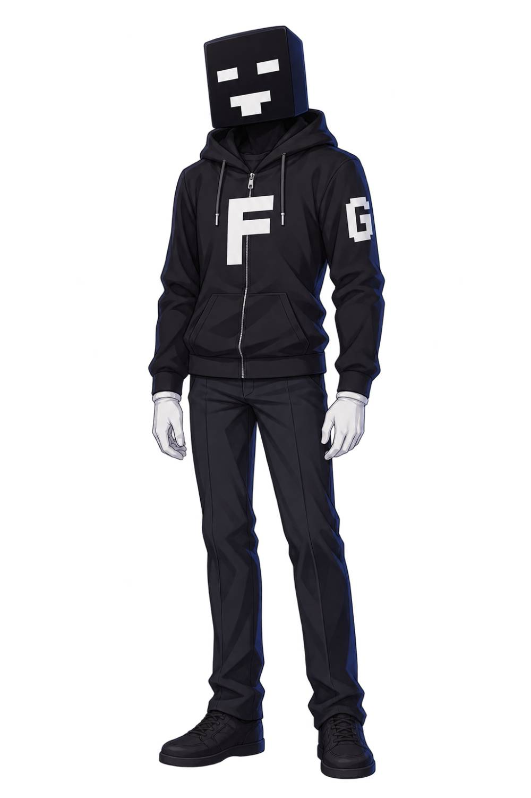

# पात्रों की छवियाँ · पृष्ठ 3

[मुख्य एनीमेशन शृंखला](https://github.com/FarlandGame/Animation-Portfolio/blob/main/collections/hi/main.md) · [Roblox एनीमेशन और संपादित क्लिप](https://github.com/FarlandGame/Animation-Portfolio/blob/main/collections/hi/roblox.md) · [शुरुआती छोटे अभ्यास](https://github.com/FarlandGame/Animation-Portfolio/blob/main/collections/hi/early.md) · [पूरी दृश्य गैलरी](https://github.com/FarlandGame/Animation-Portfolio/blob/main/gallery/hi/index.md)

चित्र कालानुक्रमिक क्रम में नहीं हैं। ID सूची के संदर्भ हैं।

[पृष्ठ 1](https://github.com/FarlandGame/Animation-Portfolio/blob/main/gallery/hi/character-art-01.md) · [पृष्ठ 2](https://github.com/FarlandGame/Animation-Portfolio/blob/main/gallery/hi/character-art-02.md) · [पृष्ठ 3](https://github.com/FarlandGame/Animation-Portfolio/blob/main/gallery/hi/character-art-03.md)

## image-157 · पात्रों की छवियाँ

Drawn black round-headed character with a white F on its clothing against bright magenta.

[पूर्ण रिज़ॉल्यूशन वाला मूल](https://raw.githubusercontent.com/FarlandGame/Animation-Portfolio/main/artwork/originals/image-157.png) · 478×661

उपलब्ध कराया गया फ़ाइलनाम: `untiled spek.png`

## image-158 · पात्रों की छवियाँ

Drawn black round-headed character with a small smile and white F against magenta.

[पूर्ण रिज़ॉल्यूशन वाला मूल](https://raw.githubusercontent.com/FarlandGame/Animation-Portfolio/main/artwork/originals/image-158.png) · 294×440

उपलब्ध कराया गया फ़ाइलनाम: `Untitled.png`

## image-162 · पात्रों की छवियाँ

Bardiya Alizadeh (Kabir), जिन्हें Farland_game के नाम से जाना जाता है, द्वारा डिज़ाइन किया गया अपने किरदार का कैरिकेचर: काला घनाकार सिर, सफेद F और G चिह्नों वाली काली हुडी, सफेद दस्ताने और काले जूते। 😎🎨

[पूर्ण रिज़ॉल्यूशन वाला मूल](https://raw.githubusercontent.com/FarlandGame/Animation-Portfolio/main/artwork/originals/image-162.jpeg) · 1000×1500

उपलब्ध कराया गया फ़ाइलनाम: `My karakter in not human.jpeg`

[पृष्ठ 1](https://github.com/FarlandGame/Animation-Portfolio/blob/main/gallery/hi/character-art-01.md) · [पृष्ठ 2](https://github.com/FarlandGame/Animation-Portfolio/blob/main/gallery/hi/character-art-02.md) · [पृष्ठ 3](https://github.com/FarlandGame/Animation-Portfolio/blob/main/gallery/hi/character-art-03.md)

[पूरी दृश्य गैलरी](https://github.com/FarlandGame/Animation-Portfolio/blob/main/gallery/hi/index.md)
