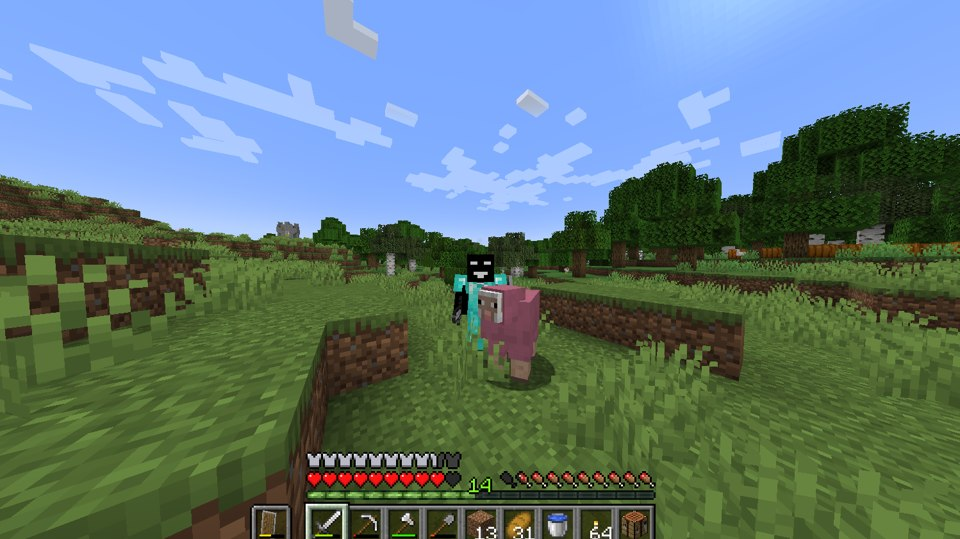

# Galeri visual lengkap · Halaman 9

[Urutan animasi utama](https://github.com/FarlandGame/Animation-Portfolio/blob/main/collections/id/main.md) · [Animasi & edit Roblox](https://github.com/FarlandGame/Animation-Portfolio/blob/main/collections/id/roblox.md) · [Studi singkat awal](https://github.com/FarlandGame/Animation-Portfolio/blob/main/collections/id/early.md) · [Galeri visual lengkap](https://github.com/FarlandGame/Animation-Portfolio/blob/main/gallery/id/index.md)

Gambar tidak memiliki urutan kronologis. ID adalah acuan katalog.

[Halaman 1](https://github.com/FarlandGame/Animation-Portfolio/blob/main/gallery/id/all-01.md) · [Halaman 2](https://github.com/FarlandGame/Animation-Portfolio/blob/main/gallery/id/all-02.md) · [Halaman 3](https://github.com/FarlandGame/Animation-Portfolio/blob/main/gallery/id/all-03.md) · [Halaman 4](https://github.com/FarlandGame/Animation-Portfolio/blob/main/gallery/id/all-04.md) · [Halaman 5](https://github.com/FarlandGame/Animation-Portfolio/blob/main/gallery/id/all-05.md) · [Halaman 6](https://github.com/FarlandGame/Animation-Portfolio/blob/main/gallery/id/all-06.md) · [Halaman 7](https://github.com/FarlandGame/Animation-Portfolio/blob/main/gallery/id/all-07.md) · [Halaman 8](https://github.com/FarlandGame/Animation-Portfolio/blob/main/gallery/id/all-08.md) · [Halaman 9](https://github.com/FarlandGame/Animation-Portfolio/blob/main/gallery/id/all-09.md)

## image-161 · Tangkapan layar editor & permainan

Minecraft gameplay screenshot showing a black character near a pink pig in a grassy landscape with the player HUD.

[File asli beresolusi penuh](https://raw.githubusercontent.com/FarlandGame/Animation-Portfolio/main/artwork/originals/image-161.png) · 1498×841

Nama file yang diberikan: `{DDBC5773-60C1-4783-A4FC-B210026B9B93}.png`

## image-162 · Gambar karakter

Karikatur karakternya sendiri yang dirancang oleh Bardiya Alizadeh (Kabir), dikenal sebagai Farland_game: kepala kubus hitam, hoodie hitam dengan lambang F dan G putih, sarung tangan putih, dan sepatu hitam. 😎🎨

[File asli beresolusi penuh](https://raw.githubusercontent.com/FarlandGame/Animation-Portfolio/main/artwork/originals/image-162.jpeg) · 1000×1500

Nama file yang diberikan: `My karakter in not human.jpeg`

[Halaman 1](https://github.com/FarlandGame/Animation-Portfolio/blob/main/gallery/id/all-01.md) · [Halaman 2](https://github.com/FarlandGame/Animation-Portfolio/blob/main/gallery/id/all-02.md) · [Halaman 3](https://github.com/FarlandGame/Animation-Portfolio/blob/main/gallery/id/all-03.md) · [Halaman 4](https://github.com/FarlandGame/Animation-Portfolio/blob/main/gallery/id/all-04.md) · [Halaman 5](https://github.com/FarlandGame/Animation-Portfolio/blob/main/gallery/id/all-05.md) · [Halaman 6](https://github.com/FarlandGame/Animation-Portfolio/blob/main/gallery/id/all-06.md) · [Halaman 7](https://github.com/FarlandGame/Animation-Portfolio/blob/main/gallery/id/all-07.md) · [Halaman 8](https://github.com/FarlandGame/Animation-Portfolio/blob/main/gallery/id/all-08.md) · [Halaman 9](https://github.com/FarlandGame/Animation-Portfolio/blob/main/gallery/id/all-09.md)

[Galeri visual lengkap](https://github.com/FarlandGame/Animation-Portfolio/blob/main/gallery/id/index.md)
