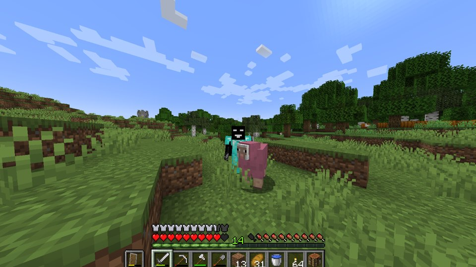

# 完整视觉画廊 · 页 9

[主动画系列](https://github.com/FarlandGame/Animation-Portfolio/blob/main/collections/zh-CN/main.md) · [Roblox 动画与剪辑](https://github.com/FarlandGame/Animation-Portfolio/blob/main/collections/zh-CN/roblox.md) · [早期短习作](https://github.com/FarlandGame/Animation-Portfolio/blob/main/collections/zh-CN/early.md) · [完整视觉画廊](https://github.com/FarlandGame/Animation-Portfolio/blob/main/gallery/zh-CN/index.md)

图像不按时间排序。ID 仅为目录索引。

[页 1](https://github.com/FarlandGame/Animation-Portfolio/blob/main/gallery/zh-CN/all-01.md) · [页 2](https://github.com/FarlandGame/Animation-Portfolio/blob/main/gallery/zh-CN/all-02.md) · [页 3](https://github.com/FarlandGame/Animation-Portfolio/blob/main/gallery/zh-CN/all-03.md) · [页 4](https://github.com/FarlandGame/Animation-Portfolio/blob/main/gallery/zh-CN/all-04.md) · [页 5](https://github.com/FarlandGame/Animation-Portfolio/blob/main/gallery/zh-CN/all-05.md) · [页 6](https://github.com/FarlandGame/Animation-Portfolio/blob/main/gallery/zh-CN/all-06.md) · [页 7](https://github.com/FarlandGame/Animation-Portfolio/blob/main/gallery/zh-CN/all-07.md) · [页 8](https://github.com/FarlandGame/Animation-Portfolio/blob/main/gallery/zh-CN/all-08.md) · [页 9](https://github.com/FarlandGame/Animation-Portfolio/blob/main/gallery/zh-CN/all-09.md)

## image-161 · 编辑器与游戏截图

Minecraft gameplay screenshot showing a black character near a pink pig in a grassy landscape with the player HUD.

[全分辨率原始文件](https://raw.githubusercontent.com/FarlandGame/Animation-Portfolio/main/artwork/originals/image-161.png) · 1498×841

提供的文件名: `{DDBC5773-60C1-4783-A4FC-B210026B9B93}.png`

## image-162 · 角色图像

Bardiya Alizadeh（Kabir，艺名 Farland_game）为自己的角色设计的漫画形象：黑色方块头、带有白色 F 和 G 标志的黑色连帽衫、白手套和黑鞋。😎🎨

[全分辨率原始文件](https://raw.githubusercontent.com/FarlandGame/Animation-Portfolio/main/artwork/originals/image-162.jpeg) · 1000×1500

提供的文件名: `My karakter in not human.jpeg`

[页 1](https://github.com/FarlandGame/Animation-Portfolio/blob/main/gallery/zh-CN/all-01.md) · [页 2](https://github.com/FarlandGame/Animation-Portfolio/blob/main/gallery/zh-CN/all-02.md) · [页 3](https://github.com/FarlandGame/Animation-Portfolio/blob/main/gallery/zh-CN/all-03.md) · [页 4](https://github.com/FarlandGame/Animation-Portfolio/blob/main/gallery/zh-CN/all-04.md) · [页 5](https://github.com/FarlandGame/Animation-Portfolio/blob/main/gallery/zh-CN/all-05.md) · [页 6](https://github.com/FarlandGame/Animation-Portfolio/blob/main/gallery/zh-CN/all-06.md) · [页 7](https://github.com/FarlandGame/Animation-Portfolio/blob/main/gallery/zh-CN/all-07.md) · [页 8](https://github.com/FarlandGame/Animation-Portfolio/blob/main/gallery/zh-CN/all-08.md) · [页 9](https://github.com/FarlandGame/Animation-Portfolio/blob/main/gallery/zh-CN/all-09.md)

[完整视觉画廊](https://github.com/FarlandGame/Animation-Portfolio/blob/main/gallery/zh-CN/index.md)
