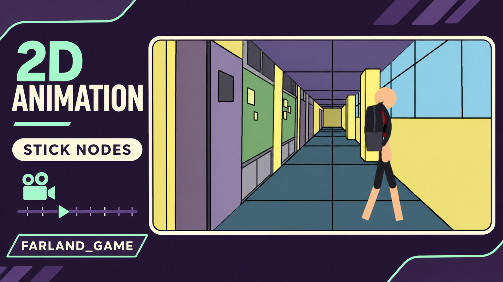

# Archiv der frühen Smartphone-Jahre 📱🎬

<!-- PHONE_ARCHIVE_STICKER_START -->
 · [Farland_game · Portfolio ↗](https://github.com/FarlandGame)
<!-- PHONE_ARCHIVE_STICKER_END -->

**Die Schulzeit-Experimente hinter Farland_game.**

[English](https://github.com/FarlandGame/Animation-Portfolio/blob/main/history/phone-era/en/index.md) · [日本語](https://github.com/FarlandGame/Animation-Portfolio/blob/main/history/phone-era/ja/index.md) · [فارسی](https://github.com/FarlandGame/Animation-Portfolio/blob/main/history/phone-era/fa/index.md) · [Deutsch](https://github.com/FarlandGame/Animation-Portfolio/blob/main/history/phone-era/de/index.md) · [Français](https://github.com/FarlandGame/Animation-Portfolio/blob/main/history/phone-era/fr/index.md) · [Español](https://github.com/FarlandGame/Animation-Portfolio/blob/main/history/phone-era/es/index.md) · [Português (Brasil)](https://github.com/FarlandGame/Animation-Portfolio/blob/main/history/phone-era/pt-BR/index.md) · [Italiano](https://github.com/FarlandGame/Animation-Portfolio/blob/main/history/phone-era/it/index.md) · [Nederlands](https://github.com/FarlandGame/Animation-Portfolio/blob/main/history/phone-era/nl/index.md) · [Polski](https://github.com/FarlandGame/Animation-Portfolio/blob/main/history/phone-era/pl/index.md) · [Українська](https://github.com/FarlandGame/Animation-Portfolio/blob/main/history/phone-era/uk/index.md) · [Türkçe](https://github.com/FarlandGame/Animation-Portfolio/blob/main/history/phone-era/tr/index.md) · [Русский](https://github.com/FarlandGame/Animation-Portfolio/blob/main/history/phone-era/ru/index.md) · [简体中文](https://github.com/FarlandGame/Animation-Portfolio/blob/main/history/phone-era/zh-CN/index.md) · [繁體中文](https://github.com/FarlandGame/Animation-Portfolio/blob/main/history/phone-era/zh-TW/index.md) · [한국어](https://github.com/FarlandGame/Animation-Portfolio/blob/main/history/phone-era/ko/index.md) · [हिन्दी](https://github.com/FarlandGame/Animation-Portfolio/blob/main/history/phone-era/hi/index.md) · [Bahasa Indonesia](https://github.com/FarlandGame/Animation-Portfolio/blob/main/history/phone-era/id/index.md)

Das sind die erhaltenen Exporte aus meinen frühen kreativen Jahren mit dem Smartphone: Animationen aus der StickNodes-Zeit, eine schulische Biografie mit verschiedenen Medien, Minecraft-Geschichten, meine erste selbst gestaltete mobile 3D-Szene und ein frühes Kanal-Intro. Über ihre Ecken und Kanten bin ich hinausgewachsen, aber sie aufzubewahren macht meinen Lernweg sichtbar. Es sind historische Arbeiten, keine Beispiele für meine heutige Produktionsqualität.

> Meine ersten Frames hatten reichlich Selbstvertrauen. Die Keyframes mussten erst noch aufholen. 📱😄

## So ist die Zeitleiste zu lesen

Ich erinnere mich, die Nummern 1–4 in der siebten Klasse im Schuljahr 1401–1402 des iranischen Sonnenkalenders und die Nummern 5–8 in der neunten Klasse gemacht zu haben. Nummer 12 ist die Ausnahme von der Zahlenfolge: Nach meiner Erinnerung ist sie älter als Nummer 1 und stammt aus dem Monat Dey 1401, kurz nachdem ich mein erstes Smartphone bekommen hatte. Weitere genaue Produktionsdaten sind nicht belegt. Nummer 13 ist ein eigenständiges frühes Intro zur Kanalgestaltung, keine nach Qualität oder Entstehungszeit neueste Animation.

## Die übergebenen Videodateien

*Ausführliche Filmnotizen: Englisch · Persisch · Japanisch*

| Nr. | Titel | Laufzeit | Auflösung | Vollständiges Video herunterladen |
|---|---|---|---|---|
| 12 | [Ein schulischer Kurzfilm gegen das Rauchen: die früheste erhaltene Datei](https://github.com/FarlandGame/Animation-Portfolio/blob/main/history/phone-era/films/phone-12.en.md) | 2:11 | 1920×1080 | [Vollständiges Video herunterladen](https://github.com/FarlandGame/Animation-Portfolio/releases/download/phone-era-archive/12-1080p.mp4) |
| 01 | [Erste erhaltene Straßenszene aus der StickNodes-Zeit](https://github.com/FarlandGame/Animation-Portfolio/blob/main/history/phone-era/films/phone-01.en.md) | 0:41 | 1920×1074 | [Vollständiges Video herunterladen](https://github.com/FarlandGame/Animation-Portfolio/releases/download/phone-era-archive/1.mp4) |
| 02 | [Frühes Actionexperiment mit Strichfiguren](https://github.com/FarlandGame/Animation-Portfolio/blob/main/history/phone-era/films/phone-02.en.md) | 0:48 | 1920×1080 | [Vollständiges Video herunterladen](https://github.com/FarlandGame/Animation-Portfolio/releases/download/phone-era-archive/2.mp4) |
| 03 | [Studie zu Mathematik und Bewegung](https://github.com/FarlandGame/Animation-Portfolio/blob/main/history/phone-era/films/phone-03.en.md) | 1:21 | 1920×1080 | [Vollständiges Video herunterladen](https://github.com/FarlandGame/Animation-Portfolio/releases/download/phone-era-archive/3.mp4) |
| 04 | [Eine lockere Animationsskizze im Hochformat](https://github.com/FarlandGame/Animation-Portfolio/blob/main/history/phone-era/films/phone-04.en.md) | 0:31 | 1080×1920 | [Vollständiges Video herunterladen](https://github.com/FarlandGame/Animation-Portfolio/releases/download/phone-era-archive/4.mp4) |
| 05 | [Arbeit und Technik: eine Unterrichtseinheit der neunten Klasse](https://github.com/FarlandGame/Animation-Portfolio/blob/main/history/phone-era/films/phone-05.en.md) | 4:28 | 1280×712 | [Vollständiges Video herunterladen](https://github.com/FarlandGame/Animation-Portfolio/releases/download/phone-era-archive/5.mp4) |
| 06 | [Die Folgen einer Flucht aus der Schule](https://github.com/FarlandGame/Animation-Portfolio/blob/main/history/phone-era/films/phone-06.en.md) | 6:28 | 640×356 | [Vollständiges Video herunterladen](https://github.com/FarlandGame/Animation-Portfolio/releases/download/phone-era-archive/6.mp4) |
| 07 | [Eine kurze schulische Biografie über Adolf Hitler](https://github.com/FarlandGame/Animation-Portfolio/blob/main/history/phone-era/films/phone-07.en.md) | 5:48 | 640×356 | [Vollständiges Video herunterladen](https://github.com/FarlandGame/Animation-Portfolio/releases/download/phone-era-archive/7.mp4) |
| 08 | [Koordinaten: das nicht eingereichte Khwarizmi-Projekt](https://github.com/FarlandGame/Animation-Portfolio/blob/main/history/phone-era/films/phone-08.en.md) | 12:49 | 1920×1080 | [Vollständiges Video herunterladen](https://github.com/FarlandGame/Animation-Portfolio/releases/download/phone-era-archive/8-1080p.mp4) |
| 09 | [Herobrine-Verfolgung und Server-Konstruktionen](https://github.com/FarlandGame/Animation-Portfolio/blob/main/history/phone-era/films/phone-09.en.md) | 5:11 | 640×360 | [Vollständiges Video herunterladen](https://github.com/FarlandGame/Animation-Portfolio/releases/download/phone-era-archive/9.mp4) |
| 10 | [Meine erste selbst gestaltete mobile 3D-Szene](https://github.com/FarlandGame/Animation-Portfolio/blob/main/history/phone-era/films/phone-10.en.md) | 1:50 | 1920×1080 | [Vollständiges Video herunterladen](https://github.com/FarlandGame/Animation-Portfolio/releases/download/phone-era-archive/10.mp4) |
| 11 | [Maus und Katze — eine Minecraft-Nacherzählung](https://github.com/FarlandGame/Animation-Portfolio/blob/main/history/phone-era/films/phone-11.en.md) | 6:03 | 1920×1080 | [Vollständiges Video herunterladen](https://github.com/FarlandGame/Animation-Portfolio/releases/download/phone-era-archive/11-1080p.mp4) |
| 13 | [Das frühe Farland_game-Intro](https://github.com/FarlandGame/Animation-Portfolio/blob/main/history/phone-era/films/phone-13.en.md) | 0:14 | 1920×1068 | [Vollständiges Video herunterladen](https://github.com/FarlandGame/Animation-Portfolio/releases/download/phone-era-archive/13.mp4) |

[Die 13 kurzen Beispiele ansehen](https://github.com/FarlandGame/Animation-Portfolio/issues/2) · [Vollständige Downloads und Prüfsummen](https://github.com/FarlandGame/Animation-Portfolio/releases/tag/phone-era-archive)

## Stimmen, Software und Zusammenarbeit

Die persischen Stimmen habe ich selbst gesprochen und oft mit Effekten verändert. Nummer 5 vermittelt eine Unterrichtseinheit aus dem Fach Arbeit und Technik der neunten Klasse; Nummer 6 hat mehrere Figurenstimmen; in Nummer 7 spreche ich auch die Erzählerstimme eines Mädchens. In Teilen von 7 und 8 sind englische Texte im Bild zu sehen, doch dieses Archiv behauptet nicht, vollständige Untertitel in 18 Sprachen anzubieten. Mein Zwillingsbruder Armiya spielt in 9 Herobrine und wirkt in 11 bei den Figuren mit.

## Referenzgalerie der Schulorte

Die 46 Fotografien sind Aufnahmen echter Schulorte, die ich als Referenzen für eine unvollendete zweite Geschichte über eine Flucht aus der Schule gemacht habe. Nach meiner Zuordnung zeigen sie die Farhang-Shahid-Parkar-Schule in Maragheh. Ich habe die Orte bei einem einzigen Besuch fotografiert; die Bilder dienten der Hintergrundplanung und sind keine fertigen Animationsbilder. Die Originaldateien stehen gemeinsam in einem Quellenpaket bereit; die kleineren Galerievorschauen zeigen jeweils das ganze Bild.

[Galerieseite 1](https://github.com/FarlandGame/Animation-Portfolio/blob/main/history/phone-era/de/school-01.md) · [Galerieseite 2](https://github.com/FarlandGame/Animation-Portfolio/blob/main/history/phone-era/de/school-02.md) · [Galerieseite 3](https://github.com/FarlandGame/Animation-Portfolio/blob/main/history/phone-era/de/school-03.md)

[Alle 46 Original-Schulfotografien herunterladen](https://github.com/FarlandGame/Animation-Portfolio/releases/download/phone-era-archive/school-reference-originals.zip)

## Projekte, die es nicht ins Archiv geschafft haben

Einige noch frühere Arbeiten, meine Experimente aus der achten Klasse und ein Teil der geplanten Fortsetzung der Schulgeschichte sind nicht erhalten geblieben. Sie lassen sich hier weder aufnehmen noch rekonstruieren. Das Koordinatenprojekt entstand für einen Khwarizmi-Wettbewerb, wurde aber nicht vor Ablauf der Frist eingereicht. Es wird daher weder als Wettbewerbsbeitrag noch als ausgezeichnetes Werk vorgestellt. Diese Exporte gehören zu dem Weg, der zu meinem Buch und meinen späteren 3D-Arbeiten führte.

[Spätere Animationssammlungen](https://github.com/FarlandGame/Animation-Portfolio/blob/main/README.md) · [Vollständiges Portfolio](https://github.com/FarlandGame)
