# Archivo de mis primeros años con el móvil 📱🎬

**Los experimentos escolares que dieron origen a Farland_game.**

[English](https://github.com/FarlandGame/Animation-Portfolio/blob/main/history/phone-era/en/index.md) · [日本語](https://github.com/FarlandGame/Animation-Portfolio/blob/main/history/phone-era/ja/index.md) · [فارسی](https://github.com/FarlandGame/Animation-Portfolio/blob/main/history/phone-era/fa/index.md) · [Deutsch](https://github.com/FarlandGame/Animation-Portfolio/blob/main/history/phone-era/de/index.md) · [Français](https://github.com/FarlandGame/Animation-Portfolio/blob/main/history/phone-era/fr/index.md) · [Español](https://github.com/FarlandGame/Animation-Portfolio/blob/main/history/phone-era/es/index.md) · [Português (Brasil)](https://github.com/FarlandGame/Animation-Portfolio/blob/main/history/phone-era/pt-BR/index.md) · [Italiano](https://github.com/FarlandGame/Animation-Portfolio/blob/main/history/phone-era/it/index.md) · [Nederlands](https://github.com/FarlandGame/Animation-Portfolio/blob/main/history/phone-era/nl/index.md) · [Polski](https://github.com/FarlandGame/Animation-Portfolio/blob/main/history/phone-era/pl/index.md) · [Українська](https://github.com/FarlandGame/Animation-Portfolio/blob/main/history/phone-era/uk/index.md) · [Türkçe](https://github.com/FarlandGame/Animation-Portfolio/blob/main/history/phone-era/tr/index.md) · [Русский](https://github.com/FarlandGame/Animation-Portfolio/blob/main/history/phone-era/ru/index.md) · [简体中文](https://github.com/FarlandGame/Animation-Portfolio/blob/main/history/phone-era/zh-CN/index.md) · [繁體中文](https://github.com/FarlandGame/Animation-Portfolio/blob/main/history/phone-era/zh-TW/index.md) · [한국어](https://github.com/FarlandGame/Animation-Portfolio/blob/main/history/phone-era/ko/index.md) · [हिन्दी](https://github.com/FarlandGame/Animation-Portfolio/blob/main/history/phone-era/hi/index.md) · [Bahasa Indonesia](https://github.com/FarlandGame/Animation-Portfolio/blob/main/history/phone-era/id/index.md)

Estas son las exportaciones que se conservan de mis primeros años de creación con el móvil: animación de la etapa de StickNodes, una biografía escolar que combina varios medios, historias en Minecraft, mi primera escena 3D original en el móvil y una antigua cabecera del canal. He avanzado desde aquellas imperfecciones, pero conservarlas permite ver el aprendizaje. Son trabajos históricos, no una muestra de mi calidad de producción actual.

> Mis primeros fotogramas tenían mucha confianza. Los fotogramas clave todavía intentaban seguirles el ritmo. 📱😄

## Cómo leer la cronología

Recuerdo haber hecho los números 1–4 en séptimo curso, durante el año escolar 1401–1402 del calendario solar de la Hégira, y los números 5–8 en noveno. El número 12 es la excepción al orden numérico: lo sitúo antes del número 1, en el mes de Dey de 1401, poco después de recibir mi primer móvil. Las demás fechas exactas de producción no están establecidas. El número 13 es una antigua cabecera independiente de identidad del canal; no es la animación más reciente por calidad ni por cronología.

## Los archivos de vídeo entregados

*Notas detalladas de las películas: inglés · persa · japonés*

| N.º | Título | Duración | Resolución | Descargar el vídeo completo |
|---|---|---|---|---|
| 12 | [Un corto escolar contra el tabaco: el archivo más antiguo conservado](https://github.com/FarlandGame/Animation-Portfolio/blob/main/history/phone-era/films/phone-12.en.md) | 2:11 | 1920×1080 | [Descargar el vídeo completo](https://github.com/FarlandGame/Animation-Portfolio/releases/download/phone-era-archive/12-1080p.mp4) |
| 01 | [Primera escena callejera conservada de la etapa de StickNodes](https://github.com/FarlandGame/Animation-Portfolio/blob/main/history/phone-era/films/phone-01.en.md) | 0:41 | 1920×1074 | [Descargar el vídeo completo](https://github.com/FarlandGame/Animation-Portfolio/releases/download/phone-era-archive/1.mp4) |
| 02 | [Experimento inicial de acción con figuras de palitos](https://github.com/FarlandGame/Animation-Portfolio/blob/main/history/phone-era/films/phone-02.en.md) | 0:48 | 1920×1080 | [Descargar el vídeo completo](https://github.com/FarlandGame/Animation-Portfolio/releases/download/phone-era-archive/2.mp4) |
| 03 | [Estudio de matemáticas y movimiento](https://github.com/FarlandGame/Animation-Portfolio/blob/main/history/phone-era/films/phone-03.en.md) | 1:21 | 1920×1080 | [Descargar el vídeo completo](https://github.com/FarlandGame/Animation-Portfolio/releases/download/phone-era-archive/3.mp4) |
| 04 | [Un boceto de animación vertical sin pretensiones](https://github.com/FarlandGame/Animation-Portfolio/blob/main/history/phone-era/films/phone-04.en.md) | 0:31 | 1080×1920 | [Descargar el vídeo completo](https://github.com/FarlandGame/Animation-Portfolio/releases/download/phone-era-archive/4.mp4) |
| 05 | [Trabajo y Tecnología: una lección de noveno curso](https://github.com/FarlandGame/Animation-Portfolio/blob/main/history/phone-era/films/phone-05.en.md) | 4:28 | 1280×712 | [Descargar el vídeo completo](https://github.com/FarlandGame/Animation-Portfolio/releases/download/phone-era-archive/5.mp4) |
| 06 | [Las consecuencias de huir de la escuela](https://github.com/FarlandGame/Animation-Portfolio/blob/main/history/phone-era/films/phone-06.en.md) | 6:28 | 640×356 | [Descargar el vídeo completo](https://github.com/FarlandGame/Animation-Portfolio/releases/download/phone-era-archive/6.mp4) |
| 07 | [Una breve biografía escolar de Adolf Hitler](https://github.com/FarlandGame/Animation-Portfolio/blob/main/history/phone-era/films/phone-07.en.md) | 5:48 | 640×356 | [Descargar el vídeo completo](https://github.com/FarlandGame/Animation-Portfolio/releases/download/phone-era-archive/7.mp4) |
| 08 | [Coordenadas: el proyecto Khwarizmi que no se entregó](https://github.com/FarlandGame/Animation-Portfolio/blob/main/history/phone-era/films/phone-08.en.md) | 12:49 | 1920×1080 | [Descargar el vídeo completo](https://github.com/FarlandGame/Animation-Portfolio/releases/download/phone-era-archive/8-1080p.mp4) |
| 09 | [Persecución con Herobrine y mecanismos del servidor](https://github.com/FarlandGame/Animation-Portfolio/blob/main/history/phone-era/films/phone-09.en.md) | 5:11 | 640×360 | [Descargar el vídeo completo](https://github.com/FarlandGame/Animation-Portfolio/releases/download/phone-era-archive/9.mp4) |
| 10 | [Mi primera escena 3D original en el móvil](https://github.com/FarlandGame/Animation-Portfolio/blob/main/history/phone-era/films/phone-10.en.md) | 1:50 | 1920×1080 | [Descargar el vídeo completo](https://github.com/FarlandGame/Animation-Portfolio/releases/download/phone-era-archive/10.mp4) |
| 11 | [El ratón y el gato: una recreación en Minecraft](https://github.com/FarlandGame/Animation-Portfolio/blob/main/history/phone-era/films/phone-11.en.md) | 6:03 | 1920×1080 | [Descargar el vídeo completo](https://github.com/FarlandGame/Animation-Portfolio/releases/download/phone-era-archive/11-1080p.mp4) |
| 13 | [La cabecera de los primeros tiempos de Farland_game](https://github.com/FarlandGame/Animation-Portfolio/blob/main/history/phone-era/films/phone-13.en.md) | 0:14 | 1920×1068 | [Descargar el vídeo completo](https://github.com/FarlandGame/Animation-Portfolio/releases/download/phone-era-archive/13.mp4) |

[Ver las 13 muestras breves](https://github.com/FarlandGame/Animation-Portfolio/issues/2) · [Descargas completas y sumas de verificación](https://github.com/FarlandGame/Animation-Portfolio/releases/tag/phone-era-archive)

<a href="https://github.com/FarlandGame/Animation-Portfolio/blob/main/history/phone-era/films/phone-12.en.md">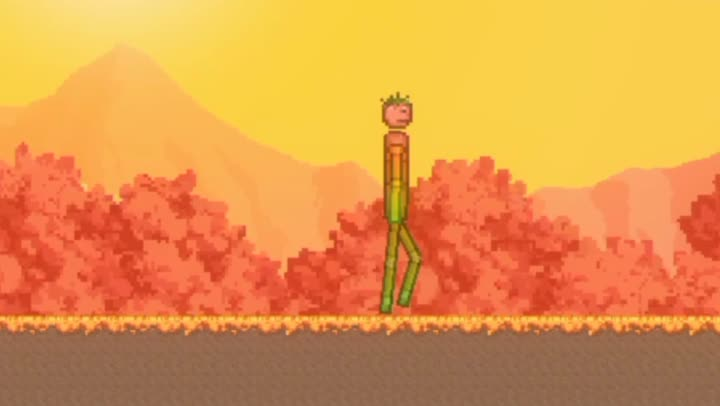</a>
<a href="https://github.com/FarlandGame/Animation-Portfolio/blob/main/history/phone-era/films/phone-01.en.md">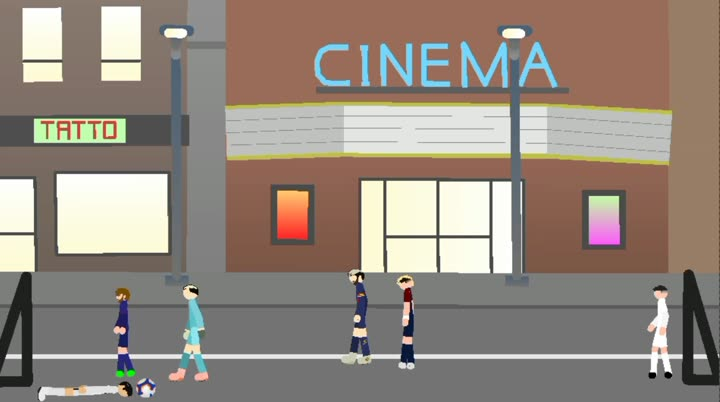</a>
<a href="https://github.com/FarlandGame/Animation-Portfolio/blob/main/history/phone-era/films/phone-02.en.md">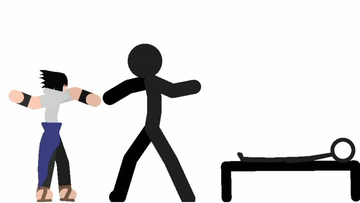</a>
<a href="https://github.com/FarlandGame/Animation-Portfolio/blob/main/history/phone-era/films/phone-03.en.md">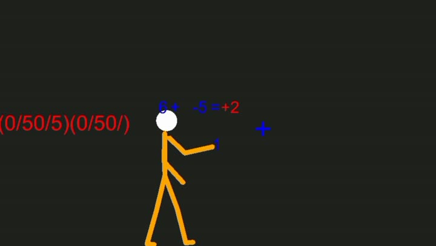</a>
<a href="https://github.com/FarlandGame/Animation-Portfolio/blob/main/history/phone-era/films/phone-04.en.md">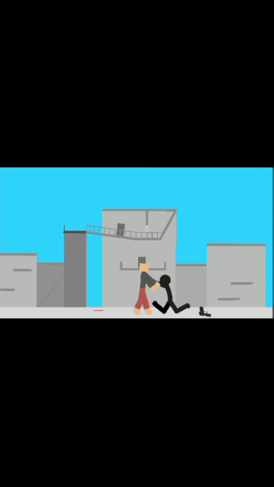</a>
<a href="https://github.com/FarlandGame/Animation-Portfolio/blob/main/history/phone-era/films/phone-05.en.md">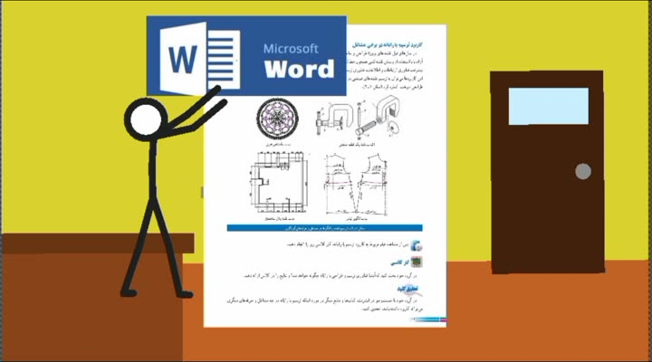</a>
<a href="https://github.com/FarlandGame/Animation-Portfolio/blob/main/history/phone-era/films/phone-06.en.md">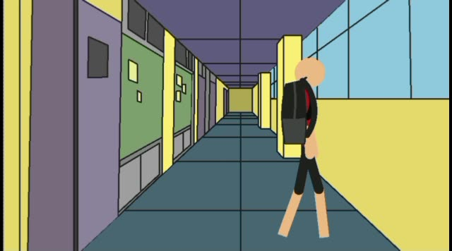</a>
<a href="https://github.com/FarlandGame/Animation-Portfolio/blob/main/history/phone-era/films/phone-07.en.md">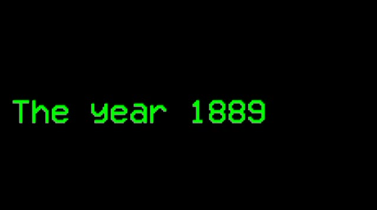</a>
<a href="https://github.com/FarlandGame/Animation-Portfolio/blob/main/history/phone-era/films/phone-08.en.md">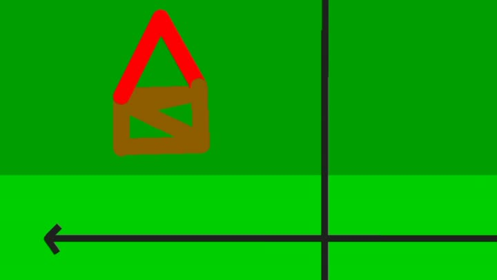</a>
<a href="https://github.com/FarlandGame/Animation-Portfolio/blob/main/history/phone-era/films/phone-09.en.md">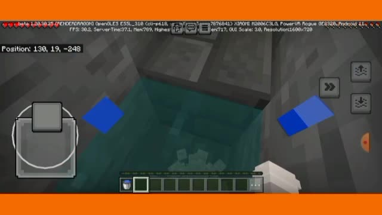</a>
<a href="https://github.com/FarlandGame/Animation-Portfolio/blob/main/history/phone-era/films/phone-10.en.md">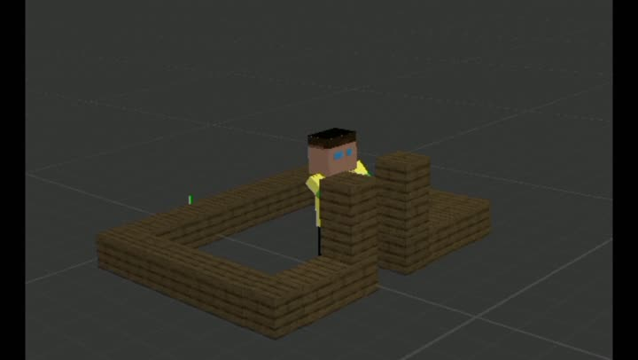</a>
<a href="https://github.com/FarlandGame/Animation-Portfolio/blob/main/history/phone-era/films/phone-11.en.md">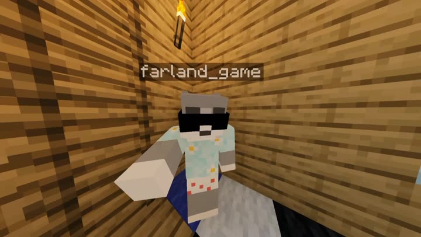</a>
<a href="https://github.com/FarlandGame/Animation-Portfolio/blob/main/history/phone-era/films/phone-13.en.md">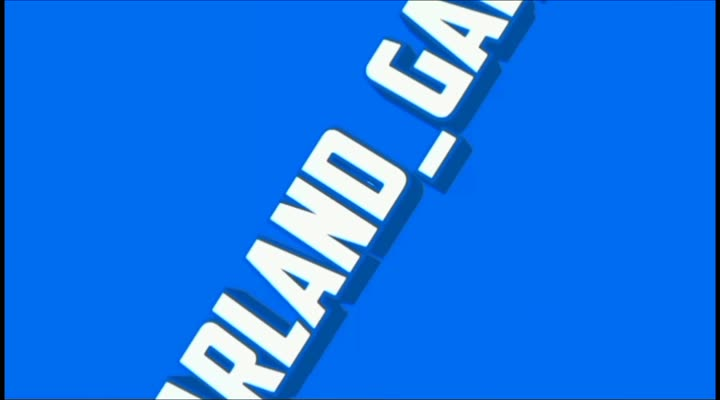</a>

## Voces, software y colaboración

Yo interpreté las voces en persa y a menudo las modifiqué con efectos. El número 5 enseña una lección de Trabajo y Tecnología de noveno curso; el 6 incluye varias voces de personajes; y en el 7 también interpreto la narración de una chica. En algunas partes del 7 y el 8 hay textos en inglés en pantalla, pero este archivo no afirma tener subtítulos completos en 18 idiomas. Mi hermano gemelo Armiya interpreta a Herobrine en el 9 y participa con los personajes en el 11.

## Galería de referencias de espacios escolares

Las 46 fotografías son referencias reales de espacios escolares que tomé para una segunda historia de huida de la escuela que quedó inacabada. Según mi identificación, muestran la escuela Farhang Shahid Parkar, en Maragheh. Fotografié los lugares durante una sola visita; estas imágenes servían para planificar los fondos y no son fotogramas de animación terminados. Los archivos originales están reunidos en un paquete de fuentes, con vistas previas más pequeñas que conservan el encuadre completo en la galería.

[Página de la galería 1](https://github.com/FarlandGame/Animation-Portfolio/blob/main/history/phone-era/es/school-01.md) · [Página de la galería 2](https://github.com/FarlandGame/Animation-Portfolio/blob/main/history/phone-era/es/school-02.md) · [Página de la galería 3](https://github.com/FarlandGame/Animation-Portfolio/blob/main/history/phone-era/es/school-03.md)

[Descargar las 46 fotografías escolares originales](https://github.com/FarlandGame/Animation-Portfolio/releases/download/phone-era-archive/school-reference-originals.zip)

<a href="https://github.com/FarlandGame/Animation-Portfolio/blob/main/history/phone-era/es/school-02.md">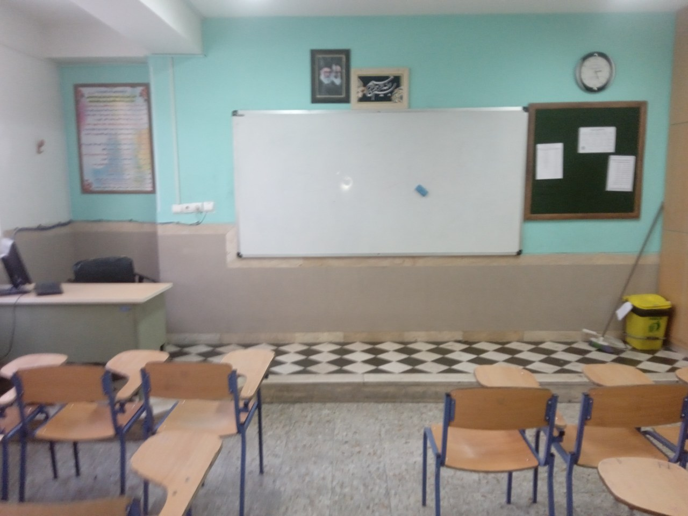</a>

## Proyectos que no llegaron al archivo

No se conservaron algunos trabajos anteriores, mis experimentos de octavo curso y parte de la continuación prevista de la historia escolar. No se pueden incluir ni reconstruir aquí. El proyecto de coordenadas se hizo para un concurso Khwarizmi, pero no se entregó antes de la fecha límite; no se presenta como una participación en el concurso ni como una obra premiada. Estas exportaciones forman parte del camino que llevó a mi libro y a mis trabajos 3D posteriores.

[Colecciones de animación posteriores](https://github.com/FarlandGame/Animation-Portfolio/blob/main/README.md) · [Portafolio completo](https://github.com/FarlandGame)
