# स्कूल-स्थलों की संदर्भ गैलरी · गैलरी पृष्ठ 3

[English](https://github.com/FarlandGame/Animation-Portfolio/blob/main/history/phone-era/en/index.md) · [日本語](https://github.com/FarlandGame/Animation-Portfolio/blob/main/history/phone-era/ja/index.md) · [فارسی](https://github.com/FarlandGame/Animation-Portfolio/blob/main/history/phone-era/fa/index.md) · [Deutsch](https://github.com/FarlandGame/Animation-Portfolio/blob/main/history/phone-era/de/index.md) · [Français](https://github.com/FarlandGame/Animation-Portfolio/blob/main/history/phone-era/fr/index.md) · [Español](https://github.com/FarlandGame/Animation-Portfolio/blob/main/history/phone-era/es/index.md) · [Português (Brasil)](https://github.com/FarlandGame/Animation-Portfolio/blob/main/history/phone-era/pt-BR/index.md) · [Italiano](https://github.com/FarlandGame/Animation-Portfolio/blob/main/history/phone-era/it/index.md) · [Nederlands](https://github.com/FarlandGame/Animation-Portfolio/blob/main/history/phone-era/nl/index.md) · [Polski](https://github.com/FarlandGame/Animation-Portfolio/blob/main/history/phone-era/pl/index.md) · [Українська](https://github.com/FarlandGame/Animation-Portfolio/blob/main/history/phone-era/uk/index.md) · [Türkçe](https://github.com/FarlandGame/Animation-Portfolio/blob/main/history/phone-era/tr/index.md) · [Русский](https://github.com/FarlandGame/Animation-Portfolio/blob/main/history/phone-era/ru/index.md) · [简体中文](https://github.com/FarlandGame/Animation-Portfolio/blob/main/history/phone-era/zh-CN/index.md) · [繁體中文](https://github.com/FarlandGame/Animation-Portfolio/blob/main/history/phone-era/zh-TW/index.md) · [한국어](https://github.com/FarlandGame/Animation-Portfolio/blob/main/history/phone-era/ko/index.md) · [हिन्दी](https://github.com/FarlandGame/Animation-Portfolio/blob/main/history/phone-era/hi/index.md) · [Bahasa Indonesia](https://github.com/FarlandGame/Animation-Portfolio/blob/main/history/phone-era/id/index.md)

ये 46 तस्वीरें वास्तविक स्कूल-स्थलों की संदर्भ तस्वीरें हैं, जिन्हें मैंने स्कूल से भागने की अधूरी दूसरी कहानी के लिए लिया था। मेरी पहचान के अनुसार, इनमें मराग़ेह का Farhang Shahid Parkar स्कूल दिखता है। मैंने एक ही दौरे में इन जगहों की तस्वीरें ली थीं; ये पृष्ठभूमि की योजना बनाने की सामग्री हैं, तैयार एनीमेशन फ़्रेम नहीं। मूल फ़ाइलें एक स्रोत पैक में साथ उपलब्ध हैं, जबकि गैलरी में पूरे फ़्रेम को बनाए रखने वाले छोटे प्रीव्यू हैं।

ये बिना क्रम की संदर्भ तस्वीरें हैं। पहचान-संख्याएँ समयक्रम या गुणवत्ता नहीं बतातीं।

[गैलरी पृष्ठ 1](https://github.com/FarlandGame/Animation-Portfolio/blob/main/history/phone-era/hi/school-01.md) · [गैलरी पृष्ठ 2](https://github.com/FarlandGame/Animation-Portfolio/blob/main/history/phone-era/hi/school-02.md) · [गैलरी पृष्ठ 3](https://github.com/FarlandGame/Animation-Portfolio/blob/main/history/phone-era/hi/school-03.md)

[स्कूल की सभी 46 मूल तस्वीरें डाउनलोड करें](https://github.com/FarlandGame/Animation-Portfolio/releases/download/phone-era-archive/school-reference-originals.zip)

## school-33 · गलियारे और दरवाज़े का संदर्भ

<a href="https://raw.githubusercontent.com/FarlandGame/Animation-Portfolio/main/history/phone-era/school/previews/school-33.jpg">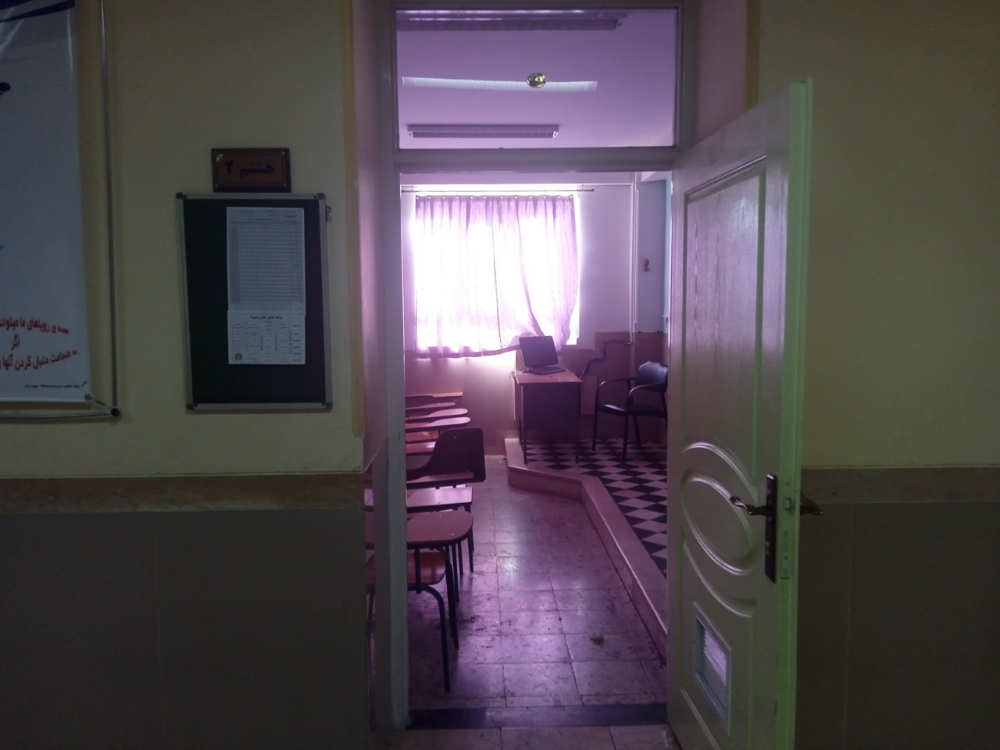</a>

पूरे फ़्रेम वाला छोटा प्रीव्यू; मूल तस्वीर स्रोत पैक में है।

दी गई फ़ाइल का नाम: `1793739672807.jpg` · 4160×3120

स्रोत का SHA-256: `864f187b846be3b93529497ed0668bcaa5719081cb339bf78ee91222085452be`

## school-34 · कक्षा का संदर्भ

<a href="https://raw.githubusercontent.com/FarlandGame/Animation-Portfolio/main/history/phone-era/school/previews/school-34.jpg">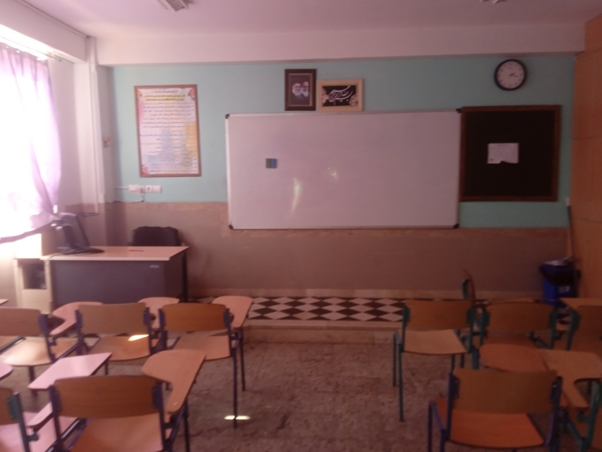</a>

पूरे फ़्रेम वाला छोटा प्रीव्यू; मूल तस्वीर स्रोत पैक में है।

दी गई फ़ाइल का नाम: `1793739672829.jpg` · 4160×3120

स्रोत का SHA-256: `df715d6b0aaa2bc734e1a0ac3a37cd7d7bd5feb9977da1a46e7ca72191621cd5`

## school-35 · कक्षा का संदर्भ

<a href="https://raw.githubusercontent.com/FarlandGame/Animation-Portfolio/main/history/phone-era/school/previews/school-35.jpg">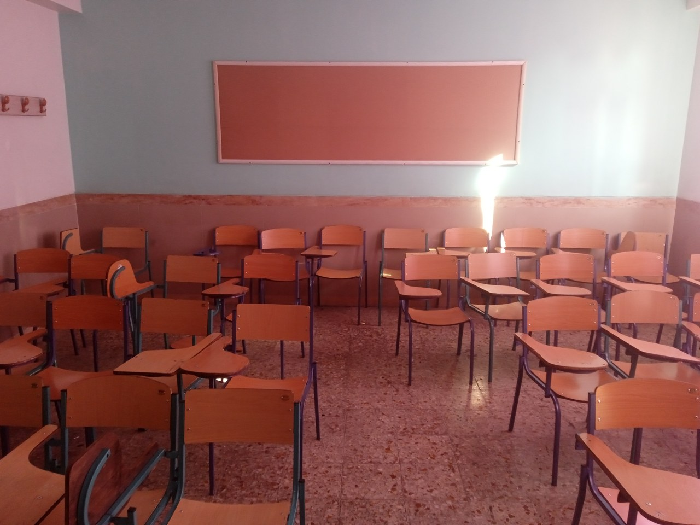</a>

पूरे फ़्रेम वाला छोटा प्रीव्यू; मूल तस्वीर स्रोत पैक में है।

दी गई फ़ाइल का नाम: `1793739672851.jpg` · 4160×3120

स्रोत का SHA-256: `084f0aaf76e80ee899eecb6f35181526e6cd629af6b64e3c8cd01725c59ebb83`

## school-36 · गलियारे और दरवाज़े का संदर्भ

<a href="https://raw.githubusercontent.com/FarlandGame/Animation-Portfolio/main/history/phone-era/school/previews/school-36.jpg">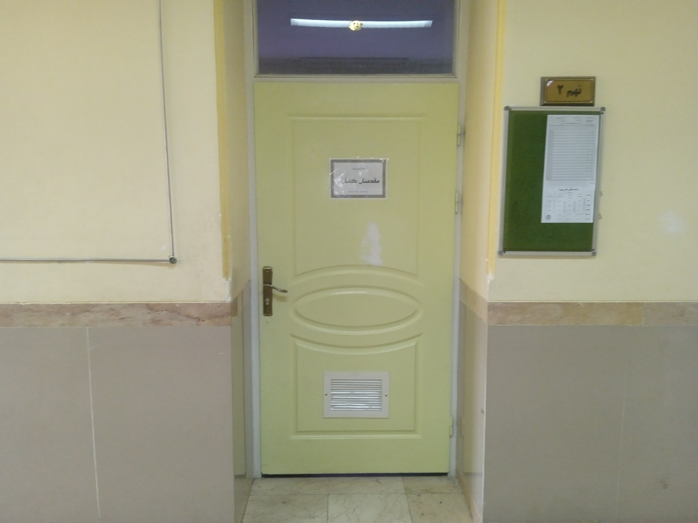</a>

पूरे फ़्रेम वाला छोटा प्रीव्यू; मूल तस्वीर स्रोत पैक में है।

दी गई फ़ाइल का नाम: `1793739672873.jpg` · 4160×3120

स्रोत का SHA-256: `a9261a1b9be9aaef811680eaae9b9494c7a82a0142549c7551629862e39b6140`

## school-37 · गलियारे और दरवाज़े का संदर्भ

<a href="https://raw.githubusercontent.com/FarlandGame/Animation-Portfolio/main/history/phone-era/school/previews/school-37.jpg">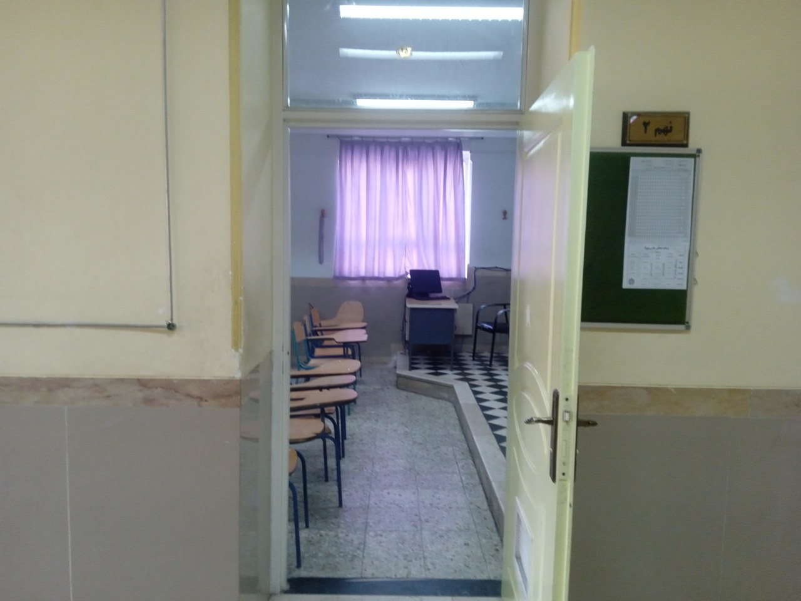</a>

पूरे फ़्रेम वाला छोटा प्रीव्यू; मूल तस्वीर स्रोत पैक में है।

दी गई फ़ाइल का नाम: `1793739672897.jpg` · 4160×3120

स्रोत का SHA-256: `d1c32d54abbd43749fd9d94dc44681e8cf1d230384c8735c12393802ca8d8672`

## school-38 · कक्षा का संदर्भ

<a href="https://raw.githubusercontent.com/FarlandGame/Animation-Portfolio/main/history/phone-era/school/previews/school-38.jpg">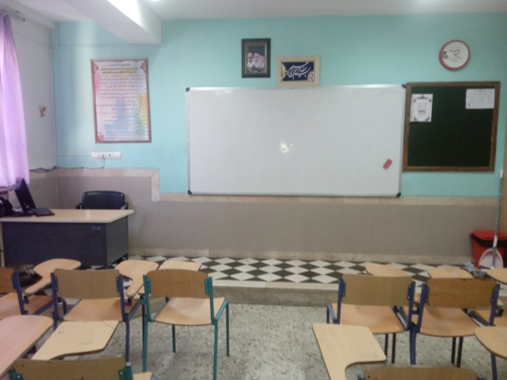</a>

पूरे फ़्रेम वाला छोटा प्रीव्यू; मूल तस्वीर स्रोत पैक में है।

दी गई फ़ाइल का नाम: `1793739672920.jpg` · 4160×3120

स्रोत का SHA-256: `ecbd86efd0d3064e8bdf59ffba6bec02b031a973a3d0106a5bb6b8025b90258e`

## school-39 · कक्षा का संदर्भ

<a href="https://raw.githubusercontent.com/FarlandGame/Animation-Portfolio/main/history/phone-era/school/previews/school-39.jpg">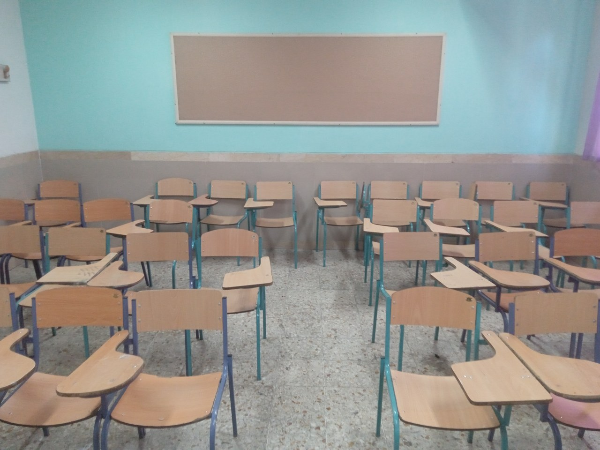</a>

पूरे फ़्रेम वाला छोटा प्रीव्यू; मूल तस्वीर स्रोत पैक में है।

दी गई फ़ाइल का नाम: `1793739672941.jpg` · 4160×3120

स्रोत का SHA-256: `b37aefa38a204ea7e66652f1249687acf4e19d868de0073b9293077dcb2bf538`

## school-40 · गलियारे और दरवाज़े का संदर्भ

<a href="https://raw.githubusercontent.com/FarlandGame/Animation-Portfolio/main/history/phone-era/school/previews/school-40.jpg">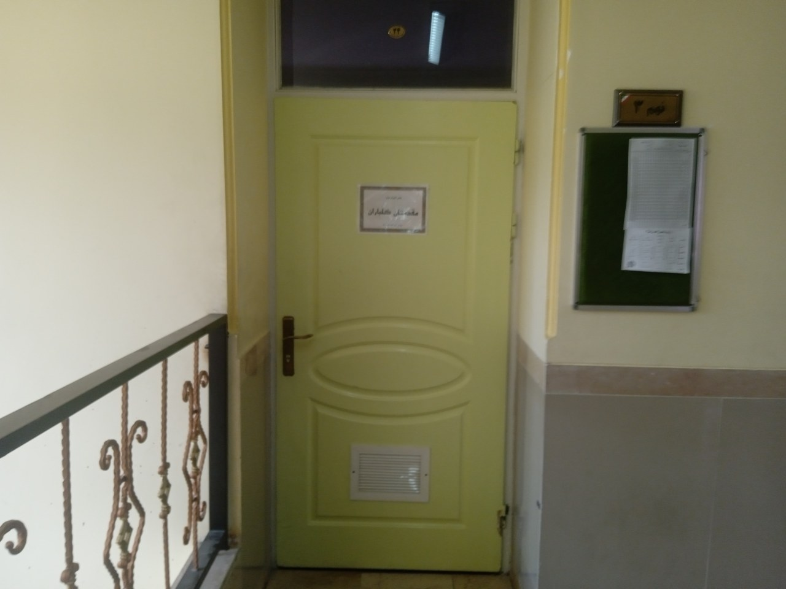</a>

पूरे फ़्रेम वाला छोटा प्रीव्यू; मूल तस्वीर स्रोत पैक में है।

दी गई फ़ाइल का नाम: `1793739672963.jpg` · 4160×3120

स्रोत का SHA-256: `761ed2ea64ed40db8b0b40fce32feee7021b08cf6f024f669dc7bdaf78434dca`

## school-41 · गलियारे और दरवाज़े का संदर्भ

<a href="https://raw.githubusercontent.com/FarlandGame/Animation-Portfolio/main/history/phone-era/school/previews/school-41.jpg">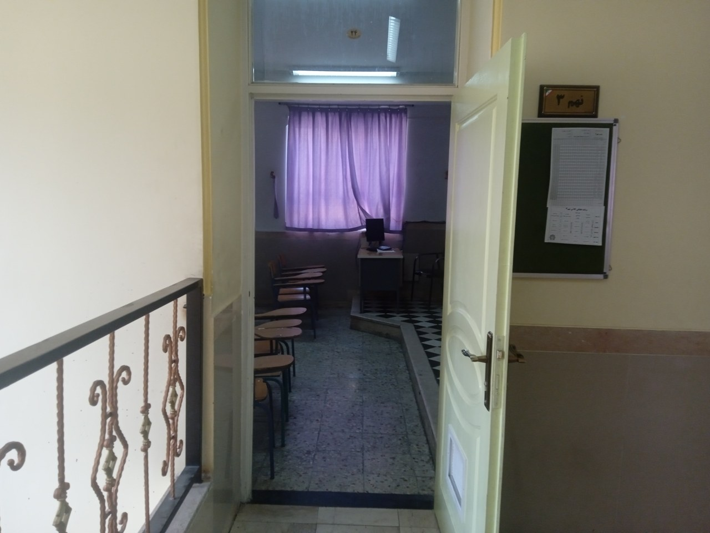</a>

पूरे फ़्रेम वाला छोटा प्रीव्यू; मूल तस्वीर स्रोत पैक में है।

दी गई फ़ाइल का नाम: `1793739672985.jpg` · 4160×3120

स्रोत का SHA-256: `b458ba1d18fe26e1aea63935f5b2905c3179a131d767645507af87072c4dd0cf`

## school-42 · कक्षा का संदर्भ

<a href="https://raw.githubusercontent.com/FarlandGame/Animation-Portfolio/main/history/phone-era/school/previews/school-42.jpg">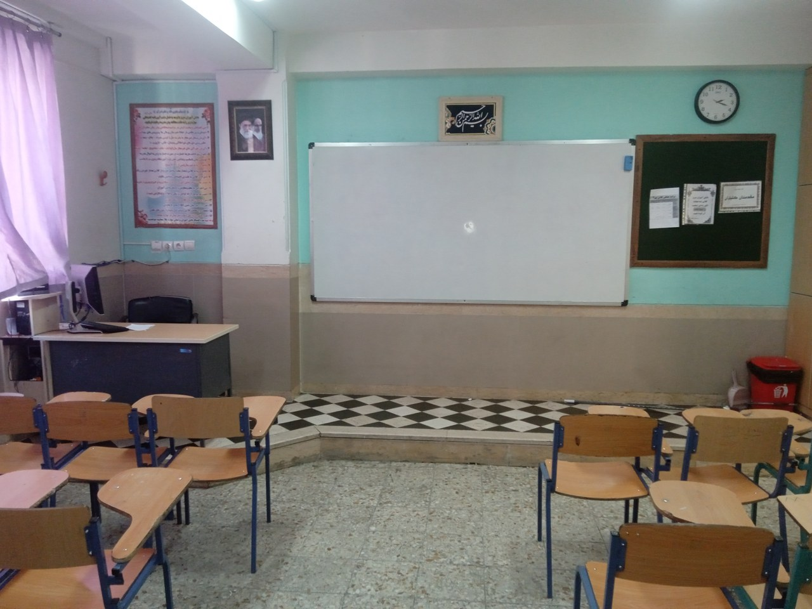</a>

पूरे फ़्रेम वाला छोटा प्रीव्यू; मूल तस्वीर स्रोत पैक में है।

दी गई फ़ाइल का नाम: `1793739673008.jpg` · 4160×3120

स्रोत का SHA-256: `6516238fa1f7bffa5e7350c000c64c2423ae4ce7f7b6fd387b91947a13ab3d8a`

## school-43 · गलियारे और दरवाज़े का संदर्भ

<a href="https://raw.githubusercontent.com/FarlandGame/Animation-Portfolio/main/history/phone-era/school/previews/school-43.jpg">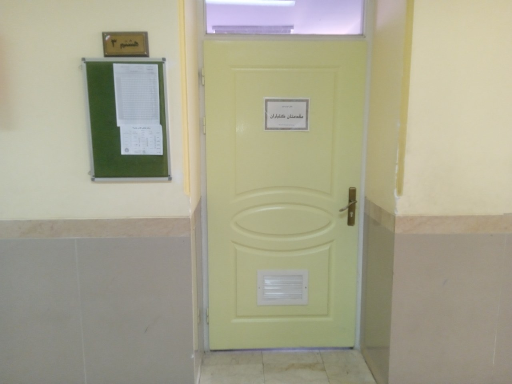</a>

पूरे फ़्रेम वाला छोटा प्रीव्यू; मूल तस्वीर स्रोत पैक में है।

दी गई फ़ाइल का नाम: `1793739673031.jpg` · 4160×3120

स्रोत का SHA-256: `87fe643eb7ae18c8f6d3ea1c85d6376e8a92251029c5394f50cb30a3911530e4`

## school-44 · गलियारे और दरवाज़े का संदर्भ

<a href="https://raw.githubusercontent.com/FarlandGame/Animation-Portfolio/main/history/phone-era/school/previews/school-44.jpg">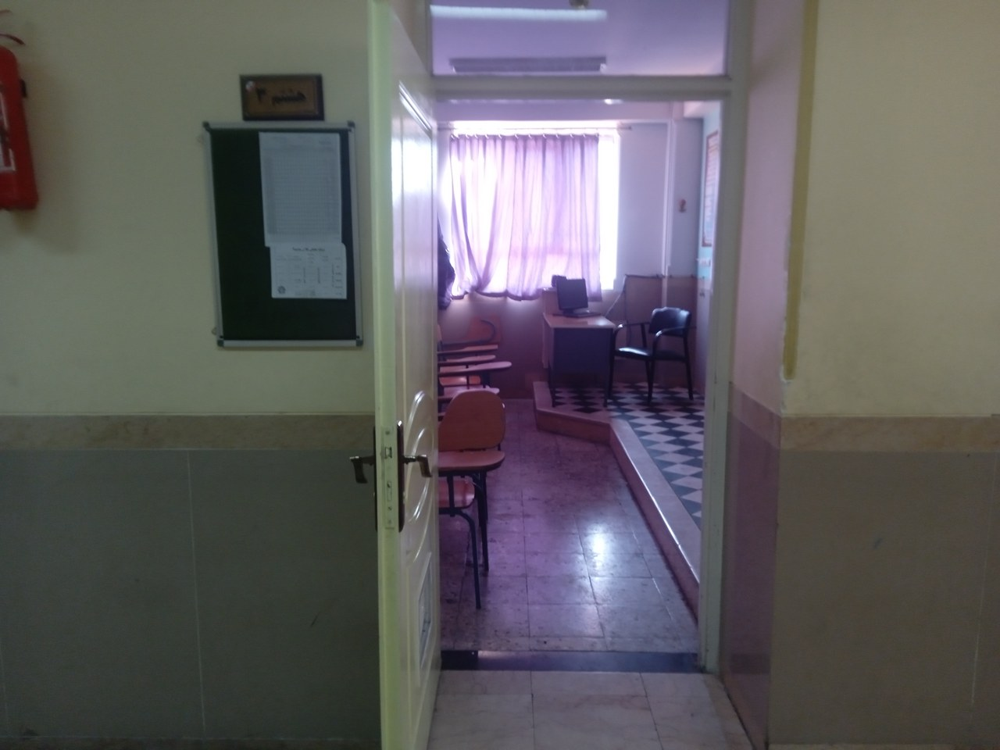</a>

पूरे फ़्रेम वाला छोटा प्रीव्यू; मूल तस्वीर स्रोत पैक में है।

दी गई फ़ाइल का नाम: `1793739673056.jpg` · 4160×3120

स्रोत का SHA-256: `047e5a8d7c66a3d683f073b284276233b53cb1045396ac19386d76c7689879e3`

## school-45 · कक्षा का संदर्भ

<a href="https://raw.githubusercontent.com/FarlandGame/Animation-Portfolio/main/history/phone-era/school/previews/school-45.jpg">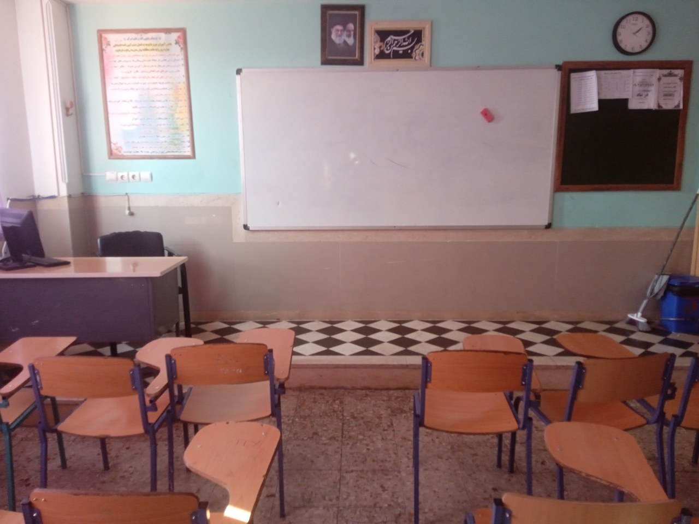</a>

पूरे फ़्रेम वाला छोटा प्रीव्यू; मूल तस्वीर स्रोत पैक में है।

दी गई फ़ाइल का नाम: `1793739673077.jpg` · 4160×3120

स्रोत का SHA-256: `004171aa2b46fe330388771eb0cdd130a0847687909dd04a21608c9b4fcd77d5`

## school-46 · कक्षा का संदर्भ

<a href="https://raw.githubusercontent.com/FarlandGame/Animation-Portfolio/main/history/phone-era/school/previews/school-46.jpg">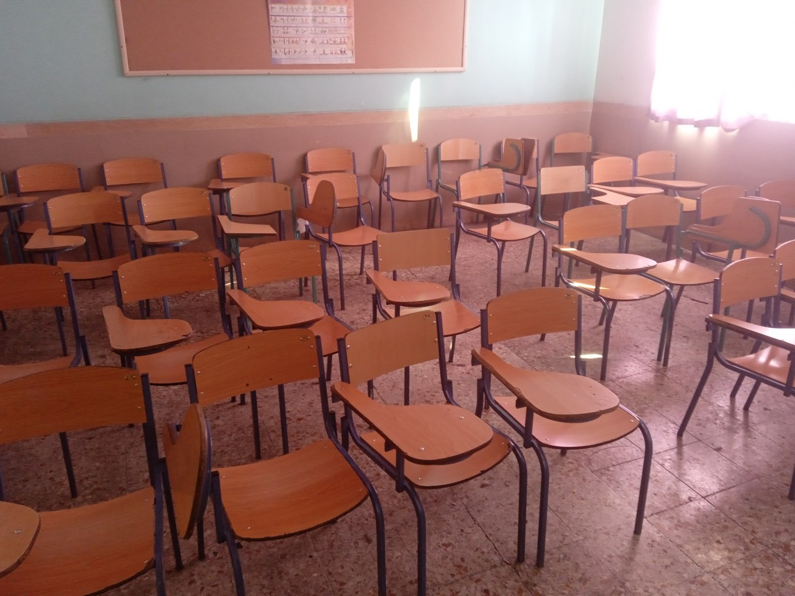</a>

पूरे फ़्रेम वाला छोटा प्रीव्यू; मूल तस्वीर स्रोत पैक में है।

दी गई फ़ाइल का नाम: `1793739673104.jpg` · 4160×3120

स्रोत का SHA-256: `ff69104f435e825c24096e6a8cc2536f802e30333060a2c1305766383bd7b3aa`

[शुरुआती फ़ोन-आधारित रचनाओं का संग्रह खोलें](https://github.com/FarlandGame/Animation-Portfolio/blob/main/history/phone-era/hi/index.md)
