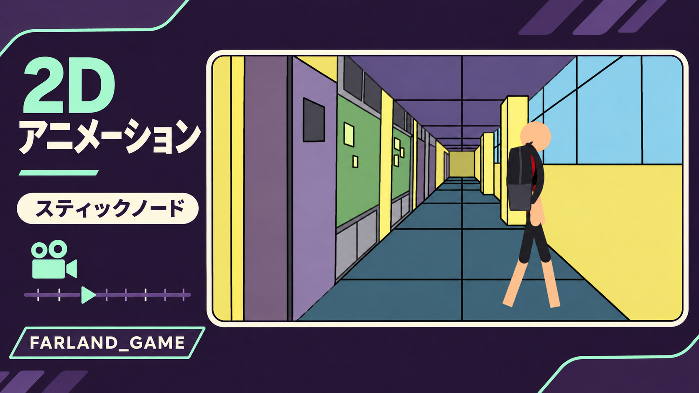

# スマートフォン創作初期のアーカイブ 📱🎬

<!-- PHONE_ARCHIVE_STICKER_START -->
 · [Farland_game · Portfolio ↗](https://github.com/FarlandGame)
<!-- PHONE_ARCHIVE_STICKER_END -->

**Farland_gameの原点となった、学生時代の試行錯誤。**

[English](https://github.com/FarlandGame/Animation-Portfolio/blob/main/history/phone-era/en/index.md) · [日本語](https://github.com/FarlandGame/Animation-Portfolio/blob/main/history/phone-era/ja/index.md) · [فارسی](https://github.com/FarlandGame/Animation-Portfolio/blob/main/history/phone-era/fa/index.md) · [Deutsch](https://github.com/FarlandGame/Animation-Portfolio/blob/main/history/phone-era/de/index.md) · [Français](https://github.com/FarlandGame/Animation-Portfolio/blob/main/history/phone-era/fr/index.md) · [Español](https://github.com/FarlandGame/Animation-Portfolio/blob/main/history/phone-era/es/index.md) · [Português (Brasil)](https://github.com/FarlandGame/Animation-Portfolio/blob/main/history/phone-era/pt-BR/index.md) · [Italiano](https://github.com/FarlandGame/Animation-Portfolio/blob/main/history/phone-era/it/index.md) · [Nederlands](https://github.com/FarlandGame/Animation-Portfolio/blob/main/history/phone-era/nl/index.md) · [Polski](https://github.com/FarlandGame/Animation-Portfolio/blob/main/history/phone-era/pl/index.md) · [Українська](https://github.com/FarlandGame/Animation-Portfolio/blob/main/history/phone-era/uk/index.md) · [Türkçe](https://github.com/FarlandGame/Animation-Portfolio/blob/main/history/phone-era/tr/index.md) · [Русский](https://github.com/FarlandGame/Animation-Portfolio/blob/main/history/phone-era/ru/index.md) · [简体中文](https://github.com/FarlandGame/Animation-Portfolio/blob/main/history/phone-era/zh-CN/index.md) · [繁體中文](https://github.com/FarlandGame/Animation-Portfolio/blob/main/history/phone-era/zh-TW/index.md) · [한국어](https://github.com/FarlandGame/Animation-Portfolio/blob/main/history/phone-era/ko/index.md) · [हिन्दी](https://github.com/FarlandGame/Animation-Portfolio/blob/main/history/phone-era/hi/index.md) · [Bahasa Indonesia](https://github.com/FarlandGame/Animation-Portfolio/blob/main/history/phone-era/id/index.md)

スマートフォンで創作を始めた頃の、現存する書き出しファイルです。StickNodes時代のアニメーション、複数のメディアを組み合わせた学校の伝記課題、Minecraftでの物語、初めて自作したモバイル3Dシーン、初期のチャンネルオープニングが含まれます。今では当時の粗さを越えて成長しましたが、残しておくことで学びの過程が見えてきます。現在の制作品質を示す作品集ではなく、歩みを記録した過去の作品です。

> 最初のフレームには自信がたっぷり。キーフレームは、まだ追いつこうとしていました。📱😄

## 年代の読み方

1〜4はイラン暦1401〜1402年度の7年生のとき、5〜8は9年生のときに作ったと記憶しています。12は番号順の例外です。最初のスマートフォンを手に入れて間もないイラン暦1401年デイ月の作品で、1よりも古いと認識しています。それ以外の正確な制作日は確認できていません。13は初期のブランディング用オープニングとして別枠の作品であり、品質や制作時期の面で最新のアニメーションという意味ではありません。

## 提供された動画ファイル

*詳しい作品ノート：英語 · ペルシャ語 · 日本語*

| 番号 | タイトル | 再生時間 | 解像度 | 動画全編をダウンロード |
|---|---|---|---|---|
| 12 | [学校向けの禁煙短編：現存する最古のファイル](https://github.com/FarlandGame/Animation-Portfolio/blob/main/history/phone-era/films/phone-12.ja.md) | 2:11 | 1920×1080 | [動画全編をダウンロード](https://github.com/FarlandGame/Animation-Portfolio/releases/download/phone-era-archive/12-1080p.mp4) |
| 01 | [現存する最初のStickNodes時代の街頭シーン](https://github.com/FarlandGame/Animation-Portfolio/blob/main/history/phone-era/films/phone-01.ja.md) | 0:41 | 1920×1074 | [動画全編をダウンロード](https://github.com/FarlandGame/Animation-Portfolio/releases/download/phone-era-archive/1.mp4) |
| 02 | [棒人間アクションの初期実験](https://github.com/FarlandGame/Animation-Portfolio/blob/main/history/phone-era/films/phone-02.ja.md) | 0:48 | 1920×1080 | [動画全編をダウンロード](https://github.com/FarlandGame/Animation-Portfolio/releases/download/phone-era-archive/2.mp4) |
| 03 | [数学と動きの習作](https://github.com/FarlandGame/Animation-Portfolio/blob/main/history/phone-era/films/phone-03.ja.md) | 1:21 | 1920×1080 | [動画全編をダウンロード](https://github.com/FarlandGame/Animation-Portfolio/releases/download/phone-era-archive/3.mp4) |
| 04 | [気軽に作った縦型アニメーションスケッチ](https://github.com/FarlandGame/Animation-Portfolio/blob/main/history/phone-era/films/phone-04.ja.md) | 0:31 | 1080×1920 | [動画全編をダウンロード](https://github.com/FarlandGame/Animation-Portfolio/releases/download/phone-era-archive/4.mp4) |
| 05 | [仕事と技術：9年生の授業](https://github.com/FarlandGame/Animation-Portfolio/blob/main/history/phone-era/films/phone-05.ja.md) | 4:28 | 1280×712 | [動画全編をダウンロード](https://github.com/FarlandGame/Animation-Portfolio/releases/download/phone-era-archive/5.mp4) |
| 06 | [学校を抜け出した先に](https://github.com/FarlandGame/Animation-Portfolio/blob/main/history/phone-era/films/phone-06.ja.md) | 6:28 | 640×356 | [動画全編をダウンロード](https://github.com/FarlandGame/Animation-Portfolio/releases/download/phone-era-archive/6.mp4) |
| 07 | [学校課題で作ったアドルフ・ヒトラーの短い伝記](https://github.com/FarlandGame/Animation-Portfolio/blob/main/history/phone-era/films/phone-07.ja.md) | 5:48 | 640×356 | [動画全編をダウンロード](https://github.com/FarlandGame/Animation-Portfolio/releases/download/phone-era-archive/7.mp4) |
| 08 | [座標：提出できなかったホラズミー作品](https://github.com/FarlandGame/Animation-Portfolio/blob/main/history/phone-era/films/phone-08.ja.md) | 12:49 | 1920×1080 | [動画全編をダウンロード](https://github.com/FarlandGame/Animation-Portfolio/releases/download/phone-era-archive/8-1080p.mp4) |
| 09 | [Herobrineとの追いかけっことサーバーの仕掛け](https://github.com/FarlandGame/Animation-Portfolio/blob/main/history/phone-era/films/phone-09.ja.md) | 5:11 | 640×360 | [動画全編をダウンロード](https://github.com/FarlandGame/Animation-Portfolio/releases/download/phone-era-archive/9.mp4) |
| 10 | [初めて自作したモバイル3Dシーン](https://github.com/FarlandGame/Animation-Portfolio/blob/main/history/phone-era/films/phone-10.ja.md) | 1:50 | 1920×1080 | [動画全編をダウンロード](https://github.com/FarlandGame/Animation-Portfolio/releases/download/phone-era-archive/10.mp4) |
| 11 | [『ネズミとネコ』― Minecraftでの再話](https://github.com/FarlandGame/Animation-Portfolio/blob/main/history/phone-era/films/phone-11.ja.md) | 6:03 | 1920×1080 | [動画全編をダウンロード](https://github.com/FarlandGame/Animation-Portfolio/releases/download/phone-era-archive/11-1080p.mp4) |
| 13 | [初期のFarland_gameオープニング](https://github.com/FarlandGame/Animation-Portfolio/blob/main/history/phone-era/films/phone-13.ja.md) | 0:14 | 1920×1068 | [動画全編をダウンロード](https://github.com/FarlandGame/Animation-Portfolio/releases/download/phone-era-archive/13.mp4) |

[13本の短いサンプルを見る](https://github.com/FarlandGame/Animation-Portfolio/issues/2) · [全編ダウンロードとチェックサム](https://github.com/FarlandGame/Animation-Portfolio/releases/tag/phone-era-archive)

## 声・ソフトウェア・共同制作

ペルシャ語の声は私が演じ、エフェクトで変えることもよくありました。5は9年生の「仕事と技術」の授業内容を教える作品、6では複数の登場人物を演じ、7の女の子のナレーションも私が担当しています。7と8の一部には英語の画面内テキストがありますが、このアーカイブは18言語の完全な字幕を備えているとはうたっていません。双子の兄弟アルミヤは9でHerobrineを演じ、11でも登場人物の演技に参加しています。

## 学校のロケーション資料ギャラリー

46枚の写真は、未完成に終わった学校脱出物語の第2作のために私が撮影した、実際の学校のロケーション資料です。私の認識では、マラーゲのファルハング・シャヒード・パルカル学校が写っています。1回の訪問で各場所を撮影したもので、完成したアニメーションのフレームではなく、背景を計画するための資料です。元ファイルは資料パックにまとめてあり、ギャラリーの小さなプレビューでも画面全体を確認できます。

[ギャラリーページ 1](https://github.com/FarlandGame/Animation-Portfolio/blob/main/history/phone-era/ja/school-01.md) · [ギャラリーページ 2](https://github.com/FarlandGame/Animation-Portfolio/blob/main/history/phone-era/ja/school-02.md) · [ギャラリーページ 3](https://github.com/FarlandGame/Animation-Portfolio/blob/main/history/phone-era/ja/school-03.md)

[学校写真の原本46枚をすべてダウンロード](https://github.com/FarlandGame/Animation-Portfolio/releases/download/phone-era-archive/school-reference-originals.zip)

## アーカイブに残らなかった企画

さらに以前の作品、8年生のときの実験、そして予定していた学校物語の続編の一部は残っていません。そのため、ここに収録したり復元したりすることはできません。座標の作品はホラズミー・コンテストに向けて作りましたが、締め切りまでに提出していません。応募作品や受賞作品としては紹介していません。これらの書き出しファイルは、私の本や、その後の3D作品へとつながった道のりの一部です。

[後年のアニメーションコレクション](https://github.com/FarlandGame/Animation-Portfolio/blob/main/README.md) · [ポートフォリオ全体](https://github.com/FarlandGame)
