# 학교 장소 참고 갤러리 · 갤러리 페이지 2

[English](https://github.com/FarlandGame/Animation-Portfolio/blob/main/history/phone-era/en/index.md) · [日本語](https://github.com/FarlandGame/Animation-Portfolio/blob/main/history/phone-era/ja/index.md) · [فارسی](https://github.com/FarlandGame/Animation-Portfolio/blob/main/history/phone-era/fa/index.md) · [Deutsch](https://github.com/FarlandGame/Animation-Portfolio/blob/main/history/phone-era/de/index.md) · [Français](https://github.com/FarlandGame/Animation-Portfolio/blob/main/history/phone-era/fr/index.md) · [Español](https://github.com/FarlandGame/Animation-Portfolio/blob/main/history/phone-era/es/index.md) · [Português (Brasil)](https://github.com/FarlandGame/Animation-Portfolio/blob/main/history/phone-era/pt-BR/index.md) · [Italiano](https://github.com/FarlandGame/Animation-Portfolio/blob/main/history/phone-era/it/index.md) · [Nederlands](https://github.com/FarlandGame/Animation-Portfolio/blob/main/history/phone-era/nl/index.md) · [Polski](https://github.com/FarlandGame/Animation-Portfolio/blob/main/history/phone-era/pl/index.md) · [Українська](https://github.com/FarlandGame/Animation-Portfolio/blob/main/history/phone-era/uk/index.md) · [Türkçe](https://github.com/FarlandGame/Animation-Portfolio/blob/main/history/phone-era/tr/index.md) · [Русский](https://github.com/FarlandGame/Animation-Portfolio/blob/main/history/phone-era/ru/index.md) · [简体中文](https://github.com/FarlandGame/Animation-Portfolio/blob/main/history/phone-era/zh-CN/index.md) · [繁體中文](https://github.com/FarlandGame/Animation-Portfolio/blob/main/history/phone-era/zh-TW/index.md) · [한국어](https://github.com/FarlandGame/Animation-Portfolio/blob/main/history/phone-era/ko/index.md) · [हिन्दी](https://github.com/FarlandGame/Animation-Portfolio/blob/main/history/phone-era/hi/index.md) · [Bahasa Indonesia](https://github.com/FarlandGame/Animation-Portfolio/blob/main/history/phone-era/id/index.md)

46장의 사진은 미완성으로 남은 두 번째 학교 탈출 이야기를 위해 제가 직접 촬영한 실제 학교 장소 참고 자료입니다. 제가 기억하는 장소는 마라게의 Farhang Shahid Parkar 학교입니다. 한 차례 방문해 이 장소들을 촬영했으며, 사진들은 배경을 계획하기 위한 자료이지 완성된 애니메이션 프레임이 아닙니다. 원본 파일은 하나의 소스 자료 묶음으로 제공하고, 갤러리에는 전체 화면을 유지한 작은 미리보기를 실었습니다.

순서가 없는 사진 참고 자료입니다. ID는 제작 시기나 완성도를 나타내지 않습니다.

[갤러리 페이지 1](https://github.com/FarlandGame/Animation-Portfolio/blob/main/history/phone-era/ko/school-01.md) · [갤러리 페이지 2](https://github.com/FarlandGame/Animation-Portfolio/blob/main/history/phone-era/ko/school-02.md) · [갤러리 페이지 3](https://github.com/FarlandGame/Animation-Portfolio/blob/main/history/phone-era/ko/school-03.md)

[학교 사진 원본 46장 모두 다운로드](https://github.com/FarlandGame/Animation-Portfolio/releases/download/phone-era-archive/school-reference-originals.zip)

## school-17 · 복도와 출입구 참고 자료

<a href="https://raw.githubusercontent.com/FarlandGame/Animation-Portfolio/main/history/phone-era/school/previews/school-17.jpg">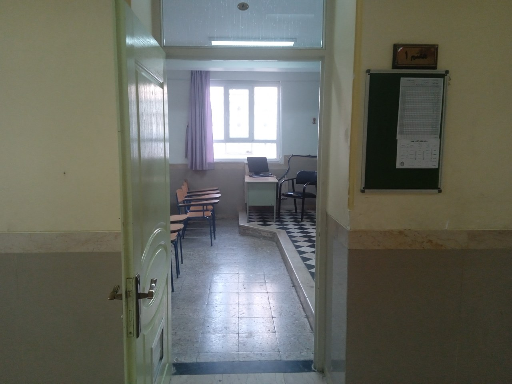</a>

전체 화면을 유지한 축소 미리보기입니다. 원본은 소스 자료 묶음에 있습니다.

제공된 파일 이름: `1793739672408.jpg` · 4160×3120

소스 SHA-256: `99d0f65424d616aecb73b2abbf6a5500f2d980fdd0f8ce6b4b0aac91bae4602d`

## school-18 · 교실 참고 자료

전체 화면을 유지한 축소 미리보기입니다. 원본은 소스 자료 묶음에 있습니다.

제공된 파일 이름: `1793739672446.jpg` · 4160×3120

소스 SHA-256: `5a4938739ef4460a8e585ec7752179befa46eab280685b024968fefd5e3a8367`

## school-19 · 교실 참고 자료

<a href="https://raw.githubusercontent.com/FarlandGame/Animation-Portfolio/main/history/phone-era/school/previews/school-19.jpg">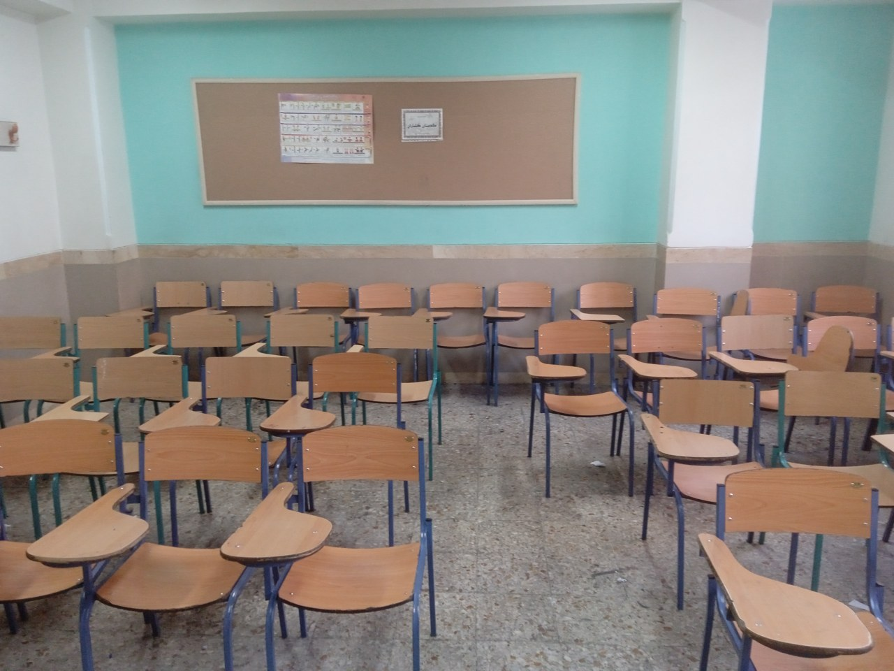</a>

전체 화면을 유지한 축소 미리보기입니다. 원본은 소스 자료 묶음에 있습니다.

제공된 파일 이름: `1793739672477.jpg` · 4160×3120

소스 SHA-256: `4d1e8b19de6c9a505c5c59d0a0959afd3ba3d61f53d6cca509ae301be4f50c7a`

## school-20 · 복도와 출입구 참고 자료

<a href="https://raw.githubusercontent.com/FarlandGame/Animation-Portfolio/main/history/phone-era/school/previews/school-20.jpg">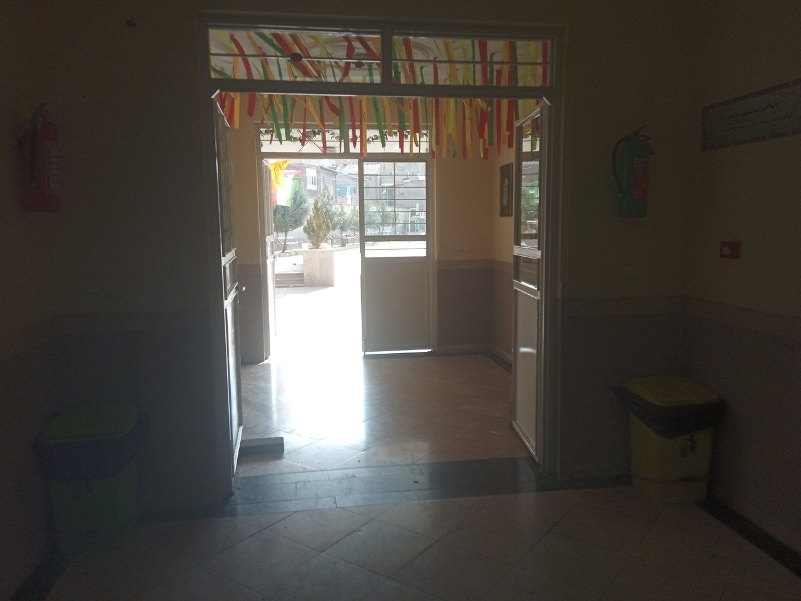</a>

전체 화면을 유지한 축소 미리보기입니다. 원본은 소스 자료 묶음에 있습니다.

제공된 파일 이름: `1793739672502.jpg` · 4160×3120

소스 SHA-256: `104bcb4c9c5be19ad65ff834e8ee11a5ad81c76ce5f98668d7de2757768778b8`

## school-21 · 계단실 참고 자료

<a href="https://raw.githubusercontent.com/FarlandGame/Animation-Portfolio/main/history/phone-era/school/previews/school-21.jpg">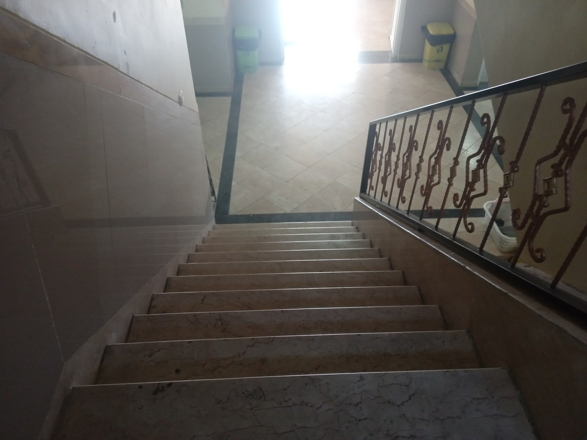</a>

전체 화면을 유지한 축소 미리보기입니다. 원본은 소스 자료 묶음에 있습니다.

제공된 파일 이름: `1793739672528.jpg` · 4160×3120

소스 SHA-256: `b2351cb663d1a1115c78178a942be6774d331e311cbbfbde0b06f3134a23a0ec`

## school-22 · 계단실 참고 자료

<a href="https://raw.githubusercontent.com/FarlandGame/Animation-Portfolio/main/history/phone-era/school/previews/school-22.jpg">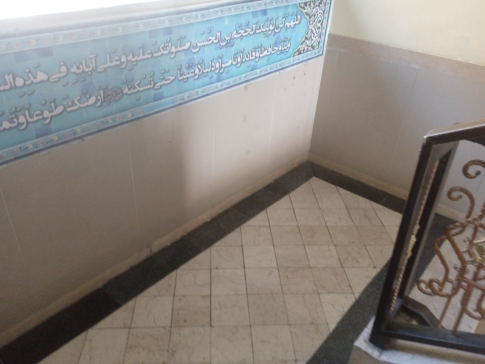</a>

전체 화면을 유지한 축소 미리보기입니다. 원본은 소스 자료 묶음에 있습니다.

제공된 파일 이름: `1793739672550.jpg` · 4160×3120

소스 SHA-256: `51b4dfda33ac4cbe87aec74acc466e30c73a698e7690c983644db088656319ec`

## school-23 · 계단실 참고 자료

<a href="https://raw.githubusercontent.com/FarlandGame/Animation-Portfolio/main/history/phone-era/school/previews/school-23.jpg">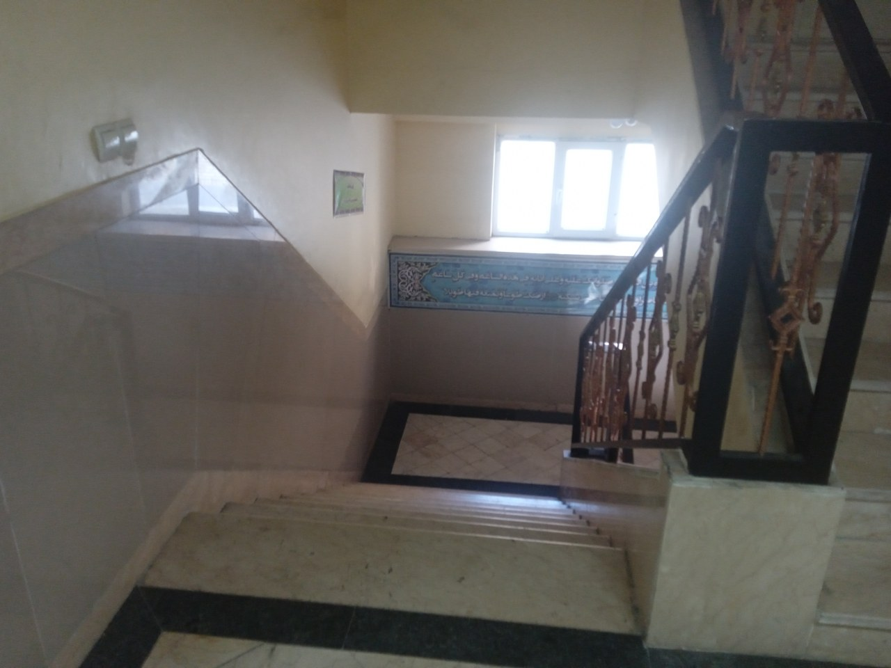</a>

전체 화면을 유지한 축소 미리보기입니다. 원본은 소스 자료 묶음에 있습니다.

제공된 파일 이름: `1793739672572.jpg` · 4160×3120

소스 SHA-256: `c750414214441822c841df74409c79d33ec3aa0809e1e7ffef13a3535dba0817`

## school-24 · 복도와 출입구 참고 자료

<a href="https://raw.githubusercontent.com/FarlandGame/Animation-Portfolio/main/history/phone-era/school/previews/school-24.jpg">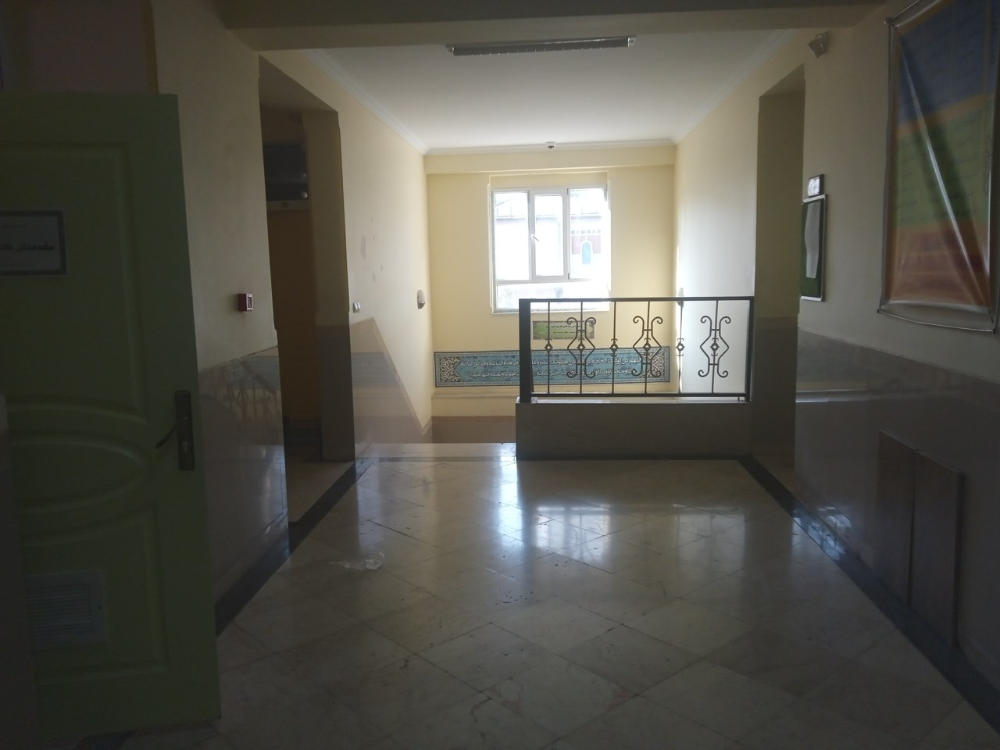</a>

전체 화면을 유지한 축소 미리보기입니다. 원본은 소스 자료 묶음에 있습니다.

제공된 파일 이름: `1793739672596.jpg` · 4160×3120

소스 SHA-256: `97dea0f1588451a44c911635985cbb443e97178e297a6d90af063b99c657c51b`

## school-25 · 복도와 출입구 참고 자료

<a href="https://raw.githubusercontent.com/FarlandGame/Animation-Portfolio/main/history/phone-era/school/previews/school-25.jpg">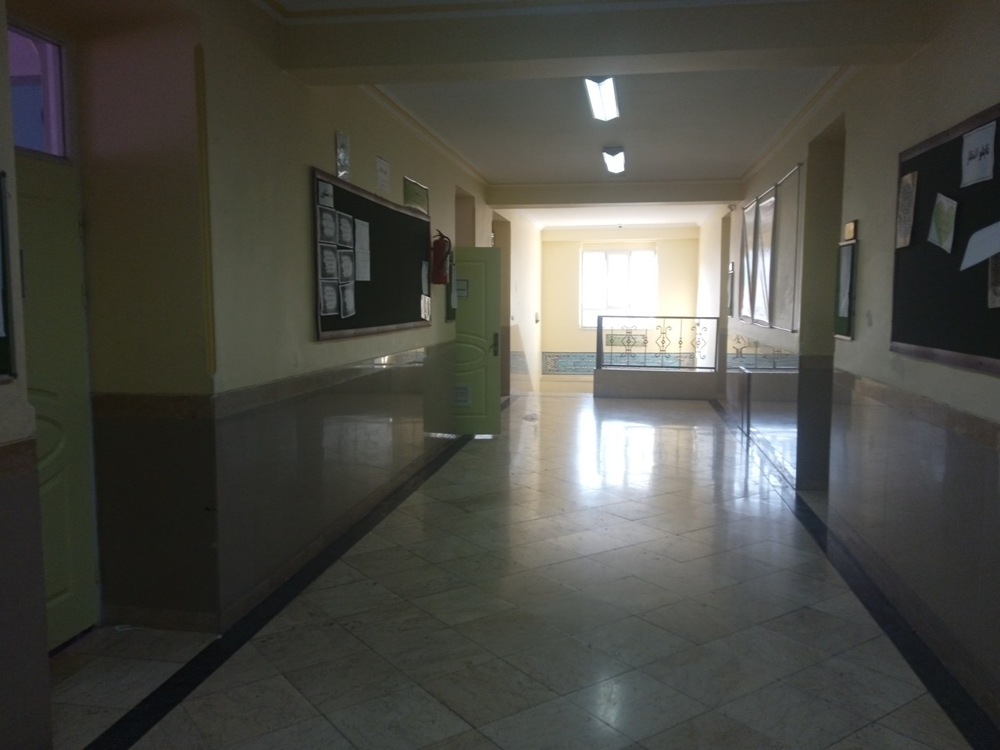</a>

전체 화면을 유지한 축소 미리보기입니다. 원본은 소스 자료 묶음에 있습니다.

제공된 파일 이름: `1793739672620.jpg` · 4160×3120

소스 SHA-256: `0a73731a149e0e5f3676aa86d8fdf24a29ee4897c308d0295ebb22bb9693a416`

## school-26 · 복도와 출입구 참고 자료

<a href="https://raw.githubusercontent.com/FarlandGame/Animation-Portfolio/main/history/phone-era/school/previews/school-26.jpg">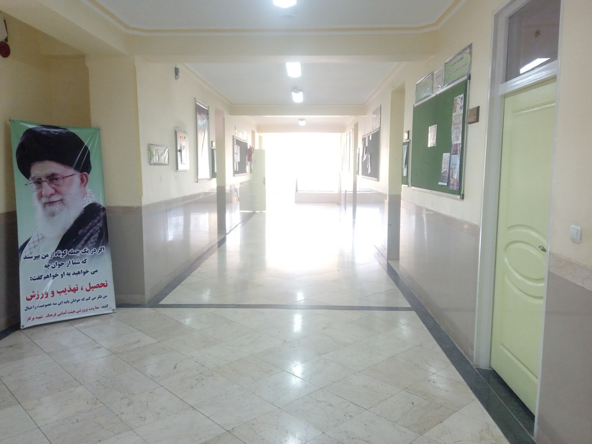</a>

전체 화면을 유지한 축소 미리보기입니다. 원본은 소스 자료 묶음에 있습니다.

제공된 파일 이름: `1793739672647.jpg` · 4160×3120

소스 SHA-256: `a9e1c2a9026d1c59e39cad2cc66003be9a72da781ec74eff9466f72e8b4fed44`

## school-27 · 복도와 출입구 참고 자료

<a href="https://raw.githubusercontent.com/FarlandGame/Animation-Portfolio/main/history/phone-era/school/previews/school-27.jpg">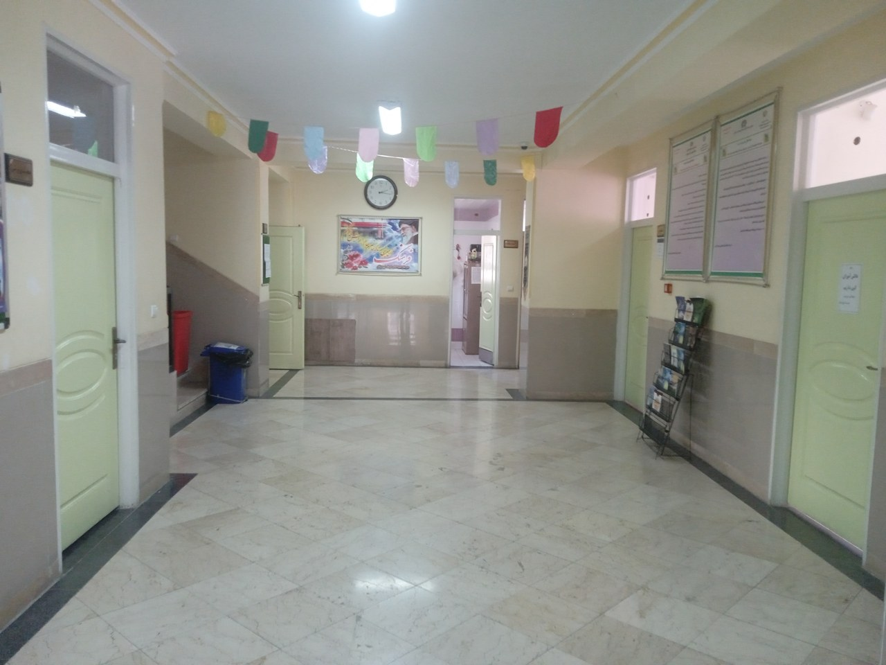</a>

전체 화면을 유지한 축소 미리보기입니다. 원본은 소스 자료 묶음에 있습니다.

제공된 파일 이름: `1793739672670.jpg` · 4160×3120

소스 SHA-256: `3455e62113420ac01ddcbc9e3d5405c9c16f7544ce211a62d8b4c5468a3e0e70`

## school-28 · 복도와 출입구 참고 자료

<a href="https://raw.githubusercontent.com/FarlandGame/Animation-Portfolio/main/history/phone-era/school/previews/school-28.jpg">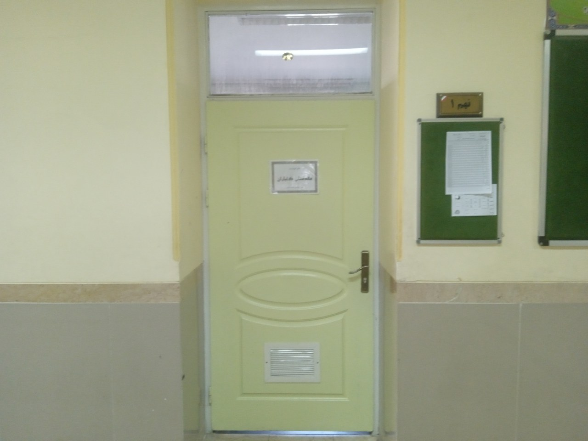</a>

전체 화면을 유지한 축소 미리보기입니다. 원본은 소스 자료 묶음에 있습니다.

제공된 파일 이름: `1793739672693.jpg` · 4160×3120

소스 SHA-256: `d8764949ccb02295dcf7078cc302eccfcb6b8ea6805e1bd764aa2bab5314f457`

## school-29 · 복도와 출입구 참고 자료

<a href="https://raw.githubusercontent.com/FarlandGame/Animation-Portfolio/main/history/phone-era/school/previews/school-29.jpg">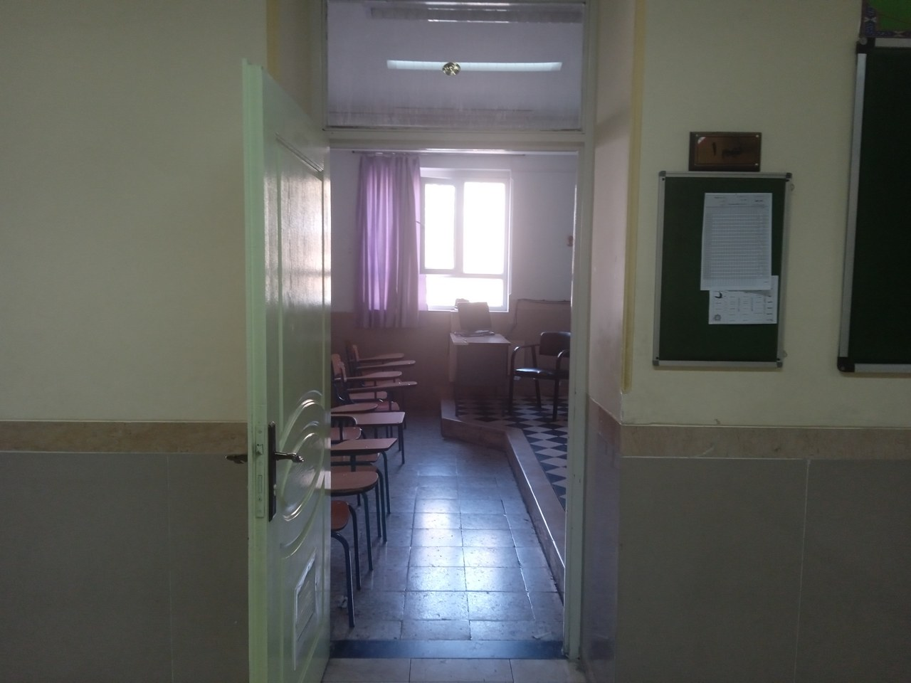</a>

전체 화면을 유지한 축소 미리보기입니다. 원본은 소스 자료 묶음에 있습니다.

제공된 파일 이름: `1793739672716.jpg` · 4160×3120

소스 SHA-256: `2e57327ed663111742886dafa8d45ce9c91c47605c750c5d97c51b43ef6ac6c7`

## school-30 · 교실 참고 자료

<a href="https://raw.githubusercontent.com/FarlandGame/Animation-Portfolio/main/history/phone-era/school/previews/school-30.jpg">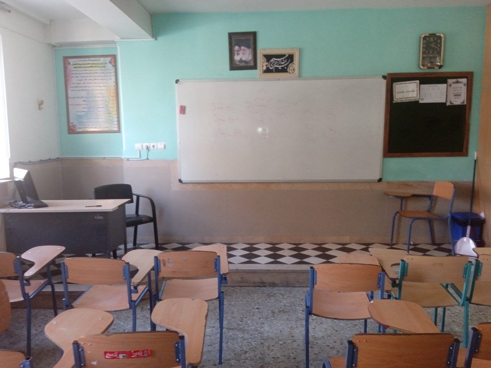</a>

전체 화면을 유지한 축소 미리보기입니다. 원본은 소스 자료 묶음에 있습니다.

제공된 파일 이름: `1793739672737.jpg` · 4160×3120

소스 SHA-256: `4f2d9e55465be771ab7b49dfb233165ec2e23dde8cc3c0b717fff3c213a5d545`

## school-31 · 교실 참고 자료

<a href="https://raw.githubusercontent.com/FarlandGame/Animation-Portfolio/main/history/phone-era/school/previews/school-31.jpg">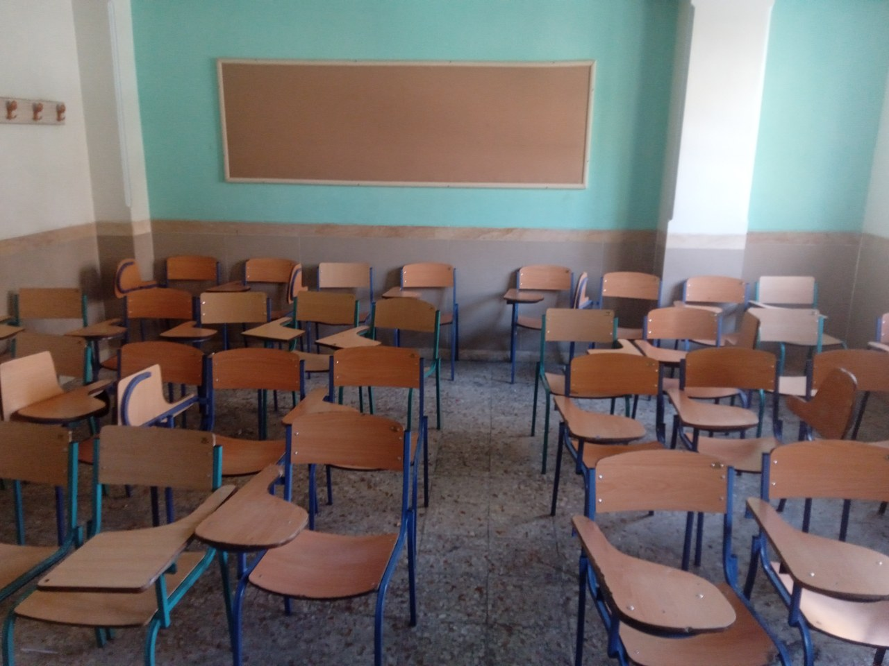</a>

전체 화면을 유지한 축소 미리보기입니다. 원본은 소스 자료 묶음에 있습니다.

제공된 파일 이름: `1793739672759.jpg` · 4160×3120

소스 SHA-256: `a7bf3d19edc94a8b2d6080fd030474cfde348875d9b9abed3b4dffd9970cd2cf`

## school-32 · 복도와 출입구 참고 자료

<a href="https://raw.githubusercontent.com/FarlandGame/Animation-Portfolio/main/history/phone-era/school/previews/school-32.jpg">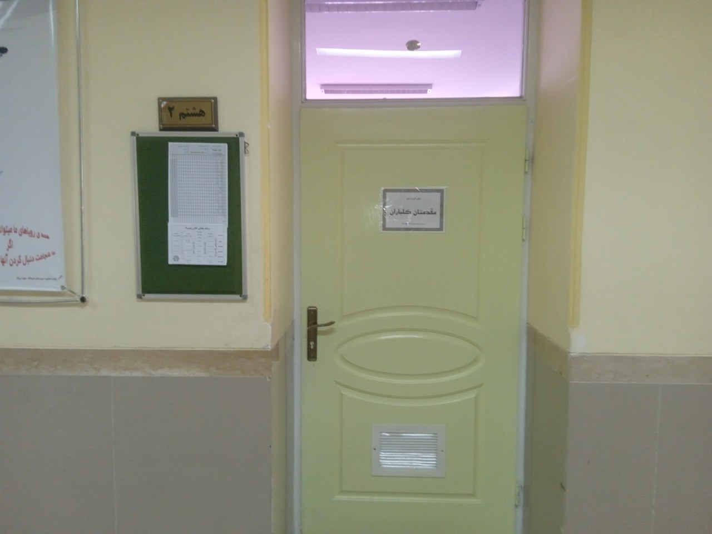</a>

전체 화면을 유지한 축소 미리보기입니다. 원본은 소스 자료 묶음에 있습니다.

제공된 파일 이름: `1793739672782.jpg` · 4160×3120

소스 SHA-256: `fbd47da093e41f3322b8fdbbe1b96adc16b8180fa310458e552c10210e9a0836`

[초기 휴대폰 창작 아카이브 열기](https://github.com/FarlandGame/Animation-Portfolio/blob/main/history/phone-era/ko/index.md)
