# Галерея референсов школьных локаций · Страница галереи 3

[English](https://github.com/FarlandGame/Animation-Portfolio/blob/main/history/phone-era/en/index.md) · [日本語](https://github.com/FarlandGame/Animation-Portfolio/blob/main/history/phone-era/ja/index.md) · [فارسی](https://github.com/FarlandGame/Animation-Portfolio/blob/main/history/phone-era/fa/index.md) · [Deutsch](https://github.com/FarlandGame/Animation-Portfolio/blob/main/history/phone-era/de/index.md) · [Français](https://github.com/FarlandGame/Animation-Portfolio/blob/main/history/phone-era/fr/index.md) · [Español](https://github.com/FarlandGame/Animation-Portfolio/blob/main/history/phone-era/es/index.md) · [Português (Brasil)](https://github.com/FarlandGame/Animation-Portfolio/blob/main/history/phone-era/pt-BR/index.md) · [Italiano](https://github.com/FarlandGame/Animation-Portfolio/blob/main/history/phone-era/it/index.md) · [Nederlands](https://github.com/FarlandGame/Animation-Portfolio/blob/main/history/phone-era/nl/index.md) · [Polski](https://github.com/FarlandGame/Animation-Portfolio/blob/main/history/phone-era/pl/index.md) · [Українська](https://github.com/FarlandGame/Animation-Portfolio/blob/main/history/phone-era/uk/index.md) · [Türkçe](https://github.com/FarlandGame/Animation-Portfolio/blob/main/history/phone-era/tr/index.md) · [Русский](https://github.com/FarlandGame/Animation-Portfolio/blob/main/history/phone-era/ru/index.md) · [简体中文](https://github.com/FarlandGame/Animation-Portfolio/blob/main/history/phone-era/zh-CN/index.md) · [繁體中文](https://github.com/FarlandGame/Animation-Portfolio/blob/main/history/phone-era/zh-TW/index.md) · [한국어](https://github.com/FarlandGame/Animation-Portfolio/blob/main/history/phone-era/ko/index.md) · [हिन्दी](https://github.com/FarlandGame/Animation-Portfolio/blob/main/history/phone-era/hi/index.md) · [Bahasa Indonesia](https://github.com/FarlandGame/Animation-Portfolio/blob/main/history/phone-era/id/index.md)

46 фотографий — это снятые мной реальные школьные локации для незавершённой второй истории о побеге из школы. По моему определению, на них школа «Фарханг Шахид Паркар» в Мараге. Все локации я сфотографировал за одно посещение; это материалы для планирования фонов, а не готовые кадры анимации. Оригиналы собраны в одном архиве исходников; в галерее представлены уменьшенные превью без обрезки кадра.

Это неупорядоченные фотореференсы. Идентификаторы не указывают хронологию или качество.

[Страница галереи 1](https://github.com/FarlandGame/Animation-Portfolio/blob/main/history/phone-era/ru/school-01.md) · [Страница галереи 2](https://github.com/FarlandGame/Animation-Portfolio/blob/main/history/phone-era/ru/school-02.md) · [Страница галереи 3](https://github.com/FarlandGame/Animation-Portfolio/blob/main/history/phone-era/ru/school-03.md)

[Скачать все 46 оригинальных школьных фотографий](https://github.com/FarlandGame/Animation-Portfolio/releases/download/phone-era-archive/school-reference-originals.zip)

## school-33 · Референс коридора и дверного проёма

<a href="https://raw.githubusercontent.com/FarlandGame/Animation-Portfolio/main/history/phone-era/school/previews/school-33.jpg">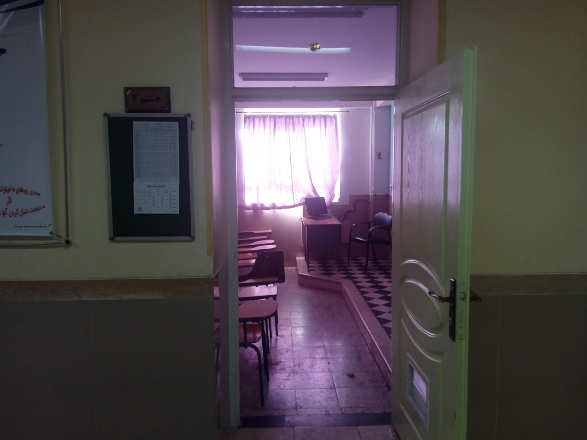</a>

Уменьшенное превью без обрезки; оригинал находится в архиве исходников.

Предоставленное имя файла: `1793739672807.jpg` · 4160×3120

SHA-256 исходника: `864f187b846be3b93529497ed0668bcaa5719081cb339bf78ee91222085452be`

## school-34 · Референс класса

<a href="https://raw.githubusercontent.com/FarlandGame/Animation-Portfolio/main/history/phone-era/school/previews/school-34.jpg">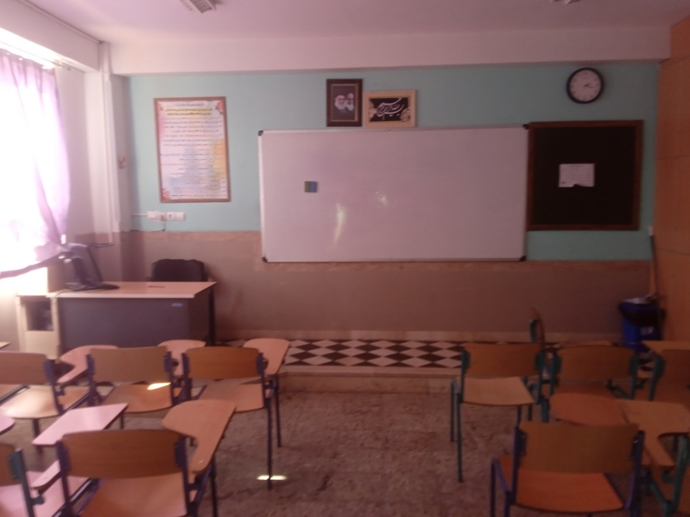</a>

Уменьшенное превью без обрезки; оригинал находится в архиве исходников.

Предоставленное имя файла: `1793739672829.jpg` · 4160×3120

SHA-256 исходника: `df715d6b0aaa2bc734e1a0ac3a37cd7d7bd5feb9977da1a46e7ca72191621cd5`

## school-35 · Референс класса

<a href="https://raw.githubusercontent.com/FarlandGame/Animation-Portfolio/main/history/phone-era/school/previews/school-35.jpg">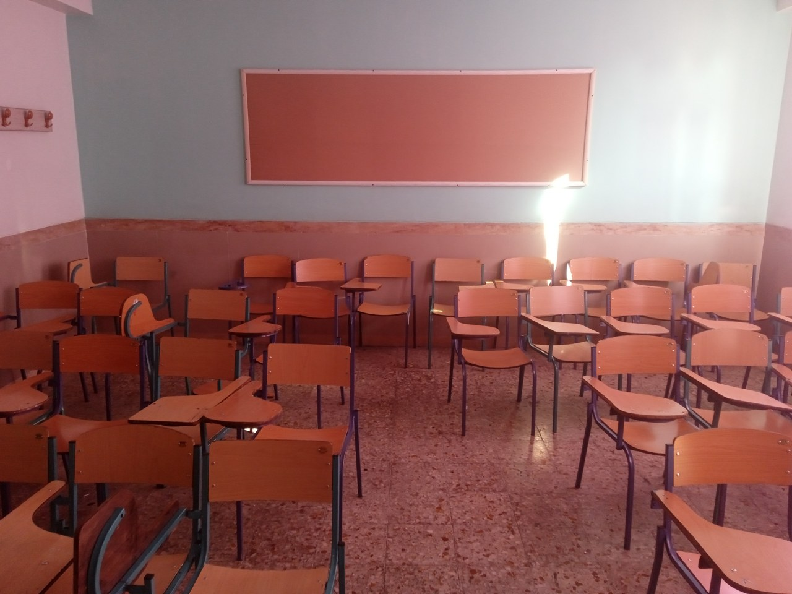</a>

Уменьшенное превью без обрезки; оригинал находится в архиве исходников.

Предоставленное имя файла: `1793739672851.jpg` · 4160×3120

SHA-256 исходника: `084f0aaf76e80ee899eecb6f35181526e6cd629af6b64e3c8cd01725c59ebb83`

## school-36 · Референс коридора и дверного проёма

<a href="https://raw.githubusercontent.com/FarlandGame/Animation-Portfolio/main/history/phone-era/school/previews/school-36.jpg">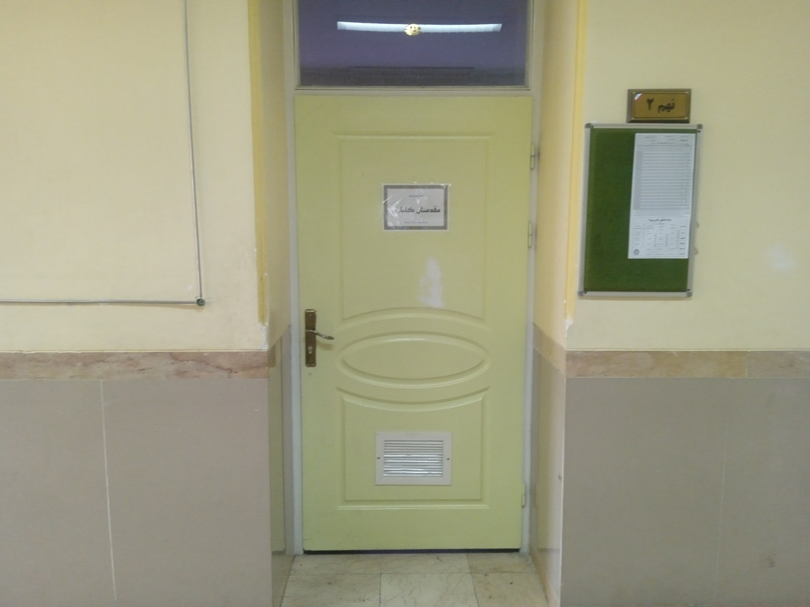</a>

Уменьшенное превью без обрезки; оригинал находится в архиве исходников.

Предоставленное имя файла: `1793739672873.jpg` · 4160×3120

SHA-256 исходника: `a9261a1b9be9aaef811680eaae9b9494c7a82a0142549c7551629862e39b6140`

## school-37 · Референс коридора и дверного проёма

<a href="https://raw.githubusercontent.com/FarlandGame/Animation-Portfolio/main/history/phone-era/school/previews/school-37.jpg">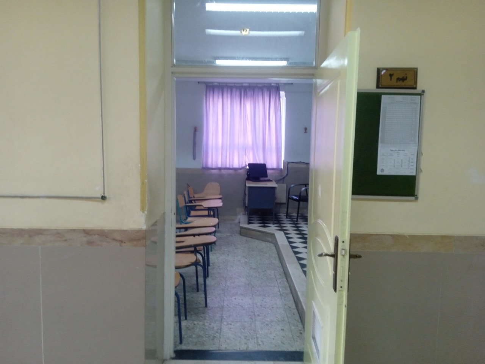</a>

Уменьшенное превью без обрезки; оригинал находится в архиве исходников.

Предоставленное имя файла: `1793739672897.jpg` · 4160×3120

SHA-256 исходника: `d1c32d54abbd43749fd9d94dc44681e8cf1d230384c8735c12393802ca8d8672`

## school-38 · Референс класса

<a href="https://raw.githubusercontent.com/FarlandGame/Animation-Portfolio/main/history/phone-era/school/previews/school-38.jpg">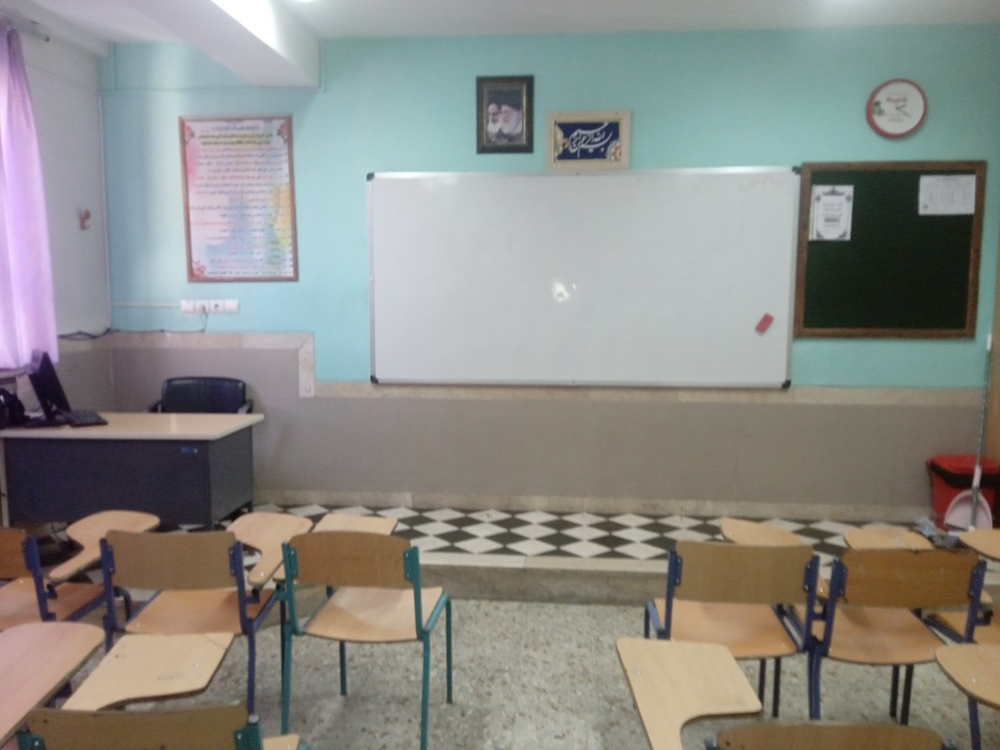</a>

Уменьшенное превью без обрезки; оригинал находится в архиве исходников.

Предоставленное имя файла: `1793739672920.jpg` · 4160×3120

SHA-256 исходника: `ecbd86efd0d3064e8bdf59ffba6bec02b031a973a3d0106a5bb6b8025b90258e`

## school-39 · Референс класса

<a href="https://raw.githubusercontent.com/FarlandGame/Animation-Portfolio/main/history/phone-era/school/previews/school-39.jpg">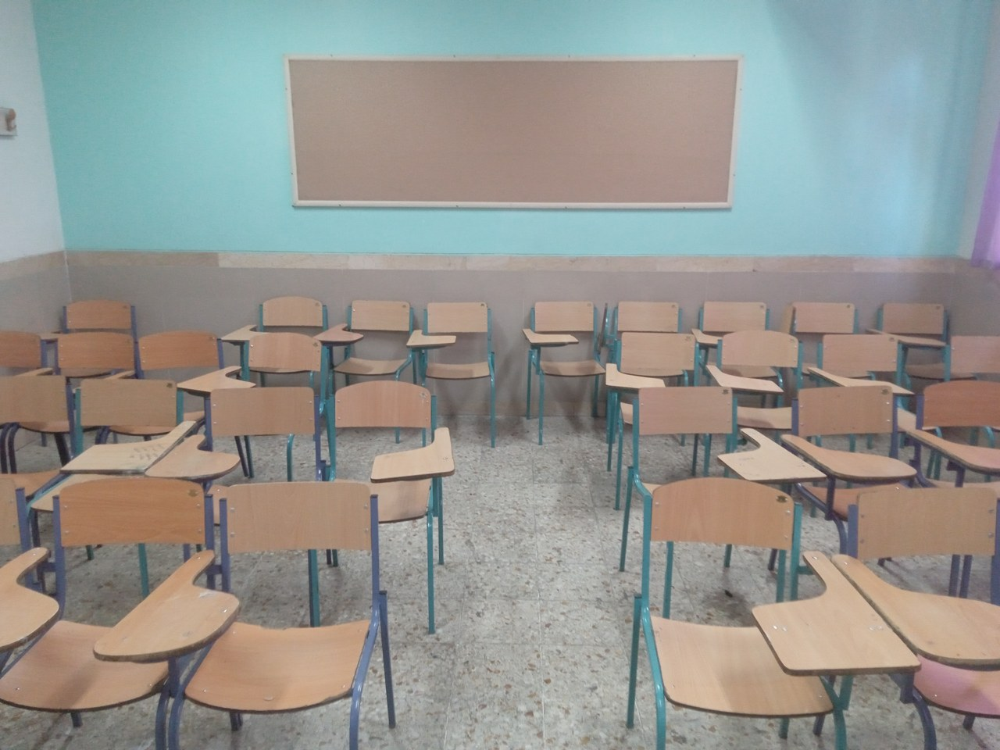</a>

Уменьшенное превью без обрезки; оригинал находится в архиве исходников.

Предоставленное имя файла: `1793739672941.jpg` · 4160×3120

SHA-256 исходника: `b37aefa38a204ea7e66652f1249687acf4e19d868de0073b9293077dcb2bf538`

## school-40 · Референс коридора и дверного проёма

<a href="https://raw.githubusercontent.com/FarlandGame/Animation-Portfolio/main/history/phone-era/school/previews/school-40.jpg">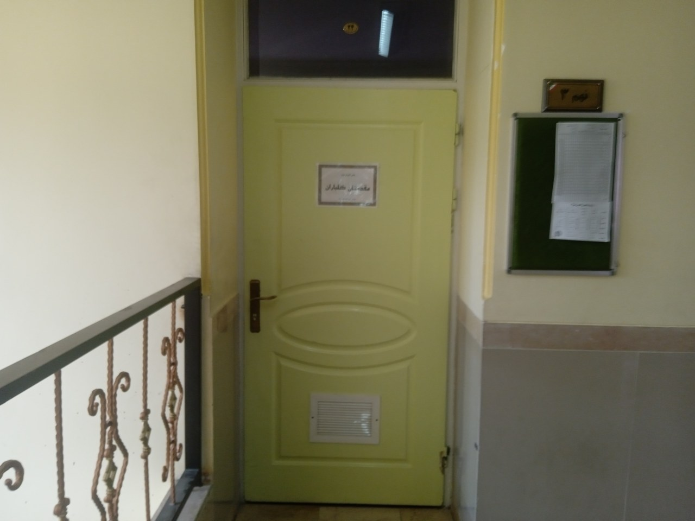</a>

Уменьшенное превью без обрезки; оригинал находится в архиве исходников.

Предоставленное имя файла: `1793739672963.jpg` · 4160×3120

SHA-256 исходника: `761ed2ea64ed40db8b0b40fce32feee7021b08cf6f024f669dc7bdaf78434dca`

## school-41 · Референс коридора и дверного проёма

<a href="https://raw.githubusercontent.com/FarlandGame/Animation-Portfolio/main/history/phone-era/school/previews/school-41.jpg">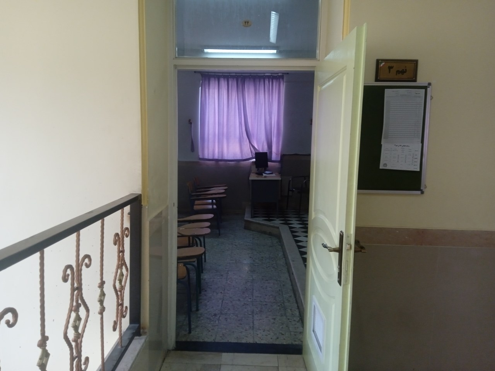</a>

Уменьшенное превью без обрезки; оригинал находится в архиве исходников.

Предоставленное имя файла: `1793739672985.jpg` · 4160×3120

SHA-256 исходника: `b458ba1d18fe26e1aea63935f5b2905c3179a131d767645507af87072c4dd0cf`

## school-42 · Референс класса

<a href="https://raw.githubusercontent.com/FarlandGame/Animation-Portfolio/main/history/phone-era/school/previews/school-42.jpg">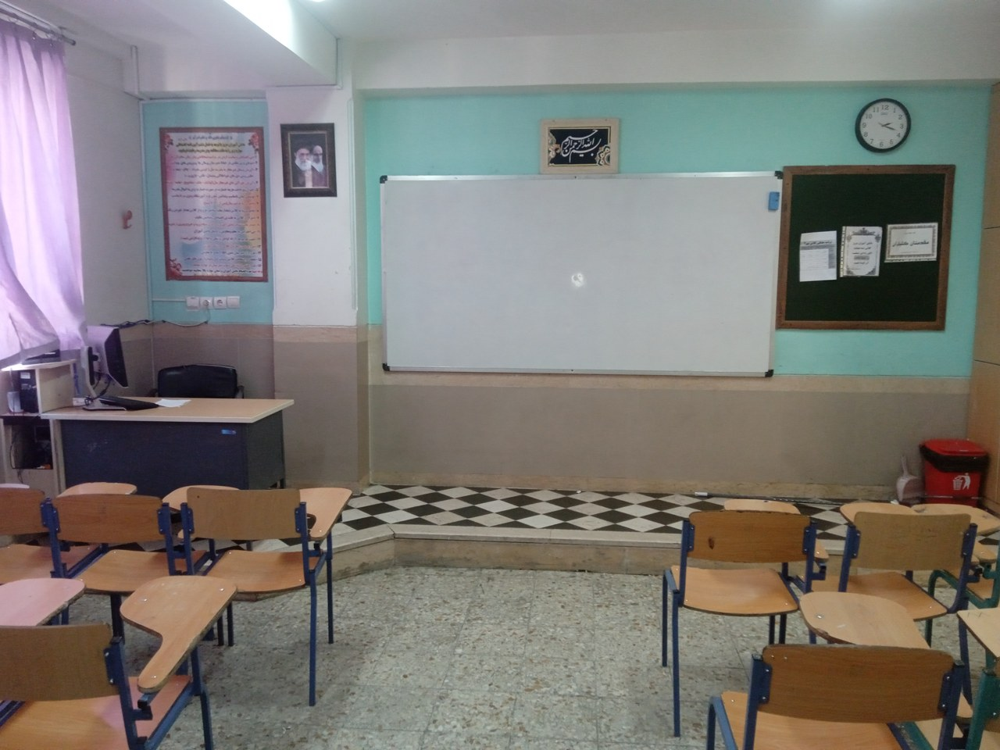</a>

Уменьшенное превью без обрезки; оригинал находится в архиве исходников.

Предоставленное имя файла: `1793739673008.jpg` · 4160×3120

SHA-256 исходника: `6516238fa1f7bffa5e7350c000c64c2423ae4ce7f7b6fd387b91947a13ab3d8a`

## school-43 · Референс коридора и дверного проёма

<a href="https://raw.githubusercontent.com/FarlandGame/Animation-Portfolio/main/history/phone-era/school/previews/school-43.jpg">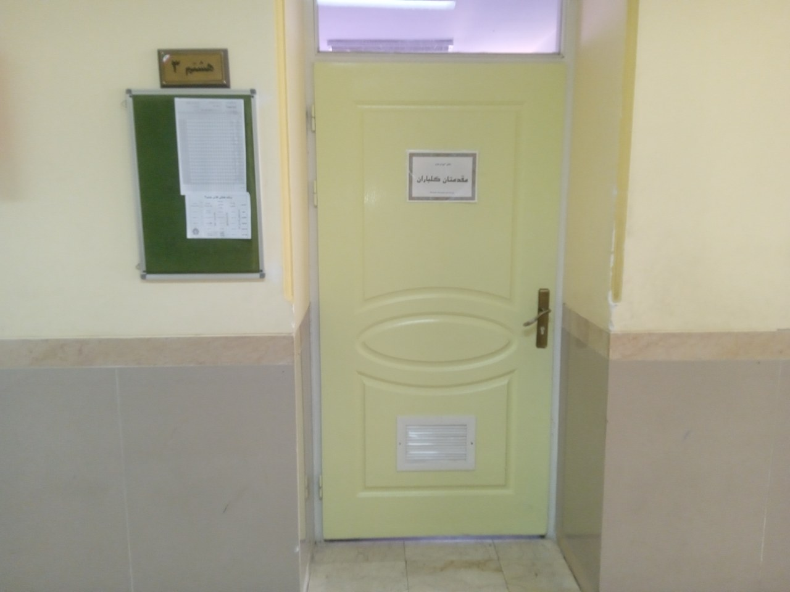</a>

Уменьшенное превью без обрезки; оригинал находится в архиве исходников.

Предоставленное имя файла: `1793739673031.jpg` · 4160×3120

SHA-256 исходника: `87fe643eb7ae18c8f6d3ea1c85d6376e8a92251029c5394f50cb30a3911530e4`

## school-44 · Референс коридора и дверного проёма

<a href="https://raw.githubusercontent.com/FarlandGame/Animation-Portfolio/main/history/phone-era/school/previews/school-44.jpg">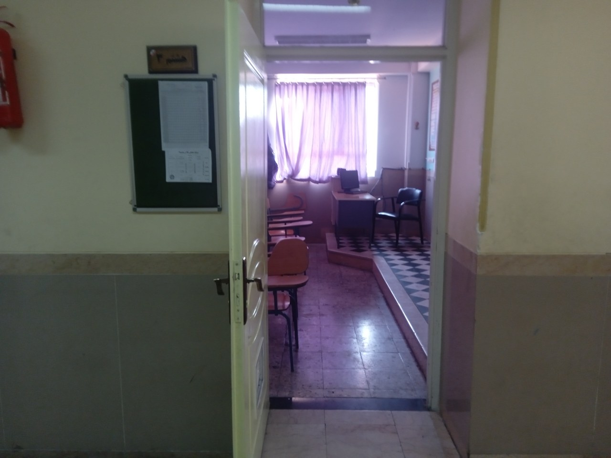</a>

Уменьшенное превью без обрезки; оригинал находится в архиве исходников.

Предоставленное имя файла: `1793739673056.jpg` · 4160×3120

SHA-256 исходника: `047e5a8d7c66a3d683f073b284276233b53cb1045396ac19386d76c7689879e3`

## school-45 · Референс класса

<a href="https://raw.githubusercontent.com/FarlandGame/Animation-Portfolio/main/history/phone-era/school/previews/school-45.jpg">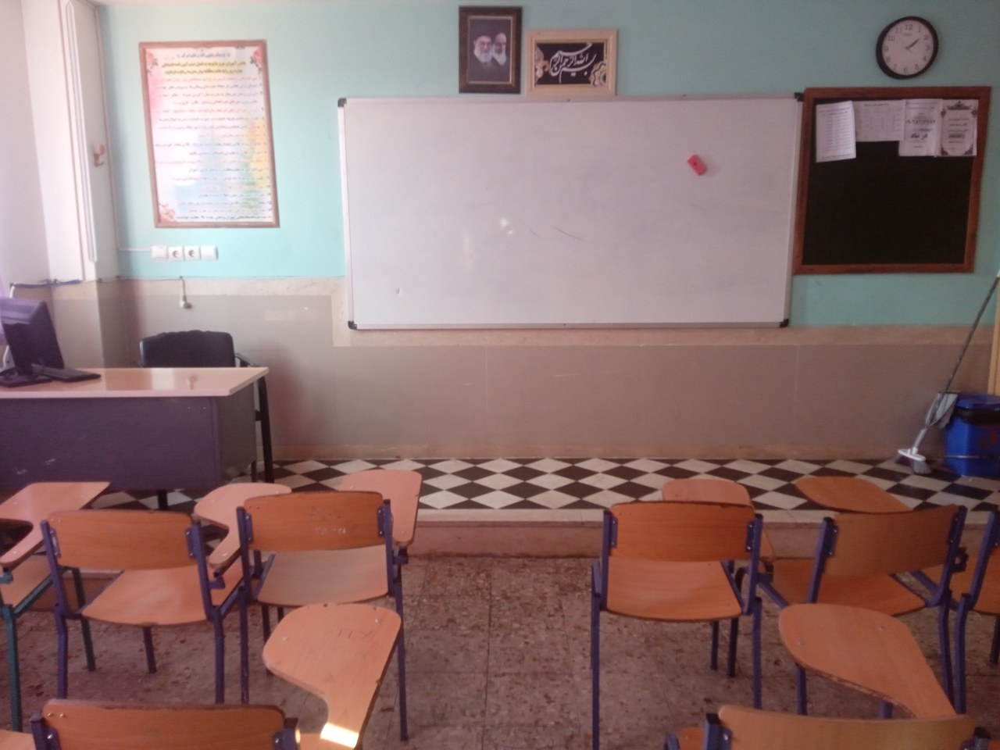</a>

Уменьшенное превью без обрезки; оригинал находится в архиве исходников.

Предоставленное имя файла: `1793739673077.jpg` · 4160×3120

SHA-256 исходника: `004171aa2b46fe330388771eb0cdd130a0847687909dd04a21608c9b4fcd77d5`

## school-46 · Референс класса

<a href="https://raw.githubusercontent.com/FarlandGame/Animation-Portfolio/main/history/phone-era/school/previews/school-46.jpg">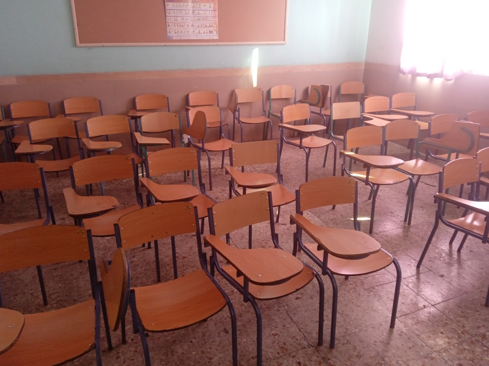</a>

Уменьшенное превью без обрезки; оригинал находится в архиве исходников.

Предоставленное имя файла: `1793739673104.jpg` · 4160×3120

SHA-256 исходника: `ff69104f435e825c24096e6a8cc2536f802e30333060a2c1305766383bd7b3aa`

[Открыть архив первых работ на телефоне](https://github.com/FarlandGame/Animation-Portfolio/blob/main/history/phone-era/ru/index.md)
