# 学校场景参考图库 · 图库页码 2

[English](https://github.com/FarlandGame/Animation-Portfolio/blob/main/history/phone-era/en/index.md) · [日本語](https://github.com/FarlandGame/Animation-Portfolio/blob/main/history/phone-era/ja/index.md) · [فارسی](https://github.com/FarlandGame/Animation-Portfolio/blob/main/history/phone-era/fa/index.md) · [Deutsch](https://github.com/FarlandGame/Animation-Portfolio/blob/main/history/phone-era/de/index.md) · [Français](https://github.com/FarlandGame/Animation-Portfolio/blob/main/history/phone-era/fr/index.md) · [Español](https://github.com/FarlandGame/Animation-Portfolio/blob/main/history/phone-era/es/index.md) · [Português (Brasil)](https://github.com/FarlandGame/Animation-Portfolio/blob/main/history/phone-era/pt-BR/index.md) · [Italiano](https://github.com/FarlandGame/Animation-Portfolio/blob/main/history/phone-era/it/index.md) · [Nederlands](https://github.com/FarlandGame/Animation-Portfolio/blob/main/history/phone-era/nl/index.md) · [Polski](https://github.com/FarlandGame/Animation-Portfolio/blob/main/history/phone-era/pl/index.md) · [Українська](https://github.com/FarlandGame/Animation-Portfolio/blob/main/history/phone-era/uk/index.md) · [Türkçe](https://github.com/FarlandGame/Animation-Portfolio/blob/main/history/phone-era/tr/index.md) · [Русский](https://github.com/FarlandGame/Animation-Portfolio/blob/main/history/phone-era/ru/index.md) · [简体中文](https://github.com/FarlandGame/Animation-Portfolio/blob/main/history/phone-era/zh-CN/index.md) · [繁體中文](https://github.com/FarlandGame/Animation-Portfolio/blob/main/history/phone-era/zh-TW/index.md) · [한국어](https://github.com/FarlandGame/Animation-Portfolio/blob/main/history/phone-era/ko/index.md) · [हिन्दी](https://github.com/FarlandGame/Animation-Portfolio/blob/main/history/phone-era/hi/index.md) · [Bahasa Indonesia](https://github.com/FarlandGame/Animation-Portfolio/blob/main/history/phone-era/id/index.md)

这 46 张照片是我为未完成的第二部校园逃脱故事拍摄的真实学校场景参考。按我的辨认，照片中的地点是马拉盖的 Farhang Shahid Parkar 学校。我在一次到访中拍摄了这些地点；这些图片用于规划背景，并非完成的动画画面。原始文件集中在一个素材包中提供，图库则展示尺寸较小、保留完整画面的预览。

这些照片参考资料没有排序，编号不表示时间先后或质量高低。

[图库页码 1](https://github.com/FarlandGame/Animation-Portfolio/blob/main/history/phone-era/zh-CN/school-01.md) · [图库页码 2](https://github.com/FarlandGame/Animation-Portfolio/blob/main/history/phone-era/zh-CN/school-02.md) · [图库页码 3](https://github.com/FarlandGame/Animation-Portfolio/blob/main/history/phone-era/zh-CN/school-03.md)

[下载全部 46 张学校照片原图](https://github.com/FarlandGame/Animation-Portfolio/releases/download/phone-era-archive/school-reference-originals.zip)

## school-17 · 走廊与门口参考

<a href="https://raw.githubusercontent.com/FarlandGame/Animation-Portfolio/main/history/phone-era/school/previews/school-17.jpg">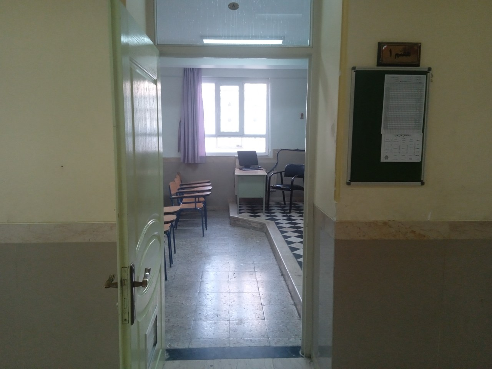</a>

保留完整画面的缩小预览；原图位于素材包中。

所提供的文件名: `1793739672408.jpg` · 4160×3120

源文件 SHA-256: `99d0f65424d616aecb73b2abbf6a5500f2d980fdd0f8ce6b4b0aac91bae4602d`

## school-18 · 教室参考

保留完整画面的缩小预览；原图位于素材包中。

所提供的文件名: `1793739672446.jpg` · 4160×3120

源文件 SHA-256: `5a4938739ef4460a8e585ec7752179befa46eab280685b024968fefd5e3a8367`

## school-19 · 教室参考

<a href="https://raw.githubusercontent.com/FarlandGame/Animation-Portfolio/main/history/phone-era/school/previews/school-19.jpg">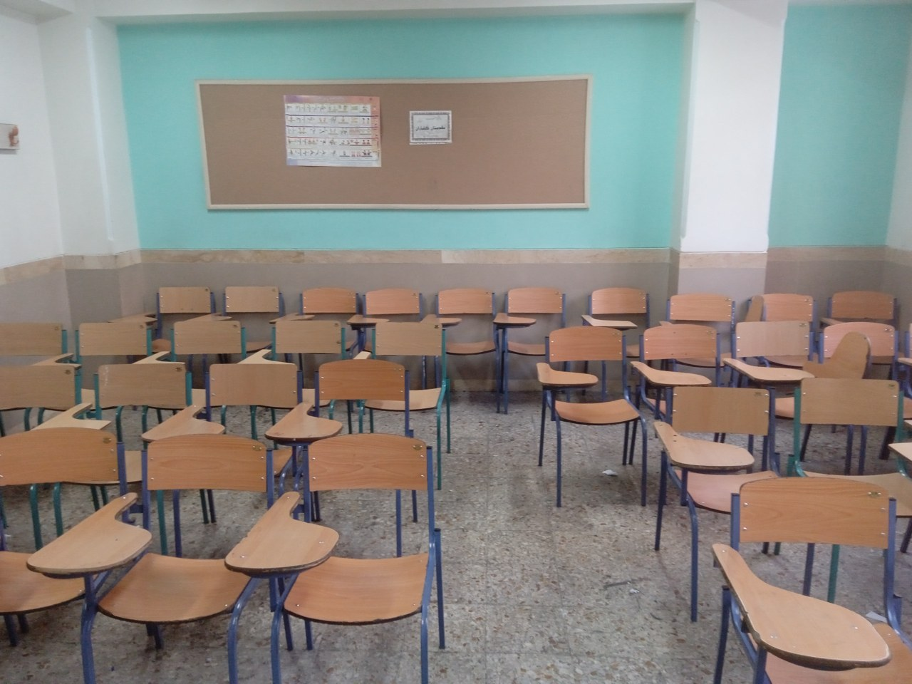</a>

保留完整画面的缩小预览；原图位于素材包中。

所提供的文件名: `1793739672477.jpg` · 4160×3120

源文件 SHA-256: `4d1e8b19de6c9a505c5c59d0a0959afd3ba3d61f53d6cca509ae301be4f50c7a`

## school-20 · 走廊与门口参考

<a href="https://raw.githubusercontent.com/FarlandGame/Animation-Portfolio/main/history/phone-era/school/previews/school-20.jpg">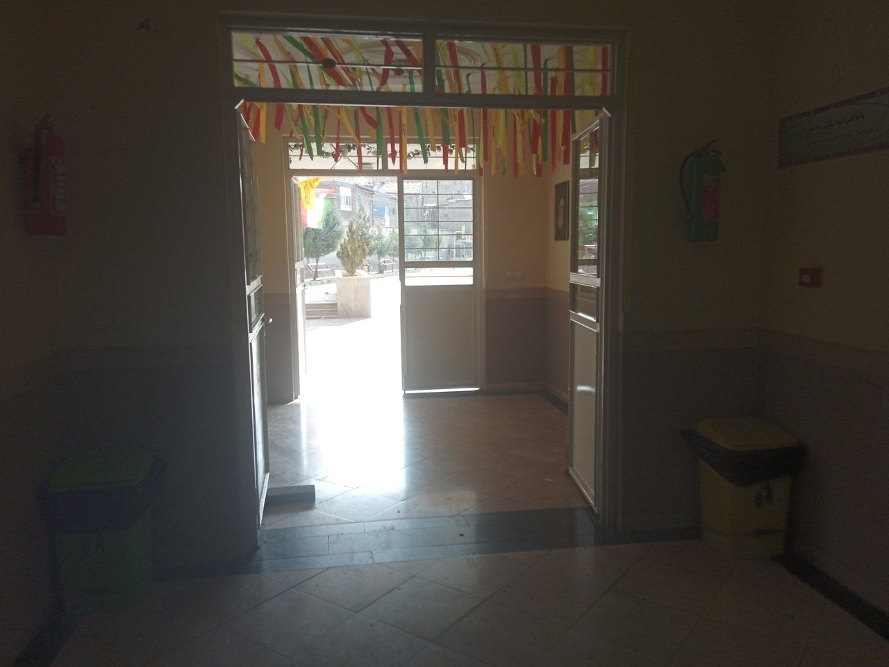</a>

保留完整画面的缩小预览；原图位于素材包中。

所提供的文件名: `1793739672502.jpg` · 4160×3120

源文件 SHA-256: `104bcb4c9c5be19ad65ff834e8ee11a5ad81c76ce5f98668d7de2757768778b8`

## school-21 · 楼梯间参考

<a href="https://raw.githubusercontent.com/FarlandGame/Animation-Portfolio/main/history/phone-era/school/previews/school-21.jpg">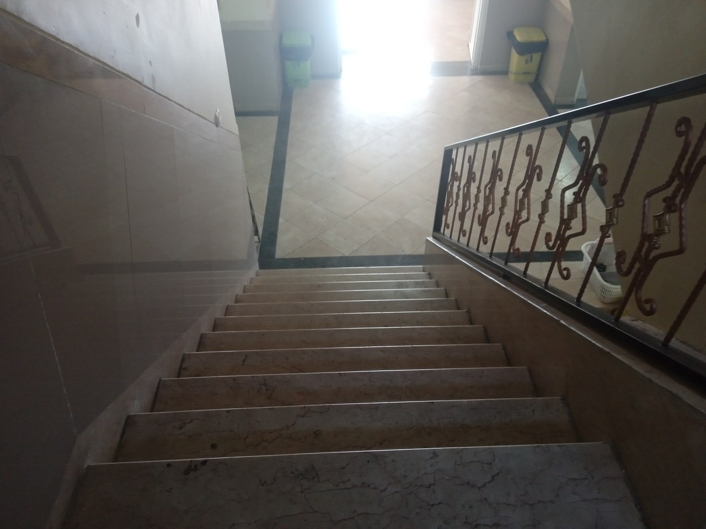</a>

保留完整画面的缩小预览；原图位于素材包中。

所提供的文件名: `1793739672528.jpg` · 4160×3120

源文件 SHA-256: `b2351cb663d1a1115c78178a942be6774d331e311cbbfbde0b06f3134a23a0ec`

## school-22 · 楼梯间参考

<a href="https://raw.githubusercontent.com/FarlandGame/Animation-Portfolio/main/history/phone-era/school/previews/school-22.jpg">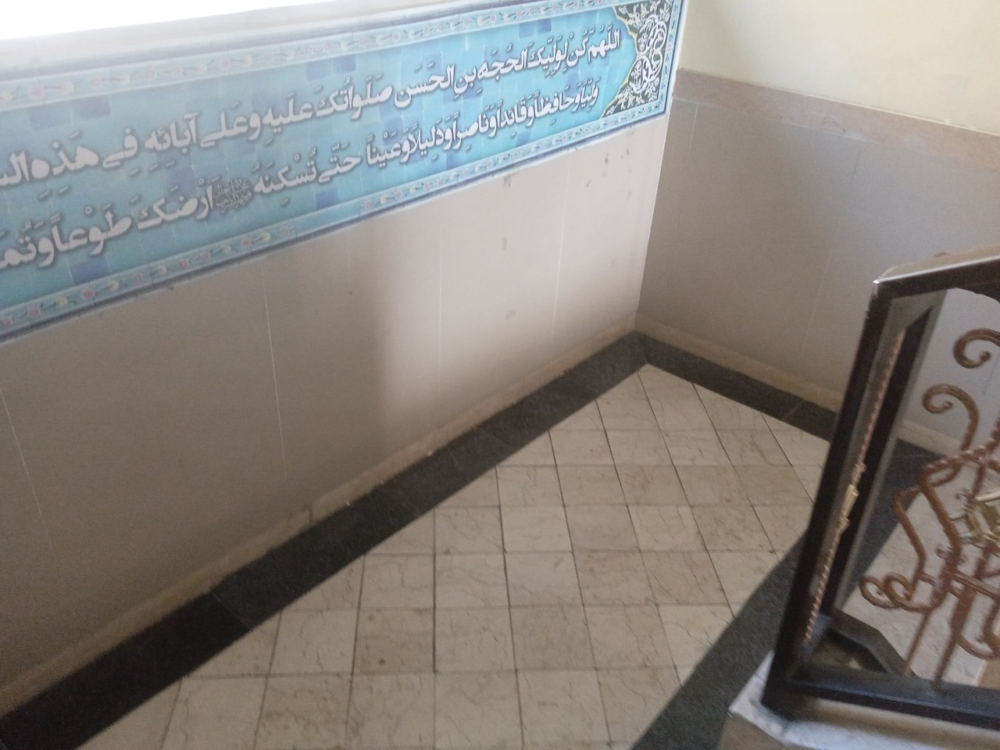</a>

保留完整画面的缩小预览；原图位于素材包中。

所提供的文件名: `1793739672550.jpg` · 4160×3120

源文件 SHA-256: `51b4dfda33ac4cbe87aec74acc466e30c73a698e7690c983644db088656319ec`

## school-23 · 楼梯间参考

<a href="https://raw.githubusercontent.com/FarlandGame/Animation-Portfolio/main/history/phone-era/school/previews/school-23.jpg">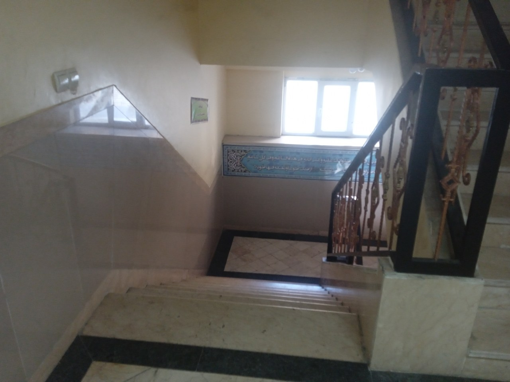</a>

保留完整画面的缩小预览；原图位于素材包中。

所提供的文件名: `1793739672572.jpg` · 4160×3120

源文件 SHA-256: `c750414214441822c841df74409c79d33ec3aa0809e1e7ffef13a3535dba0817`

## school-24 · 走廊与门口参考

<a href="https://raw.githubusercontent.com/FarlandGame/Animation-Portfolio/main/history/phone-era/school/previews/school-24.jpg">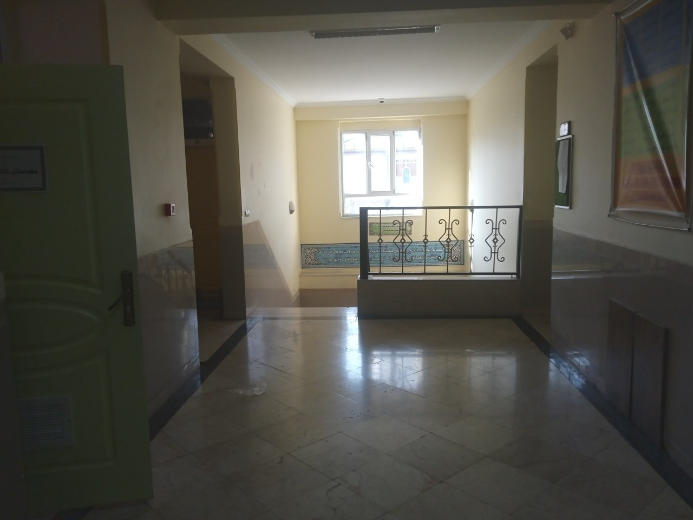</a>

保留完整画面的缩小预览；原图位于素材包中。

所提供的文件名: `1793739672596.jpg` · 4160×3120

源文件 SHA-256: `97dea0f1588451a44c911635985cbb443e97178e297a6d90af063b99c657c51b`

## school-25 · 走廊与门口参考

<a href="https://raw.githubusercontent.com/FarlandGame/Animation-Portfolio/main/history/phone-era/school/previews/school-25.jpg">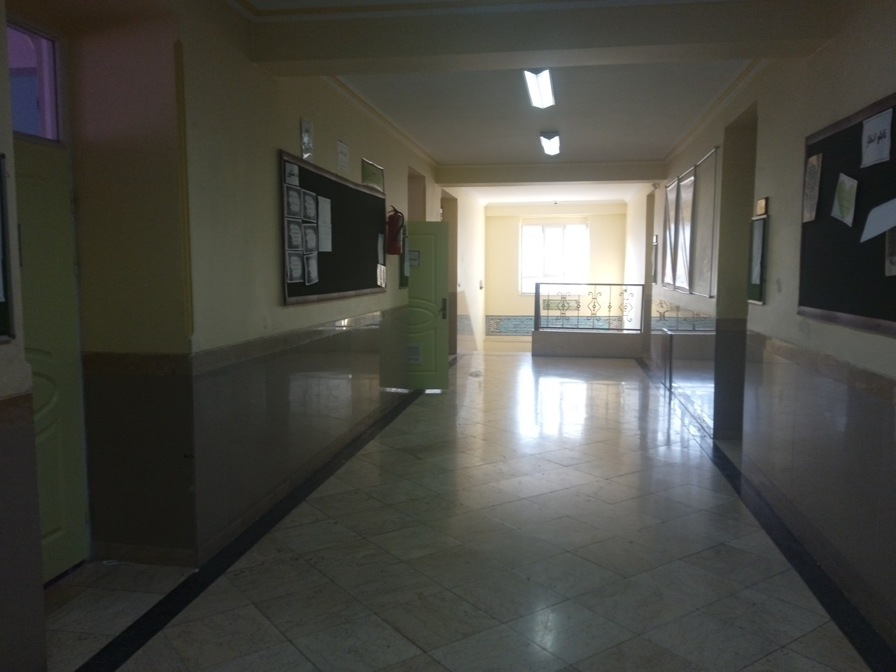</a>

保留完整画面的缩小预览；原图位于素材包中。

所提供的文件名: `1793739672620.jpg` · 4160×3120

源文件 SHA-256: `0a73731a149e0e5f3676aa86d8fdf24a29ee4897c308d0295ebb22bb9693a416`

## school-26 · 走廊与门口参考

<a href="https://raw.githubusercontent.com/FarlandGame/Animation-Portfolio/main/history/phone-era/school/previews/school-26.jpg">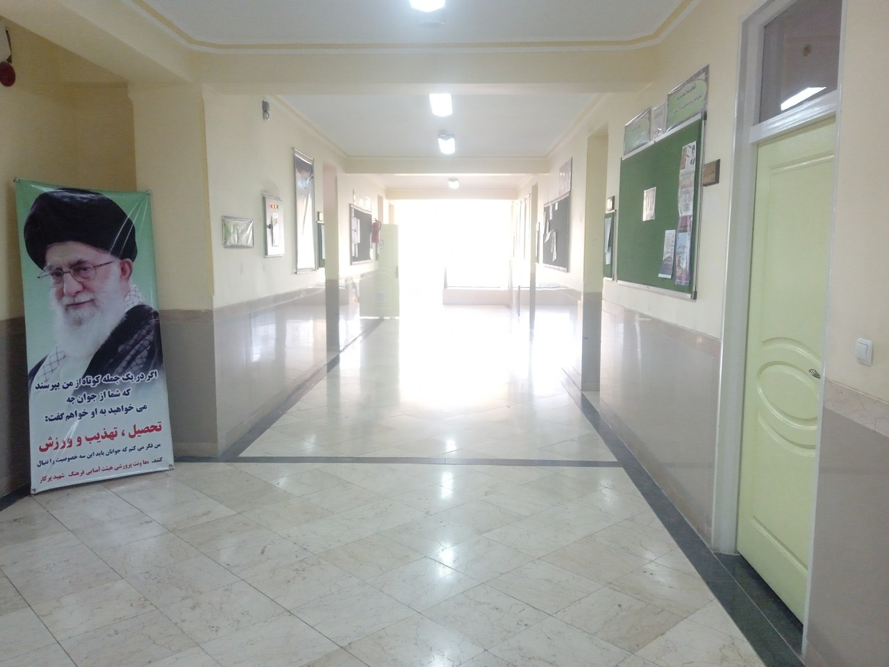</a>

保留完整画面的缩小预览；原图位于素材包中。

所提供的文件名: `1793739672647.jpg` · 4160×3120

源文件 SHA-256: `a9e1c2a9026d1c59e39cad2cc66003be9a72da781ec74eff9466f72e8b4fed44`

## school-27 · 走廊与门口参考

<a href="https://raw.githubusercontent.com/FarlandGame/Animation-Portfolio/main/history/phone-era/school/previews/school-27.jpg">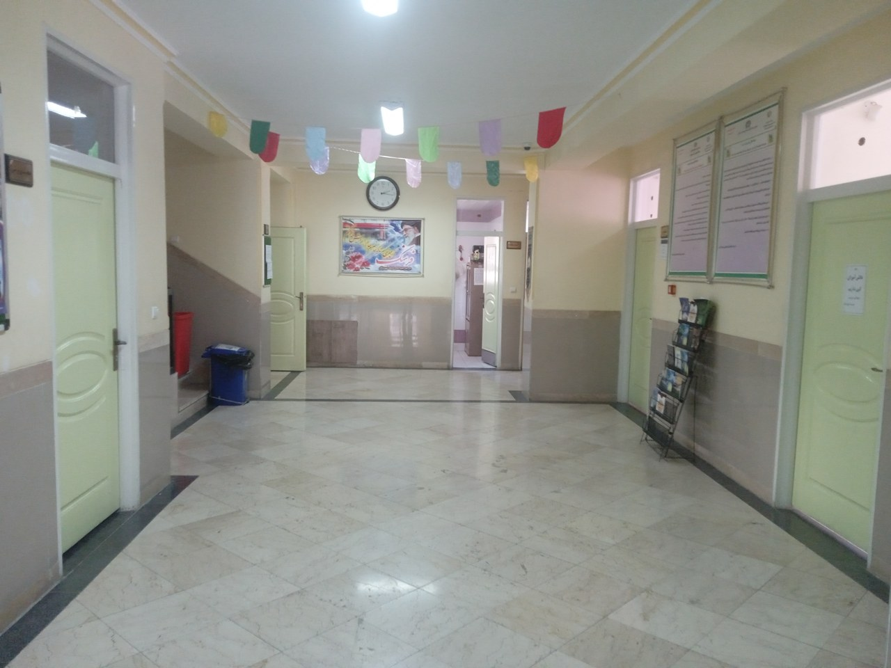</a>

保留完整画面的缩小预览；原图位于素材包中。

所提供的文件名: `1793739672670.jpg` · 4160×3120

源文件 SHA-256: `3455e62113420ac01ddcbc9e3d5405c9c16f7544ce211a62d8b4c5468a3e0e70`

## school-28 · 走廊与门口参考

<a href="https://raw.githubusercontent.com/FarlandGame/Animation-Portfolio/main/history/phone-era/school/previews/school-28.jpg">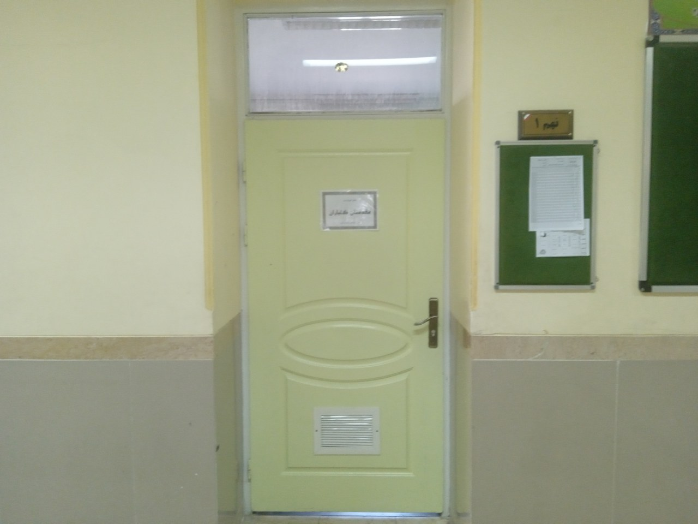</a>

保留完整画面的缩小预览；原图位于素材包中。

所提供的文件名: `1793739672693.jpg` · 4160×3120

源文件 SHA-256: `d8764949ccb02295dcf7078cc302eccfcb6b8ea6805e1bd764aa2bab5314f457`

## school-29 · 走廊与门口参考

<a href="https://raw.githubusercontent.com/FarlandGame/Animation-Portfolio/main/history/phone-era/school/previews/school-29.jpg">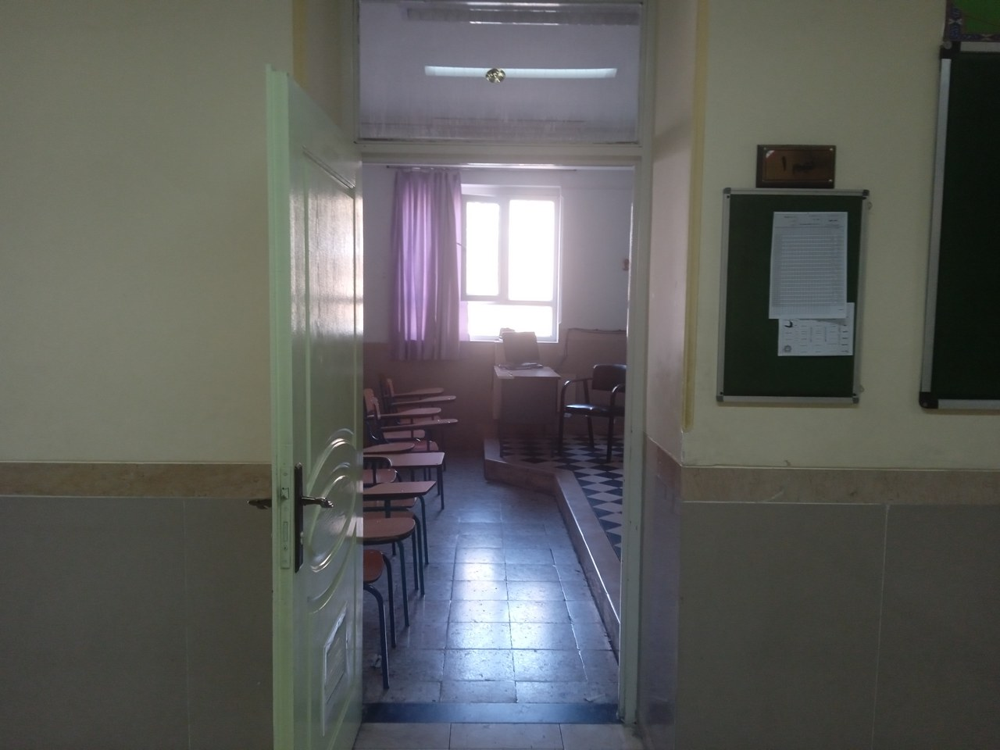</a>

保留完整画面的缩小预览；原图位于素材包中。

所提供的文件名: `1793739672716.jpg` · 4160×3120

源文件 SHA-256: `2e57327ed663111742886dafa8d45ce9c91c47605c750c5d97c51b43ef6ac6c7`

## school-30 · 教室参考

<a href="https://raw.githubusercontent.com/FarlandGame/Animation-Portfolio/main/history/phone-era/school/previews/school-30.jpg">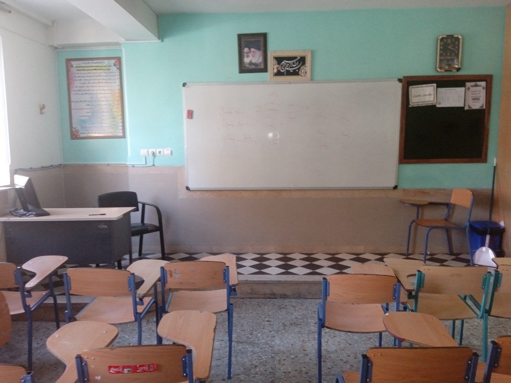</a>

保留完整画面的缩小预览；原图位于素材包中。

所提供的文件名: `1793739672737.jpg` · 4160×3120

源文件 SHA-256: `4f2d9e55465be771ab7b49dfb233165ec2e23dde8cc3c0b717fff3c213a5d545`

## school-31 · 教室参考

<a href="https://raw.githubusercontent.com/FarlandGame/Animation-Portfolio/main/history/phone-era/school/previews/school-31.jpg">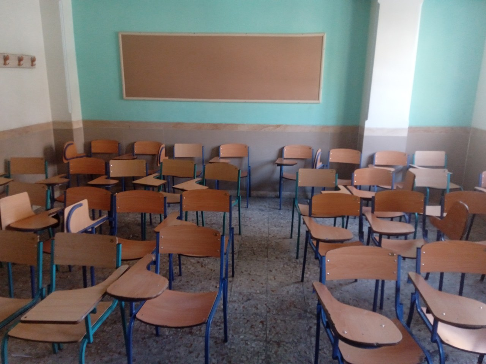</a>

保留完整画面的缩小预览；原图位于素材包中。

所提供的文件名: `1793739672759.jpg` · 4160×3120

源文件 SHA-256: `a7bf3d19edc94a8b2d6080fd030474cfde348875d9b9abed3b4dffd9970cd2cf`

## school-32 · 走廊与门口参考

<a href="https://raw.githubusercontent.com/FarlandGame/Animation-Portfolio/main/history/phone-era/school/previews/school-32.jpg">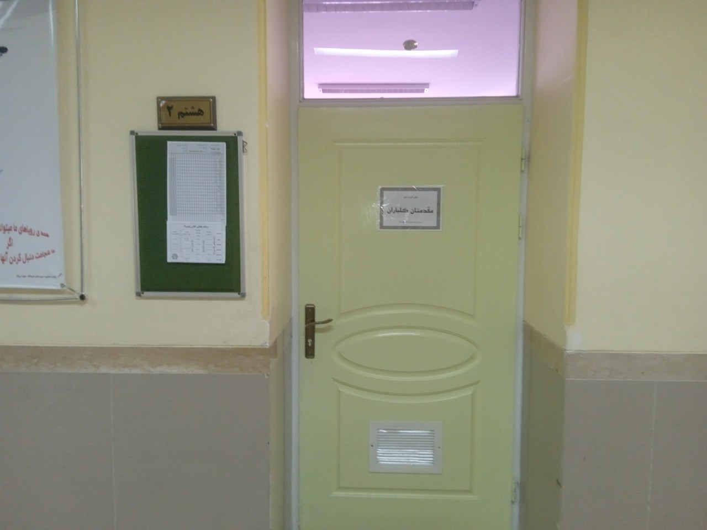</a>

保留完整画面的缩小预览；原图位于素材包中。

所提供的文件名: `1793739672782.jpg` · 4160×3120

源文件 SHA-256: `fbd47da093e41f3322b8fdbbe1b96adc16b8180fa310458e552c10210e9a0836`

[打开早期手机创作档案](https://github.com/FarlandGame/Animation-Portfolio/blob/main/history/phone-era/zh-CN/index.md)
