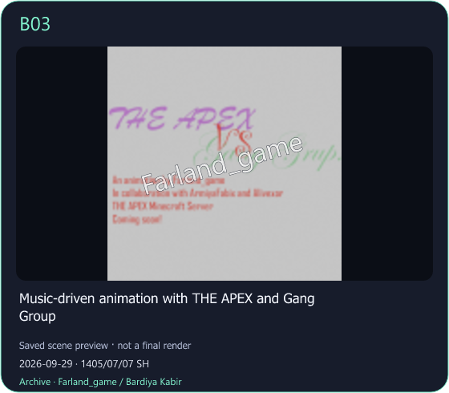

# B03 · Music-driven animation with THE APEX and Gang Group
[English](https://github.com/FarlandGame/Animation-Portfolio/blob/main/sources/blender/en/B03.md) · [فارسی](https://github.com/FarlandGame/Animation-Portfolio/blob/main/sources/blender/fa/B03.md) · [日本語](https://github.com/FarlandGame/Animation-Portfolio/blob/main/sources/blender/ja/B03.md) · [Русский](https://github.com/FarlandGame/Animation-Portfolio/blob/main/sources/blender/ru/B03.md)

## Creator’s account

One of Bardiya’s more recent animations, combining music with appearances by the THE APEX team and Gang Group.

**Supplied file last modified:** 2026-09-29 · 1405/07/07 SH

Dates describe the supplied file’s last modification in Tehran time. They do not establish the original creation date or completion date.

**Supplied filename:** `untitled.blend`

**Original saved-file version:** 4.3

### [Download prepared source archive · ZIP · 24.6 MB](https://github.com/FarlandGame/Animation-Portfolio/releases/download/blender-source-archive-2026-11/B03-blender-source-snapshot.zip)

Public-copy format: Blender 5.2. Older-version compatibility and full final rendering are not guaranteed.

These are separately prepared copies. Original source files on the creator’s computer were not changed. Available file textures were packaged; unfinished work, missing resources and removed third-party motions are explicitly retained as limitations.

`SHA-256: 087631e407a9c996dda1d884d2cc1f0eed465a58c203ff3c748d8ea28c71672c`

## Resources and public-copy changes

**Missing image references:** None reported by this inspection

**Identifiable Mixamo actions removed:** `SimplePlayer.arma|mixamo.com|Layer0`

**Music omitted from this copy:** `ESPECTRO_Ultra_Slowed_DJ_Alex_MC_LOCKED_Dean_Kappert_Aleksa.m4a`

**Retained audio:** None reported by this inspection

External font names: 8

`AGENCYB.TTF`, `BRUSHSCI.TTF`, `BRUSHSCI.TTF`, `BRUSHSCI.TTF`, `CURLZ___.TTF`, `ITCEDSCR.TTF`, `ITCEDSCR.TTF`, `ITCEDSCR.TTF`

### Retained previous save

A previous save is preserved in the archive’s versions folder. It is not automatically an independent project. Hashes and supplied-file dates are included inside the download.

Keep the original credit: **Bardiya Alizadeh (Kabir / Farland_game)**. Eligible original contributions use **CC BY-NC 4.0**: noncommercial reuse, a license link and an indication of changes are required. Credit your own additions separately. Third-party resources keep their own terms.

[How to open, continue and give credit](https://github.com/FarlandGame/Animation-Portfolio/blob/main/sources/blender/en/guide.md) · [Third-party credits](https://github.com/FarlandGame/Animation-Portfolio/blob/main/sources/blender/THIRD-PARTY.md) · [All source entries](https://github.com/FarlandGame/Animation-Portfolio/blob/main/sources/blender/en/index.md)
