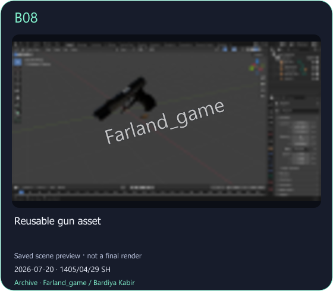

# B08 · Reusable gun asset
[English](https://github.com/FarlandGame/Animation-Portfolio/blob/main/sources/blender/en/B08.md) · [فارسی](https://github.com/FarlandGame/Animation-Portfolio/blob/main/sources/blender/fa/B08.md) · [日本語](https://github.com/FarlandGame/Animation-Portfolio/blob/main/sources/blender/ja/B08.md) · [Русский](https://github.com/FarlandGame/Animation-Portfolio/blob/main/sources/blender/ru/B08.md)

## Creator’s account

A gun-model file kept for repeated use in animations, avoiding the need to download it again each time.

**Supplied file last modified:** 2026-07-20 · 1405/04/29 SH

Dates describe the supplied file’s last modification in Tehran time. They do not establish the original creation date or completion date.

**Supplied filename:** `untitled.blend`

**Original saved-file version:** 4.3

## Preview / provider reference only

A downloaded gun prop, not an original model claim. Its standalone redistribution license has not been identified, so this entry offers a preview rather than a model ZIP.

Keep the original credit: **Bardiya Alizadeh (Kabir / Farland_game)**. Eligible original contributions use **CC BY-NC 4.0**: noncommercial reuse, a license link and an indication of changes are required. Credit your own additions separately. Third-party resources keep their own terms.

[How to open, continue and give credit](https://github.com/FarlandGame/Animation-Portfolio/blob/main/sources/blender/en/guide.md) · [Third-party credits](https://github.com/FarlandGame/Animation-Portfolio/blob/main/sources/blender/THIRD-PARTY.md) · [All source entries](https://github.com/FarlandGame/Animation-Portfolio/blob/main/sources/blender/en/index.md)
