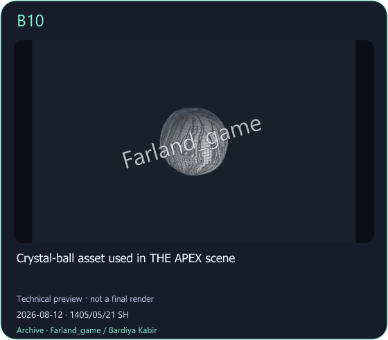

# B10 · Crystal-ball asset used in THE APEX scene
[English](https://github.com/FarlandGame/Animation-Portfolio/blob/main/sources/blender/en/B10.md) · [فارسی](https://github.com/FarlandGame/Animation-Portfolio/blob/main/sources/blender/fa/B10.md) · [日本語](https://github.com/FarlandGame/Animation-Portfolio/blob/main/sources/blender/ja/B10.md) · [Русский](https://github.com/FarlandGame/Animation-Portfolio/blob/main/sources/blender/ru/B10.md)

## Creator’s account

The orb asset used in the THE APEX server-entry image in project B11.

**Supplied file last modified:** 2026-08-12 · 1405/05/21 SH

Dates describe the supplied file’s last modification in Tehran time. They do not establish the original creation date or completion date.

**Supplied filename:** `crystal-ball-with-roots-and-vegetation_2K_f5c5d7ac-356d-4af3-94b9-7a3ccb0ba10a.blend`

**Original saved-file version:** 4.5

## Preview / provider reference only

Third-party model by **Dennis Hafemann**, obtained through Blendkit. Embedded asset identifiers match the original provider. Obtain the model from its creator under its own royalty-free terms.

[Crystal Ball With Roots And Vegetation · Dennis Hafemann](https://www.blendkit.com/asset-gallery-detail/982768a1-12a9-4783-93c6-771bb34691d9/)

Keep the original credit: **Bardiya Alizadeh (Kabir / Farland_game)**. Eligible original contributions use **CC BY-NC 4.0**: noncommercial reuse, a license link and an indication of changes are required. Credit your own additions separately. Third-party resources keep their own terms.

[How to open, continue and give credit](https://github.com/FarlandGame/Animation-Portfolio/blob/main/sources/blender/en/guide.md) · [Third-party credits](https://github.com/FarlandGame/Animation-Portfolio/blob/main/sources/blender/THIRD-PARTY.md) · [All source entries](https://github.com/FarlandGame/Animation-Portfolio/blob/main/sources/blender/en/index.md)
