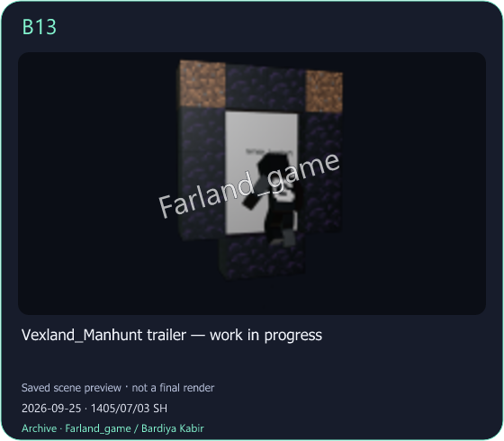

# B13 · Vexland_Manhunt trailer — work in progress
[English](https://github.com/FarlandGame/Animation-Portfolio/blob/main/sources/blender/en/B13.md) · [فارسی](https://github.com/FarlandGame/Animation-Portfolio/blob/main/sources/blender/fa/B13.md) · [日本語](https://github.com/FarlandGame/Animation-Portfolio/blob/main/sources/blender/ja/B13.md)

## Creator’s account

An animated trailer for the Vexland_Manhunt plugin, originally intended to be long. Bardiya paused it after making part of the trailer and considering music-copyright concerns, but is continuing work and intends to finish it. He has authorized sharing the current work-in-progress version.

**Supplied file last modified:** 2026-09-25 · 1405/07/03 SH

Dates describe the supplied file’s last modification in Tehran time. They do not establish the original creation date or completion date.

**Supplied filename:** `Part_1.blend`

**Original saved-file version:** 5.2

### [Download prepared source archive · RAR · 72.9 MB](https://github.com/FarlandGame/Animation-Portfolio/releases/download/blender-source-archive-2026-11/B13-blender-source-snapshot.rar)

Public-copy format: Blender 5.2. Older-version compatibility and full final rendering are not guaranteed.

These are separately prepared copies. Original source files on the creator’s computer were not changed. Available file textures were packaged; unfinished work, missing resources and removed third-party motions are explicitly retained as limitations.

`SHA-256: a257e5fe68be046f3540b58cbc88d3fe4cd61cbda5df43b78a9d3f8a9ab5dc5e`

## Resources and public-copy changes

**Missing image references:** None reported by this inspection

Identifiable Mixamo actions removed: 15

`SimplePlayer.arma.001|mixamo.com|Layer0.001`, `SimplePlayer.arma.001|mixamo.com|Layer0.002`, `SimplePlayer.arma.002|mixamo.com|Layer0`, `SimplePlayer.arma.003|mixamo.com|Layer0`, `SimplePlayer.arma.004|mixamo.com|Layer0.002`, `SimplePlayer.arma|mixamo.com|Layer0`, `SimplePlayer.arma|mixamo.com|Layer0.001`, `SimplePlayer.arma|mixamo.com|Layer0.002`, `SimplePlayer.arma|mixamo.com|Layer0.003`, `SimplePlayer.arma|mixamo.com|Layer0.004`, `SimplePlayer.arma|mixamo.com|Layer0.005`, `SimplePlayer.arma|mixamo.com|Layer0.006`, `SimplePlayer.arma|mixamo.com|Layer0.007`, `SimplePlayer.arma|mixamo.com|Layer0.008`, `SimplePlayer.arma|mixamo.com|Layer0.009`

**Music omitted from this copy:** None reported by this inspection

**Retained audio:** `LIKE YOU~   ANATHEMA-000.mp3`

External font names: 47

`Minecraft.ttf`, `Minecraft.ttf`, `Minecraft.ttf`, `Minecraft.ttf`, `Minecraft.ttf`, `Minecraft.ttf`, `Minecraft.ttf`, `Minecraft.ttf`, `Minecraft.ttf`, `Minecraft.ttf`, `Minecraft.ttf`, `Minecraft.ttf`, `Minecraft.ttf`, `Minecraft.ttf`, `Minecraft.ttf`, `Minecraft.ttf`, `Minecraft.ttf`, `Minecraft.ttf`, `Minecraft.ttf`, `Minecraft.ttf`, `Minecraft.ttf`, `Minecraft.ttf`, `Minecraft.ttf`, `Minecraft.ttf`, `Minecraft.ttf`, `Minecraft.ttf`, `Minecraft.ttf`, `Minecraft.ttf`, `Minecraft.ttf`, `Minecraft.ttf`, `Minecraft.ttf`, `Minecraft.ttf`, `Minecraft.ttf`, `Minecraft.ttf`, `Minecraft.ttf`, `Minecraft.ttf`, `Minecraft.ttf`, `Minecraft.ttf`, `Minecraft.ttf`, `Minecraft.ttf`, `Minecraft.ttf`, `Minecraft.ttf`, `Minecraft.ttf`, `Minecraft.ttf`, `Minecraft.ttf`, `Minecraft.ttf`, `Minecraft.ttf`

### Retained previous save

A previous save is preserved in the archive’s versions folder. It is not automatically an independent project. Hashes and supplied-file dates are included inside the download.

Keep the original credit: **Bardiya Alizadeh (Kabir / Farland_game)**. Eligible original contributions use **CC BY-NC 4.0**: noncommercial reuse, a license link and an indication of changes are required. Credit your own additions separately. Third-party resources keep their own terms.

[How to open, continue and give credit](https://github.com/FarlandGame/Animation-Portfolio/blob/main/sources/blender/en/guide.md) · [Third-party credits](https://github.com/FarlandGame/Animation-Portfolio/blob/main/sources/blender/THIRD-PARTY.md) · [All source entries](https://github.com/FarlandGame/Animation-Portfolio/blob/main/sources/blender/en/index.md)
