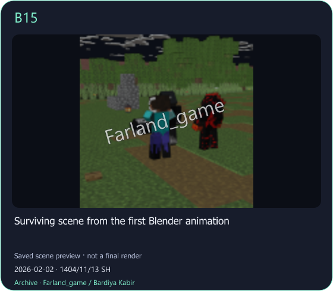

# B15 · Surviving scene from the first Blender animation
[English](https://github.com/FarlandGame/Animation-Portfolio/blob/main/sources/blender/en/B15.md) · [فارسی](https://github.com/FarlandGame/Animation-Portfolio/blob/main/sources/blender/fa/B15.md) · [日本語](https://github.com/FarlandGame/Animation-Portfolio/blob/main/sources/blender/ja/B15.md) · [Русский](https://github.com/FarlandGame/Animation-Portfolio/blob/main/sources/blender/ru/B15.md)

## Creator’s account

This is one of the two surviving files from Bardiya’s first animation made with Blender. The project originally used four Blender files for different scenes; the other two have been lost. These retained files show how he built that early project.

**Supplied file last modified:** 2026-02-02 · 1404/11/13 SH

Dates describe the supplied file’s last modification in Tehran time. They do not establish the original creation date or completion date.

**Supplied filename:** `opening 2.blend`

**Original saved-file version:** 4.3

### [Download prepared source archive · ZIP · 17.0 MB](https://github.com/FarlandGame/Animation-Portfolio/releases/download/blender-source-archive-2026-11/B15-blender-source-snapshot.zip)

Public-copy format: Blender 5.2. Older-version compatibility and full final rendering are not guaranteed.

These are separately prepared copies. Original source files on the creator’s computer were not changed. Available file textures were packaged; unfinished work, missing resources and removed third-party motions are explicitly retained as limitations.

`SHA-256: f0315ea11ed4c4ae74c68cd620d0ccbb687b8e9cd9dae4476dc0ec140d0c6482`

## Resources and public-copy changes

**Missing image references:** `Amir.jpg`, `Super Null.png`, `Super Null.png.003`

**Identifiable Mixamo actions removed:** None reported by this inspection

**Music omitted from this copy:** `WE ARE FURY  'ETERNAL'.mp3`

**Retained audio:** None reported by this inspection

**External font names:** None reported by this inspection

### Retained previous save

A previous save is preserved in the archive’s versions folder. It is not automatically an independent project. Hashes and supplied-file dates are included inside the download.

**Related files:** [B16](https://github.com/FarlandGame/Animation-Portfolio/blob/main/sources/blender/en/B16.md)

Keep the original credit: **Bardiya Alizadeh (Kabir / Farland_game)**. Eligible original contributions use **CC BY-NC 4.0**: noncommercial reuse, a license link and an indication of changes are required. Credit your own additions separately. Third-party resources keep their own terms.

[How to open, continue and give credit](https://github.com/FarlandGame/Animation-Portfolio/blob/main/sources/blender/en/guide.md) · [Third-party credits](https://github.com/FarlandGame/Animation-Portfolio/blob/main/sources/blender/THIRD-PARTY.md) · [All source entries](https://github.com/FarlandGame/Animation-Portfolio/blob/main/sources/blender/en/index.md)
