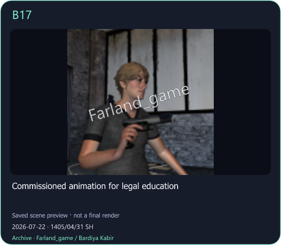

# B17 · Commissioned animation for legal education
[English](https://github.com/FarlandGame/Animation-Portfolio/blob/main/sources/blender/en/B17.md) · [فارسی](https://github.com/FarlandGame/Animation-Portfolio/blob/main/sources/blender/fa/B17.md) · [日本語](https://github.com/FarlandGame/Animation-Portfolio/blob/main/sources/blender/ja/B17.md)

## Creator’s account

A paid animation commission illustrating a scenario for a law lesson, made for one of the professors of Bardiya’s mother, who is a lawyer. A character intends to shoot someone in front of him, but a trembling hand causes the shot to go to the right. Bardiya animated the scenario for teaching.

**Supplied file last modified:** 2026-07-22 · 1405/04/31 SH

Dates describe the supplied file’s last modification in Tehran time. They do not establish the original creation date or completion date.

**Supplied filename:** `untitled.blend`

**Original saved-file version:** 4.3

### Download prepared source archive · RAR × 3 · 275.8 MB

Download **all three volumes** to the same folder, then extract **part1.rar**. These are parts of one complete package, not separate projects.

[B17-blender-source-snapshot.part1.rar · 104.9 MB](https://github.com/FarlandGame/Animation-Portfolio/releases/download/blender-source-archive-2026-11/B17-blender-source-snapshot.part1.rar)

`SHA-256: e6060bdb5592d2ff7cf276bc44ba98a5453dc636948cdacc0e4e6eb376ed4932`

[B17-blender-source-snapshot.part2.rar · 104.9 MB](https://github.com/FarlandGame/Animation-Portfolio/releases/download/blender-source-archive-2026-11/B17-blender-source-snapshot.part2.rar)

`SHA-256: 53b08abbb30fc42e1be58310b618f3c7e9f7e2d95d17f21f321b3ae718739890`

[B17-blender-source-snapshot.part3.rar · 66.0 MB](https://github.com/FarlandGame/Animation-Portfolio/releases/download/blender-source-archive-2026-11/B17-blender-source-snapshot.part3.rar)

`SHA-256: 0b8a6c875cd0de09cbef6ecf8f5eb24ea6ff17c5bcb6c42511c3333cadb41789`

Public-copy format: Blender 5.2. Older-version compatibility and full final rendering are not guaranteed.

These are separately prepared copies. Original source files on the creator’s computer were not changed. Available file textures were packaged; unfinished work, missing resources and removed third-party motions are explicitly retained as limitations.

## Resources and public-copy changes

**Missing image references:** `Map #1`

Identifiable Mixamo actions removed: 6

`Armature.001|mixamo.com|Layer0`, `Armature.002|mixamo.com|Layer0`, `Armature.003|mixamo.com|Layer0`, `Armature.003|mixamo.com|Layer0.001`, `Armature.003|mixamo.com|Layer0.004`, `Armature|mixamo.com|Layer0`

**Music omitted from this copy:** None reported by this inspection

**Retained audio:** None reported by this inspection

**External font names:** None reported by this inspection

### Retained previous save

A previous save is preserved in the archive’s versions folder. It is not automatically an independent project. Hashes and supplied-file dates are included inside the download.

Keep the original credit: **Bardiya Alizadeh (Kabir / Farland_game)**. Eligible original contributions use **CC BY-NC 4.0**: noncommercial reuse, a license link and an indication of changes are required. Credit your own additions separately. Third-party resources keep their own terms.

[How to open, continue and give credit](https://github.com/FarlandGame/Animation-Portfolio/blob/main/sources/blender/en/guide.md) · [Third-party credits](https://github.com/FarlandGame/Animation-Portfolio/blob/main/sources/blender/THIRD-PARTY.md) · [All source entries](https://github.com/FarlandGame/Animation-Portfolio/blob/main/sources/blender/en/index.md)
