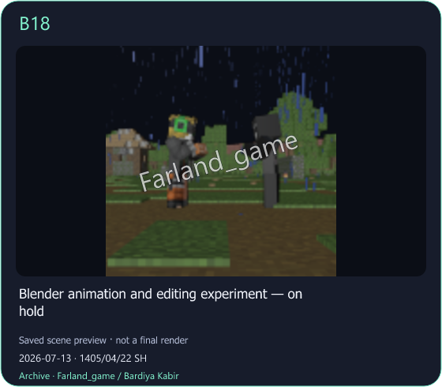

# B18 · Blender animation and editing experiment — on hold
[English](https://github.com/FarlandGame/Animation-Portfolio/blob/main/sources/blender/en/B18.md) · [فارسی](https://github.com/FarlandGame/Animation-Portfolio/blob/main/sources/blender/fa/B18.md) · [日本語](https://github.com/FarlandGame/Animation-Portfolio/blob/main/sources/blender/ja/B18.md)

## Creator’s account

Bardiya planned an animation whose final result would rely heavily on editing after building the scene in Blender. At the time he did not have After Effects, and his later collaboration with Ashkan had not yet begun. He made part of the scene and kept the file so he could continue it when time allowed.

**Supplied file last modified:** 2026-07-13 · 1405/04/22 SH

Dates describe the supplied file’s last modification in Tehran time. They do not establish the original creation date or completion date.

**Supplied filename:** `untitled.blend`

**Original saved-file version:** 4.3

### [Download prepared source archive · ZIP · 16.6 MB](https://github.com/FarlandGame/Animation-Portfolio/releases/download/blender-source-archive-2026-11/B18-blender-source-snapshot.zip)

Public-copy format: Blender 5.2. Older-version compatibility and full final rendering are not guaranteed.

These are separately prepared copies. Original source files on the creator’s computer were not changed. Available file textures were packaged; unfinished work, missing resources and removed third-party motions are explicitly retained as limitations.

`SHA-256: 7cdc888fbbe4b6cfb5dd21ad80d0d19e3c74b61d8f900a7d40dd9c504c93cf49`

## Resources and public-copy changes

**Missing image references:** None reported by this inspection

**Identifiable Mixamo actions removed:** None reported by this inspection

**Music omitted from this copy:** `PSYCHOSIS (Slowed)   KUMUKI GANG   HOST1LE   Dj Syndr0m.m4a`

**Retained audio:** None reported by this inspection

**External font names:** `AGENCYB.TTF`, `ALGER.TTF`, `ariblk.ttf`

### Retained previous save

A previous save is preserved in the archive’s versions folder. It is not automatically an independent project. Hashes and supplied-file dates are included inside the download.

Keep the original credit: **Bardiya Alizadeh (Kabir / Farland_game)**. Eligible original contributions use **CC BY-NC 4.0**: noncommercial reuse, a license link and an indication of changes are required. Credit your own additions separately. Third-party resources keep their own terms.

[How to open, continue and give credit](https://github.com/FarlandGame/Animation-Portfolio/blob/main/sources/blender/en/guide.md) · [Third-party credits](https://github.com/FarlandGame/Animation-Portfolio/blob/main/sources/blender/THIRD-PARTY.md) · [All source entries](https://github.com/FarlandGame/Animation-Portfolio/blob/main/sources/blender/en/index.md)
