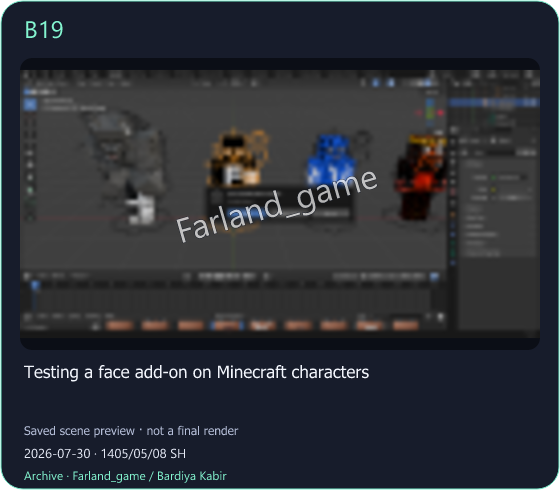

# B19 · Testing a face add-on on Minecraft characters
[English](https://github.com/FarlandGame/Animation-Portfolio/blob/main/sources/blender/en/B19.md) · [فارسی](https://github.com/FarlandGame/Animation-Portfolio/blob/main/sources/blender/fa/B19.md) · [日本語](https://github.com/FarlandGame/Animation-Portfolio/blob/main/sources/blender/ja/B19.md) · [Русский](https://github.com/FarlandGame/Animation-Portfolio/blob/main/sources/blender/ru/B19.md)

## Creator’s account

Bardiya used this file to test an add-on that added eyes and mouths to characters. He tried it on his own character and on the characters of Alireza, Ali and Amir, keeping the file as a record of those experiments.

**Supplied file last modified:** 2026-07-30 · 1405/05/08 SH

Dates describe the supplied file’s last modification in Tehran time. They do not establish the original creation date or completion date.

**Supplied filename:** `Untitled.blend`

**Original saved-file version:** 5.2

### [Download prepared source archive · ZIP · 24.1 MB](https://github.com/FarlandGame/Animation-Portfolio/releases/download/blender-source-archive-2026-11/B19-blender-source-snapshot.zip)

Public-copy format: Blender 5.2. Older-version compatibility and full final rendering are not guaranteed.

These are separately prepared copies. Original source files on the creator’s computer were not changed. Available file textures were packaged; unfinished work, missing resources and removed third-party motions are explicitly retained as limitations.

`SHA-256: a5d0c446664f0b38c845b4c5fff1fc8c499bb30e7b52490d6ac98ac5b387f63c`

## Resources and public-copy changes

**Missing image references:** `30493219985a52a2d691bc52cd38dbcf82f593c5.png`

**Identifiable Mixamo actions removed:** None reported by this inspection

**Music omitted from this copy:** None reported by this inspection

**Retained audio:** None reported by this inspection

**External font names:** None reported by this inspection

### Retained previous save

A previous save is preserved in the archive’s versions folder. It is not automatically an independent project. Hashes and supplied-file dates are included inside the download.

Keep the original credit: **Bardiya Alizadeh (Kabir / Farland_game)**. Eligible original contributions use **CC BY-NC 4.0**: noncommercial reuse, a license link and an indication of changes are required. Credit your own additions separately. Third-party resources keep their own terms.

[How to open, continue and give credit](https://github.com/FarlandGame/Animation-Portfolio/blob/main/sources/blender/en/guide.md) · [Third-party credits](https://github.com/FarlandGame/Animation-Portfolio/blob/main/sources/blender/THIRD-PARTY.md) · [All source entries](https://github.com/FarlandGame/Animation-Portfolio/blob/main/sources/blender/en/index.md)
