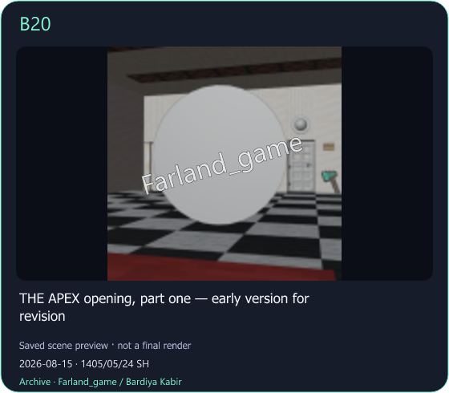

# B20 · THE APEX opening, part one — early version for revision
[English](https://github.com/FarlandGame/Animation-Portfolio/blob/main/sources/blender/en/B20.md) · [فارسی](https://github.com/FarlandGame/Animation-Portfolio/blob/main/sources/blender/fa/B20.md) · [日本語](https://github.com/FarlandGame/Animation-Portfolio/blob/main/sources/blender/ja/B20.md)

## Creator’s account

The first of three planned sections of the opening animation for THE APEX, Bardiya’s Minecraft story and escape-room project. The opening was intended to play through a plugin when a player began the game. An early version of this section was rendered, and Bardiya plans to revise the walking animation and early voice work. He recalls approximately 11,000 frames and about 80 days rendering on his laptop. The experience became an important part of learning about rendering and transferring projects to other systems.

**Supplied file last modified:** 2026-08-15 · 1405/05/24 SH

Dates describe the supplied file’s last modification in Tehran time. They do not establish the original creation date or completion date.

**Supplied filename:** `untitled.blend`

**Original saved-file version:** 5.2

### [Download prepared source archive · ZIP · 22.8 MB](https://github.com/FarlandGame/Animation-Portfolio/releases/download/blender-source-archive-2026-11/B20-blender-source-snapshot.zip)

Public-copy format: Blender 5.2. Older-version compatibility and full final rendering are not guaranteed.

These are separately prepared copies. Original source files on the creator’s computer were not changed. Available file textures were packaged; unfinished work, missing resources and removed third-party motions are explicitly retained as limitations.

`SHA-256: bf55ce633544410d7c8e53cd88c9835cafdc7a54ede6bcd409887dc2e141289f`

## Resources and public-copy changes

**Missing image references:** None reported by this inspection

**Identifiable Mixamo actions removed:** None reported by this inspection

**Music omitted from this copy:** None reported by this inspection

Retained audio: 12

`1.aac`, `1.mp3`, `2.aac`, `2.mp3`, `3.aac`, `3.mp3`, `4.aac`, `bardia 1.mp3`, `bardiya 2.mp3`, `bardiya 5.mp3`, `bardiya 6.mp3`, `bardiya 8.mp3`

External font names: 13

`AGENCYB.TTF`, `AGENCYB.TTF`, `AGENCYB.TTF`, `AGENCYB.TTF`, `AGENCYB.TTF`, `AGENCYB.TTF`, `AGENCYB.TTF`, `AGENCYB.TTF`, `AGENCYB.TTF`, `AGENCYB.TTF`, `AGENCYB.TTF`, `AGENCYB.TTF`, `AGENCYB.TTF`

### Retained previous save

A previous save is preserved in the archive’s versions folder. It is not automatically an independent project. Hashes and supplied-file dates are included inside the download.

Keep the original credit: **Bardiya Alizadeh (Kabir / Farland_game)**. Eligible original contributions use **CC BY-NC 4.0**: noncommercial reuse, a license link and an indication of changes are required. Credit your own additions separately. Third-party resources keep their own terms.

[How to open, continue and give credit](https://github.com/FarlandGame/Animation-Portfolio/blob/main/sources/blender/en/guide.md) · [Third-party credits](https://github.com/FarlandGame/Animation-Portfolio/blob/main/sources/blender/THIRD-PARTY.md) · [All source entries](https://github.com/FarlandGame/Animation-Portfolio/blob/main/sources/blender/en/index.md)
