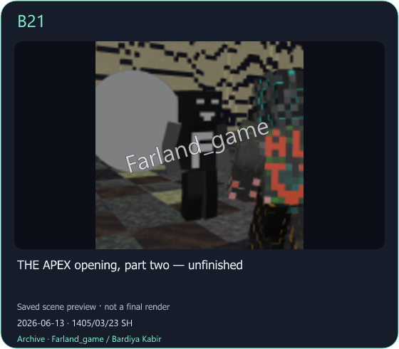

# B21 · THE APEX opening, part two — unfinished
[English](https://github.com/FarlandGame/Animation-Portfolio/blob/main/sources/blender/en/B21.md) · [فارسی](https://github.com/FarlandGame/Animation-Portfolio/blob/main/sources/blender/fa/B21.md) · [日本語](https://github.com/FarlandGame/Animation-Portfolio/blob/main/sources/blender/ja/B21.md)

## Creator’s account

The continuation of B20 and the second section of the three-part THE APEX opening. This section is unfinished, and Bardiya has not resumed work on it since it was paused.

**Supplied file last modified:** 2026-06-13 · 1405/03/23 SH

Dates describe the supplied file’s last modification in Tehran time. They do not establish the original creation date or completion date.

**Supplied filename:** `untitled.blend`

**Original saved-file version:** 4.3

### [Download prepared source archive · ZIP · 41.1 MB](https://github.com/FarlandGame/Animation-Portfolio/releases/download/blender-source-archive-2026-11/B21-blender-source-snapshot.zip)

Public-copy format: Blender 5.2. Older-version compatibility and full final rendering are not guaranteed.

These are separately prepared copies. Original source files on the creator’s computer were not changed. Available file textures were packaged; unfinished work, missing resources and removed third-party motions are explicitly retained as limitations.

`SHA-256: f658a9dfab75d4ccbc003ae05404719ff5f98bc880d83fff79aa53c0086a8824`

## Resources and public-copy changes

**Missing image references:** None reported by this inspection

**Identifiable Mixamo actions removed:** `SimplePlayer.arma.003|mixamo.com|Layer0`, `SimplePlayer.arma.004|mixamo.com|Layer0`, `SimplePlayer.arma.005|mixamo.com|Layer0`, `SimplePlayer.arma.006|mixamo.com|Layer0`

**Music omitted from this copy:** None reported by this inspection

**Retained audio:** `bardiya 10.mp3`, `bardiya 9.mp3`, `bardiya sound 1.mp3`, `bardiya sound 2.mp3`

**External font names:** None reported by this inspection

### Retained previous save

A previous save is preserved in the archive’s versions folder. It is not automatically an independent project. Hashes and supplied-file dates are included inside the download.

**Related files:** [B20](https://github.com/FarlandGame/Animation-Portfolio/blob/main/sources/blender/en/B20.md)

Keep the original credit: **Bardiya Alizadeh (Kabir / Farland_game)**. Eligible original contributions use **CC BY-NC 4.0**: noncommercial reuse, a license link and an indication of changes are required. Credit your own additions separately. Third-party resources keep their own terms.

[How to open, continue and give credit](https://github.com/FarlandGame/Animation-Portfolio/blob/main/sources/blender/en/guide.md) · [Third-party credits](https://github.com/FarlandGame/Animation-Portfolio/blob/main/sources/blender/THIRD-PARTY.md) · [All source entries](https://github.com/FarlandGame/Animation-Portfolio/blob/main/sources/blender/en/index.md)
