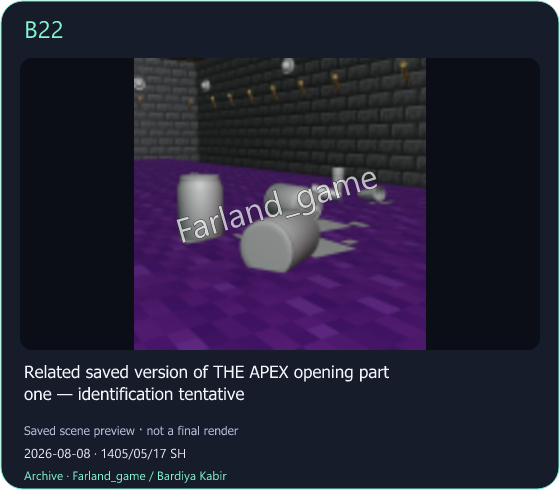

# B22 · Related saved version of THE APEX opening part one — identification tentative
[English](https://github.com/FarlandGame/Animation-Portfolio/blob/main/sources/blender/en/B22.md) · [فارسی](https://github.com/FarlandGame/Animation-Portfolio/blob/main/sources/blender/fa/B22.md) · [日本語](https://github.com/FarlandGame/Animation-Portfolio/blob/main/sources/blender/ja/B22.md)

## Creator’s account

Bardiya believes this may be another saved version of the same first THE APEX opening section as B20, rather than a separate project. File inspection found the same frame range but different object and resource counts; B22 does not contain B20’s saved audio data. Both versions are retained for comparison and preservation.

**Supplied file last modified:** 2026-08-08 · 1405/05/17 SH

Dates describe the supplied file’s last modification in Tehran time. They do not establish the original creation date or completion date.

**Supplied filename:** `Untitled.blend`

**Original saved-file version:** 5.2

### [Download prepared source archive · ZIP · 10.8 MB](https://github.com/FarlandGame/Animation-Portfolio/releases/download/blender-source-archive-2026-11/B22-blender-source-snapshot.zip)

Public-copy format: Blender 5.2. Older-version compatibility and full final rendering are not guaranteed.

These are separately prepared copies. Original source files on the creator’s computer were not changed. Available file textures were packaged; unfinished work, missing resources and removed third-party motions are explicitly retained as limitations.

`SHA-256: d493ddc937d37a90274634a7ce5f37396d48c9eb1d758732e6528408e7f199e4`

## Resources and public-copy changes

**Missing image references:** None reported by this inspection

**Identifiable Mixamo actions removed:** None reported by this inspection

**Music omitted from this copy:** None reported by this inspection

**Retained audio:** None reported by this inspection

External font names: 13

`AGENCYB.TTF`, `AGENCYB.TTF`, `AGENCYB.TTF`, `AGENCYB.TTF`, `AGENCYB.TTF`, `AGENCYB.TTF`, `AGENCYB.TTF`, `AGENCYB.TTF`, `AGENCYB.TTF`, `AGENCYB.TTF`, `AGENCYB.TTF`, `AGENCYB.TTF`, `AGENCYB.TTF`

### Retained previous save

A previous save is preserved in the archive’s versions folder. It is not automatically an independent project. Hashes and supplied-file dates are included inside the download.

**Related files:** [B20](https://github.com/FarlandGame/Animation-Portfolio/blob/main/sources/blender/en/B20.md)

Keep the original credit: **Bardiya Alizadeh (Kabir / Farland_game)**. Eligible original contributions use **CC BY-NC 4.0**: noncommercial reuse, a license link and an indication of changes are required. Credit your own additions separately. Third-party resources keep their own terms.

[How to open, continue and give credit](https://github.com/FarlandGame/Animation-Portfolio/blob/main/sources/blender/en/guide.md) · [Third-party credits](https://github.com/FarlandGame/Animation-Portfolio/blob/main/sources/blender/THIRD-PARTY.md) · [All source entries](https://github.com/FarlandGame/Animation-Portfolio/blob/main/sources/blender/en/index.md)
