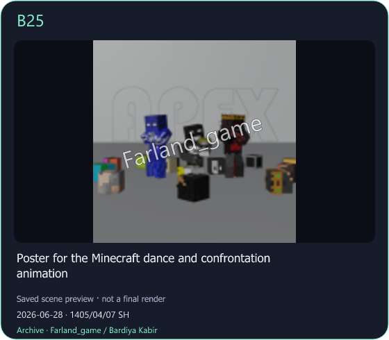

# B25 · Poster for the Minecraft dance and confrontation animation
[English](https://github.com/FarlandGame/Animation-Portfolio/blob/main/sources/blender/en/B25.md) · [فارسی](https://github.com/FarlandGame/Animation-Portfolio/blob/main/sources/blender/fa/B25.md) · [日本語](https://github.com/FarlandGame/Animation-Portfolio/blob/main/sources/blender/ja/B25.md) · [Русский](https://github.com/FarlandGame/Animation-Portfolio/blob/main/sources/blender/ru/B25.md)

## Creator’s account

The Blender poster scene for B26: Bardiya dances, Armiya and Ali appear, and a stylized confrontation follows without blood. Bardiya says the film and finished poster were already published on GitHub, but the poster’s separate effects-editing file no longer survives. This scene does not contain every part of that final edit.

**Supplied file last modified:** 2026-06-28 · 1405/04/07 SH

Dates describe the supplied file’s last modification in Tehran time. They do not establish the original creation date or completion date.

**Supplied filename:** `untitled.blend`

**Original saved-file version:** 4.3

### [Download prepared source archive · ZIP · 2.6 MB](https://github.com/FarlandGame/Animation-Portfolio/releases/download/blender-source-archive-2026-11/B25-blender-source-snapshot.zip)

Public-copy format: Blender 5.2. Older-version compatibility and full final rendering are not guaranteed.

These are separately prepared copies. Original source files on the creator’s computer were not changed. Available file textures were packaged; unfinished work, missing resources and removed third-party motions are explicitly retained as limitations.

`SHA-256: 51c93837a9e7743c4f37660804efe0aea3312e00561dabe81a9723a5c55c2431`

## Resources and public-copy changes

**Missing image references:** `GunGS_Albedo.tga.png`, `GunGS_Roughness.tga.png`

**Identifiable Mixamo actions removed:** None reported by this inspection

**Music omitted from this copy:** None reported by this inspection

**Retained audio:** None reported by this inspection

**External font names:** `BAUHS93.TTF`

### Retained previous save

A previous save is preserved in the archive’s versions folder. It is not automatically an independent project. Hashes and supplied-file dates are included inside the download.

## Previously published result

Poster and film source paired by the creator; visual comparison also matches the existing main-06 frame and color poster.

[▶ main-06](https://github.com/FarlandGame/Animation-Portfolio/blob/main/collections/en/main.md#main-06) · [THE APEX](https://github.com/FarlandGame/Animation-Portfolio/blob/main/assets/section-covers/the-apex-color.png)

**Related files:** [B26](https://github.com/FarlandGame/Animation-Portfolio/blob/main/sources/blender/en/B26.md) · [B27](https://github.com/FarlandGame/Animation-Portfolio/blob/main/sources/blender/en/B27.md)

Keep the original credit: **Bardiya Alizadeh (Kabir / Farland_game)**. Eligible original contributions use **CC BY-NC 4.0**: noncommercial reuse, a license link and an indication of changes are required. Credit your own additions separately. Third-party resources keep their own terms.

[How to open, continue and give credit](https://github.com/FarlandGame/Animation-Portfolio/blob/main/sources/blender/en/guide.md) · [Third-party credits](https://github.com/FarlandGame/Animation-Portfolio/blob/main/sources/blender/THIRD-PARTY.md) · [All source entries](https://github.com/FarlandGame/Animation-Portfolio/blob/main/sources/blender/en/index.md)
