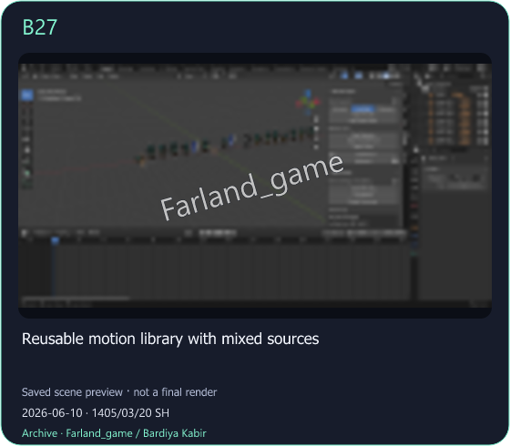

# B27 · Reusable motion library with mixed sources
[English](https://github.com/FarlandGame/Animation-Portfolio/blob/main/sources/blender/en/B27.md) · [فارسی](https://github.com/FarlandGame/Animation-Portfolio/blob/main/sources/blender/fa/B27.md) · [日本語](https://github.com/FarlandGame/Animation-Portfolio/blob/main/sources/blender/ja/B27.md)

## Creator’s account

A working library kept to avoid rebuilding or downloading motions again, particularly for B26. Some motions were made by Bardiya, some reconstructed using videos as references, and some downloaded from Mixamo. He copied needed sections into the film scene and changed character skins. This is a mixed-source collection, not a wholly original motion pack; raw Mixamo data retains its own distribution terms.

**Supplied file last modified:** 2026-06-10 · 1405/03/20 SH

Dates describe the supplied file’s last modification in Tehran time. They do not establish the original creation date or completion date.

**Supplied filename:** `untitled.blend`

**Original saved-file version:** 4.3

## Preview / provider reference only

The creator cannot separate original motions from Mixamo downloads in this mixed library. At his confirmed preference it is documented and previewed, without a raw-library download.

[Mixamo](https://www.mixamo.com/) · [Distribution information](https://community.adobe.com/questions-696/mixamo-faq-licensing-royalties-ownership-eula-and-tos-589400)

**Related files:** [B26](https://github.com/FarlandGame/Animation-Portfolio/blob/main/sources/blender/en/B26.md)

Keep the original credit: **Bardiya Alizadeh (Kabir / Farland_game)**. Eligible original contributions use **CC BY-NC 4.0**: noncommercial reuse, a license link and an indication of changes are required. Credit your own additions separately. Third-party resources keep their own terms.

[How to open, continue and give credit](https://github.com/FarlandGame/Animation-Portfolio/blob/main/sources/blender/en/guide.md) · [Third-party credits](https://github.com/FarlandGame/Animation-Portfolio/blob/main/sources/blender/THIRD-PARTY.md) · [All source entries](https://github.com/FarlandGame/Animation-Portfolio/blob/main/sources/blender/en/index.md)
