# Inside the .blend files 🎬
[English](https://github.com/FarlandGame/Animation-Portfolio/blob/main/sources/blender/en/index.md) · [فارسی](https://github.com/FarlandGame/Animation-Portfolio/blob/main/sources/blender/fa/index.md) · [日本語](https://github.com/FarlandGame/Animation-Portfolio/blob/main/sources/blender/ja/index.md) · [Русский](https://github.com/FarlandGame/Animation-Portfolio/blob/main/sources/blender/ru/index.md)

An archive of earlier experiments, unfinished scenes and evolving ideas by **Bardiya Alizadeh (Kabir / Farland_game)**. I am focusing on newer projects now, but may return to finish some of these works. Others can learn, adapt and continue my eligible original contributions noncommercially while keeping my credit.

> The render may need a break. The ideas apparently do not. 🍿🖥️

28 indexed files · 25 prepared source downloads · retained previous saves where supplied. File IDs are catalogue references, not a chronological order or 28 separate completed films.

[How to open, continue and give credit](https://github.com/FarlandGame/Animation-Portfolio/blob/main/sources/blender/en/guide.md) · [CC BY-NC 4.0](https://creativecommons.org/licenses/by-nc/4.0/) · [Portfolio](https://github.com/FarlandGame)

Dates describe the supplied file’s last modification in Tehran time. They do not establish the original creation date or completion date.

## Browse the 28 source-file entries

| | |
|:--:|:--:|
| <a href="https://github.com/FarlandGame/Animation-Portfolio/blob/main/sources/blender/en/B01.md">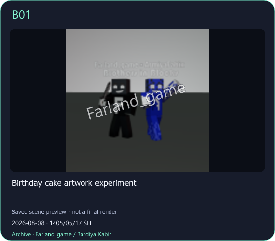</a> [B01 · Birthday cake artwork experiment](https://github.com/FarlandGame/Animation-Portfolio/blob/main/sources/blender/en/B01.md) | <a href="https://github.com/FarlandGame/Animation-Portfolio/blob/main/sources/blender/en/B02.md">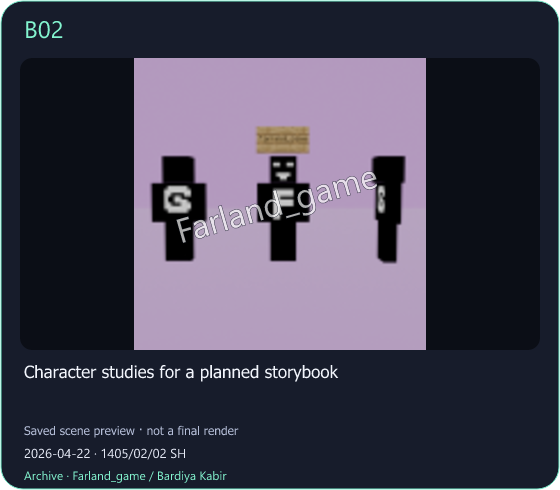</a> [B02 · Character studies for a planned storybook](https://github.com/FarlandGame/Animation-Portfolio/blob/main/sources/blender/en/B02.md) |

| | |
|:--:|:--:|
| <a href="https://github.com/FarlandGame/Animation-Portfolio/blob/main/sources/blender/en/B03.md">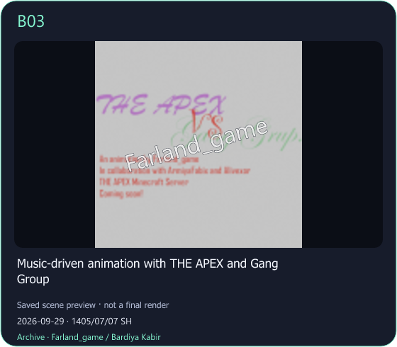</a> [B03 · Music-driven animation with THE APEX and Gang Group](https://github.com/FarlandGame/Animation-Portfolio/blob/main/sources/blender/en/B03.md) | <a href="https://github.com/FarlandGame/Animation-Portfolio/blob/main/sources/blender/en/B04.md">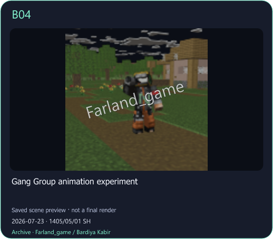</a> [B04 · Gang Group animation experiment](https://github.com/FarlandGame/Animation-Portfolio/blob/main/sources/blender/en/B04.md) |

| | |
|:--:|:--:|
| <a href="https://github.com/FarlandGame/Animation-Portfolio/blob/main/sources/blender/en/B05.md">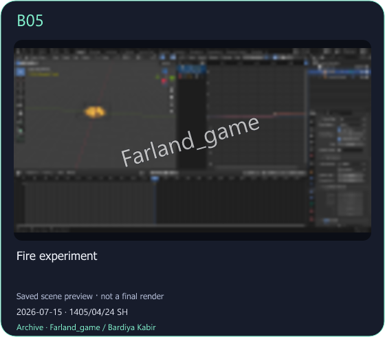</a> [B05 · Fire experiment](https://github.com/FarlandGame/Animation-Portfolio/blob/main/sources/blender/en/B05.md) | <a href="https://github.com/FarlandGame/Animation-Portfolio/blob/main/sources/blender/en/B06.md">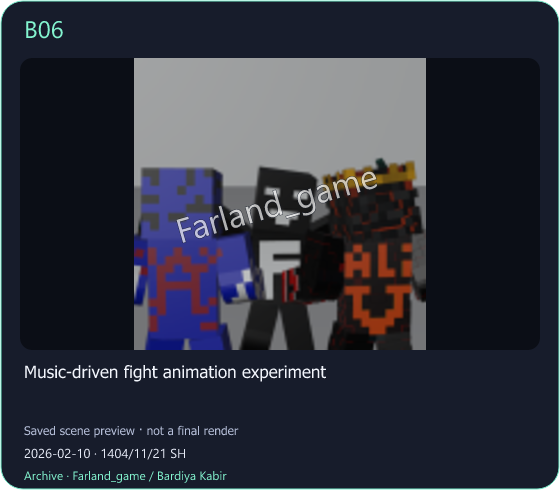</a> [B06 · Music-driven fight animation experiment](https://github.com/FarlandGame/Animation-Portfolio/blob/main/sources/blender/en/B06.md) |

| | |
|:--:|:--:|
| <a href="https://github.com/FarlandGame/Animation-Portfolio/blob/main/sources/blender/en/B07.md">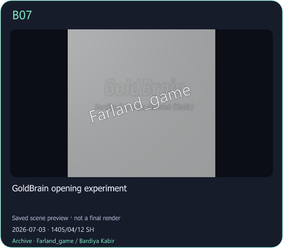</a> [B07 · GoldBrain opening experiment](https://github.com/FarlandGame/Animation-Portfolio/blob/main/sources/blender/en/B07.md) | <a href="https://github.com/FarlandGame/Animation-Portfolio/blob/main/sources/blender/en/B08.md">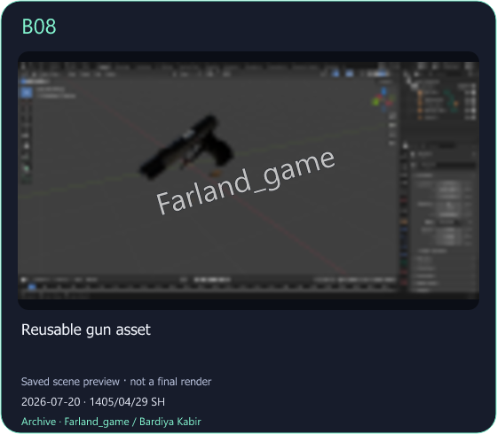</a> [B08 · Reusable gun asset](https://github.com/FarlandGame/Animation-Portfolio/blob/main/sources/blender/en/B08.md) |

| | |
|:--:|:--:|
| <a href="https://github.com/FarlandGame/Animation-Portfolio/blob/main/sources/blender/en/B09.md">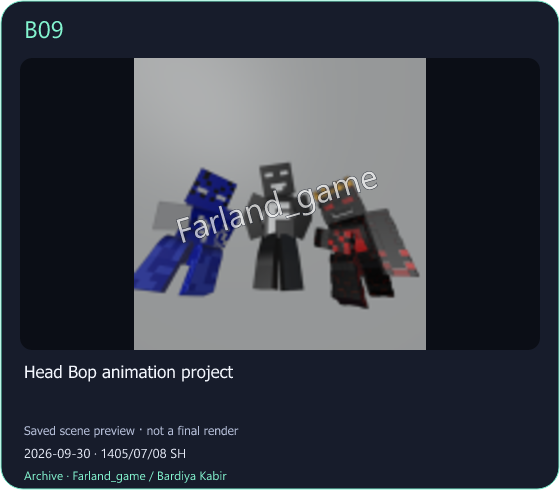</a> [B09 · Head Bop animation project](https://github.com/FarlandGame/Animation-Portfolio/blob/main/sources/blender/en/B09.md) | <a href="https://github.com/FarlandGame/Animation-Portfolio/blob/main/sources/blender/en/B10.md">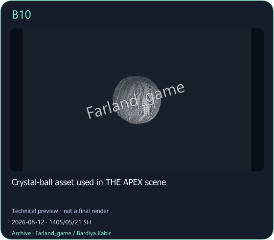</a> [B10 · Crystal-ball asset used in THE APEX scene](https://github.com/FarlandGame/Animation-Portfolio/blob/main/sources/blender/en/B10.md) |

| | |
|:--:|:--:|
| <a href="https://github.com/FarlandGame/Animation-Portfolio/blob/main/sources/blender/en/B11.md">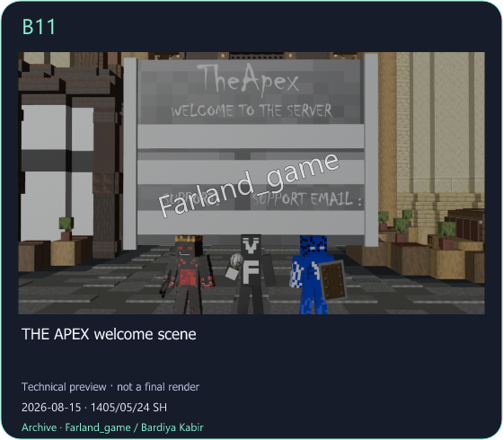</a> [B11 · THE APEX welcome scene](https://github.com/FarlandGame/Animation-Portfolio/blob/main/sources/blender/en/B11.md) | <a href="https://github.com/FarlandGame/Animation-Portfolio/blob/main/sources/blender/en/B12.md">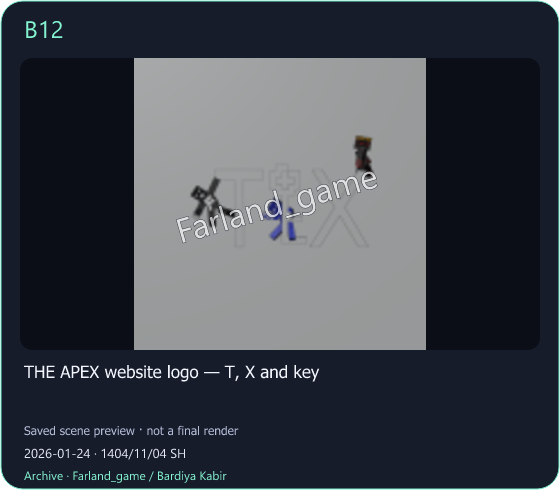</a> [B12 · THE APEX website logo — T, X and key](https://github.com/FarlandGame/Animation-Portfolio/blob/main/sources/blender/en/B12.md) |

| | |
|:--:|:--:|
| <a href="https://github.com/FarlandGame/Animation-Portfolio/blob/main/sources/blender/en/B13.md">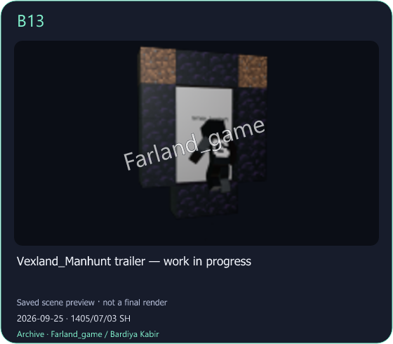</a> [B13 · Vexland_Manhunt trailer — work in progress](https://github.com/FarlandGame/Animation-Portfolio/blob/main/sources/blender/en/B13.md) | <a href="https://github.com/FarlandGame/Animation-Portfolio/blob/main/sources/blender/en/B14.md">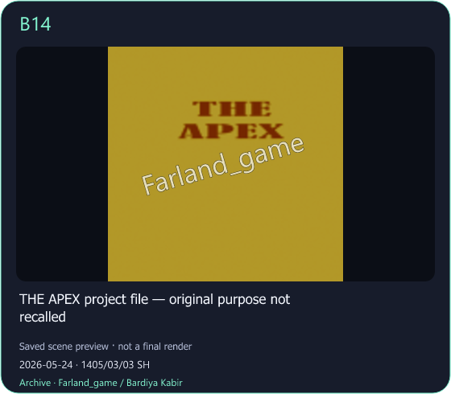</a> [B14 · THE APEX project file — original purpose not recalled](https://github.com/FarlandGame/Animation-Portfolio/blob/main/sources/blender/en/B14.md) |

| | |
|:--:|:--:|
| <a href="https://github.com/FarlandGame/Animation-Portfolio/blob/main/sources/blender/en/B15.md">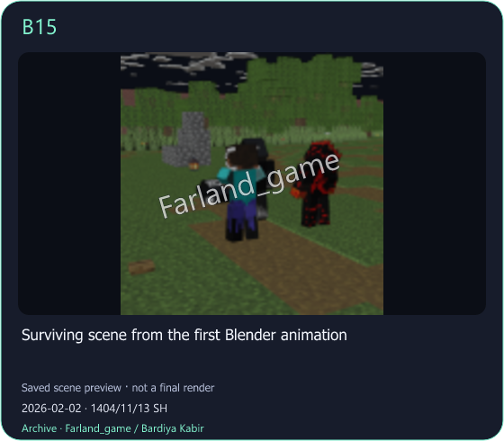</a> [B15 · Surviving scene from the first Blender animation](https://github.com/FarlandGame/Animation-Portfolio/blob/main/sources/blender/en/B15.md) | <a href="https://github.com/FarlandGame/Animation-Portfolio/blob/main/sources/blender/en/B16.md">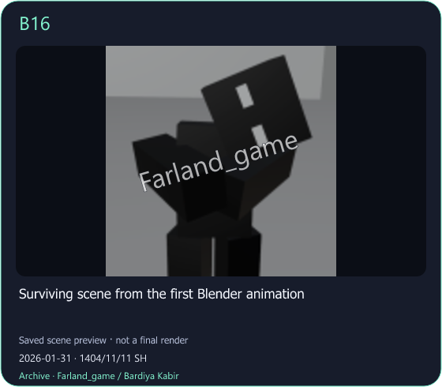</a> [B16 · Surviving scene from the first Blender animation](https://github.com/FarlandGame/Animation-Portfolio/blob/main/sources/blender/en/B16.md) |

| | |
|:--:|:--:|
| <a href="https://github.com/FarlandGame/Animation-Portfolio/blob/main/sources/blender/en/B17.md">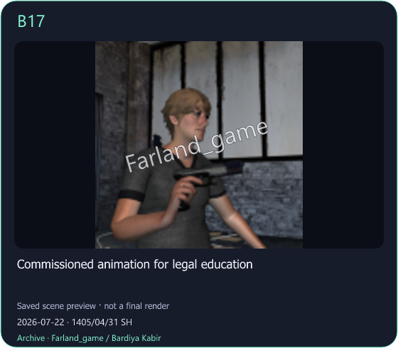</a> [B17 · Commissioned animation for legal education](https://github.com/FarlandGame/Animation-Portfolio/blob/main/sources/blender/en/B17.md) | <a href="https://github.com/FarlandGame/Animation-Portfolio/blob/main/sources/blender/en/B18.md">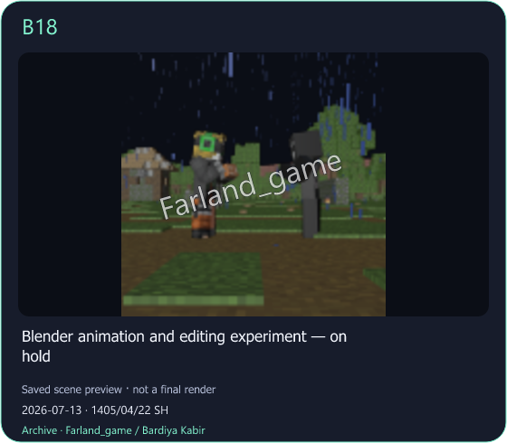</a> [B18 · Blender animation and editing experiment — on hold](https://github.com/FarlandGame/Animation-Portfolio/blob/main/sources/blender/en/B18.md) |

| | |
|:--:|:--:|
| <a href="https://github.com/FarlandGame/Animation-Portfolio/blob/main/sources/blender/en/B19.md">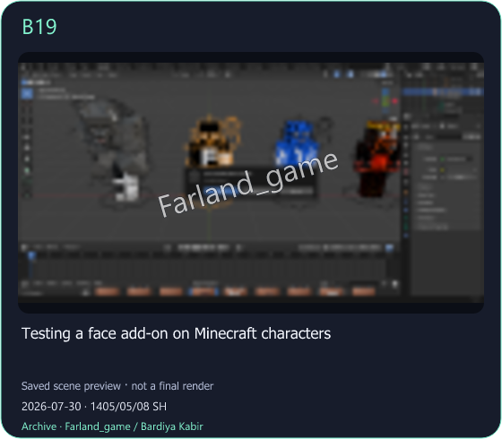</a> [B19 · Testing a face add-on on Minecraft characters](https://github.com/FarlandGame/Animation-Portfolio/blob/main/sources/blender/en/B19.md) | <a href="https://github.com/FarlandGame/Animation-Portfolio/blob/main/sources/blender/en/B20.md">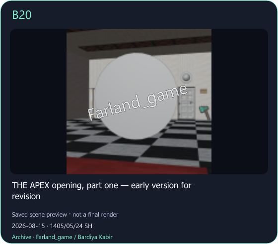</a> [B20 · THE APEX opening, part one — early version for revision](https://github.com/FarlandGame/Animation-Portfolio/blob/main/sources/blender/en/B20.md) |

| | |
|:--:|:--:|
| <a href="https://github.com/FarlandGame/Animation-Portfolio/blob/main/sources/blender/en/B21.md">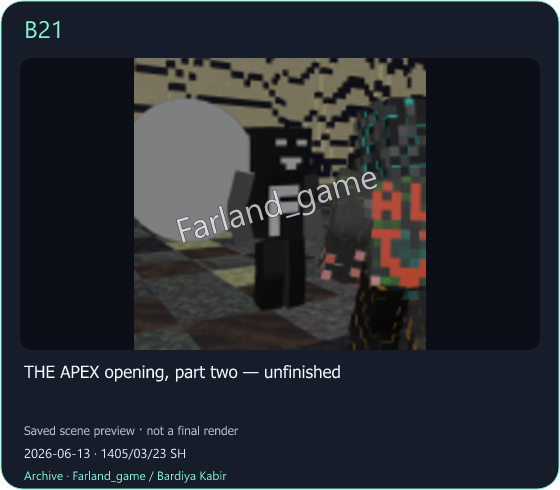</a> [B21 · THE APEX opening, part two — unfinished](https://github.com/FarlandGame/Animation-Portfolio/blob/main/sources/blender/en/B21.md) | <a href="https://github.com/FarlandGame/Animation-Portfolio/blob/main/sources/blender/en/B22.md">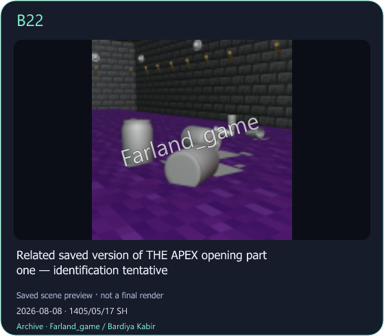</a> [B22 · Related saved version of THE APEX opening part one — identification tentative](https://github.com/FarlandGame/Animation-Portfolio/blob/main/sources/blender/en/B22.md) |

| | |
|:--:|:--:|
| <a href="https://github.com/FarlandGame/Animation-Portfolio/blob/main/sources/blender/en/B23.md">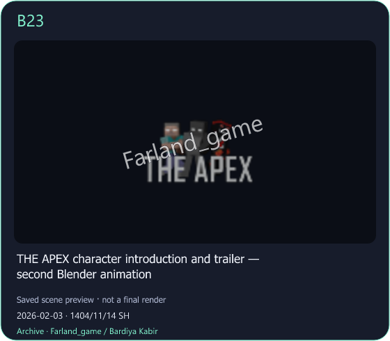</a> [B23 · THE APEX character introduction and trailer — second Blender animation](https://github.com/FarlandGame/Animation-Portfolio/blob/main/sources/blender/en/B23.md) | <a href="https://github.com/FarlandGame/Animation-Portfolio/blob/main/sources/blender/en/B24.md">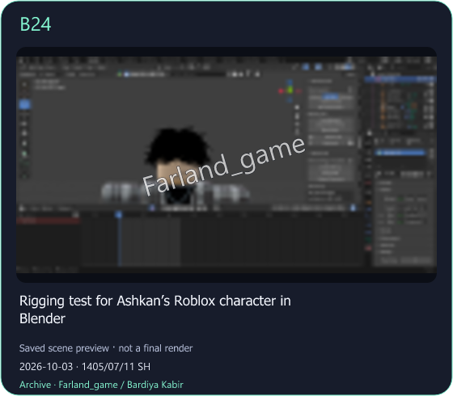</a> [B24 · Rigging test for Ashkan’s Roblox character in Blender](https://github.com/FarlandGame/Animation-Portfolio/blob/main/sources/blender/en/B24.md) |

| | |
|:--:|:--:|
| <a href="https://github.com/FarlandGame/Animation-Portfolio/blob/main/sources/blender/en/B25.md">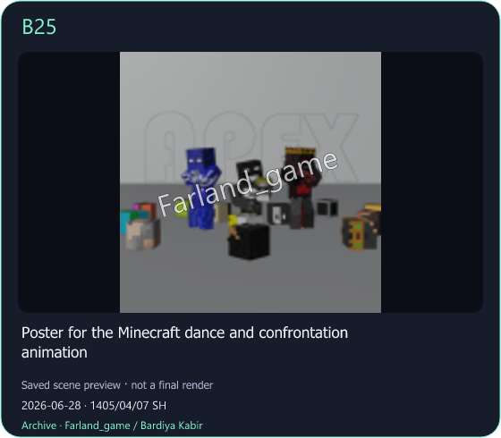</a> [B25 · Poster for the Minecraft dance and confrontation animation](https://github.com/FarlandGame/Animation-Portfolio/blob/main/sources/blender/en/B25.md) | <a href="https://github.com/FarlandGame/Animation-Portfolio/blob/main/sources/blender/en/B26.md">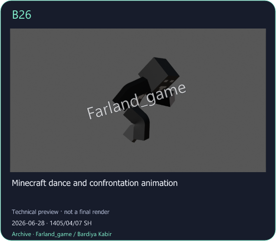</a> [B26 · Minecraft dance and confrontation animation](https://github.com/FarlandGame/Animation-Portfolio/blob/main/sources/blender/en/B26.md) |

| | |
|:--:|:--:|
| <a href="https://github.com/FarlandGame/Animation-Portfolio/blob/main/sources/blender/en/B27.md">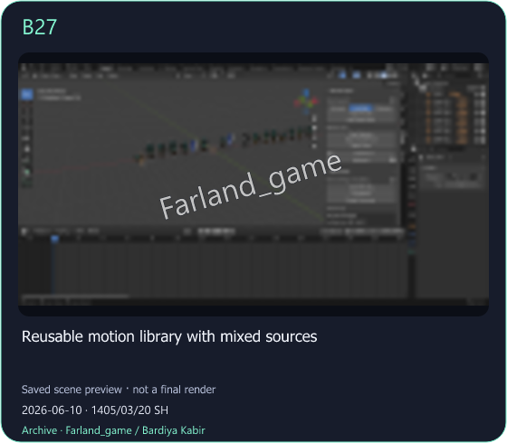</a> [B27 · Reusable motion library with mixed sources](https://github.com/FarlandGame/Animation-Portfolio/blob/main/sources/blender/en/B27.md) | <a href="https://github.com/FarlandGame/Animation-Portfolio/blob/main/sources/blender/en/B28.md">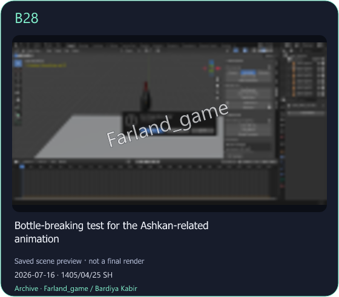</a> [B28 · Bottle-breaking test for the Ashkan-related animation](https://github.com/FarlandGame/Animation-Portfolio/blob/main/sources/blender/en/B28.md) |
