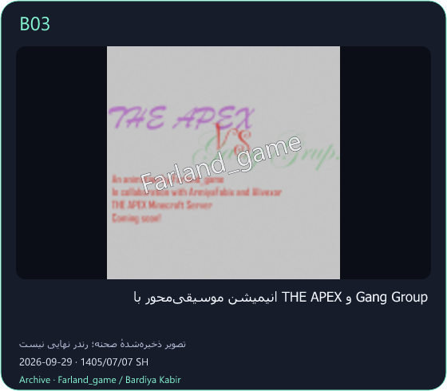

# B03 · انیمیشن موسیقی‌محور با THE APEX و Gang Group
[English](https://github.com/FarlandGame/Animation-Portfolio/blob/main/sources/blender/en/B03.md) · [فارسی](https://github.com/FarlandGame/Animation-Portfolio/blob/main/sources/blender/fa/B03.md) · [日本語](https://github.com/FarlandGame/Animation-Portfolio/blob/main/sources/blender/ja/B03.md) · [Русский](https://github.com/FarlandGame/Animation-Portfolio/blob/main/sources/blender/ru/B03.md)

## روایت سازنده

یکی از انیمیشن‌های جدیدتر بردیا، همراه با موسیقی و حضور تیم THE APEX و Gang Group.

**آخرین تغییر فایل تحویلی:** 2026-09-29 · 1405/07/07 SH

تاریخ‌ها زمان آخرین تغییر نسخهٔ تحویلی فایل، به وقت تهران‌اند؛ تاریخ قطعی شروع ساخت یا پایان پروژه نیستند.

**نام فایل تحویلی:** `untitled.blend`

**نسخهٔ ثبت‌شده در فایل اصلی:** 4.3

### [دانلود بستهٔ فایل قابل‌ویرایش · ZIP · 24.6 MB](https://github.com/FarlandGame/Animation-Portfolio/releases/download/blender-source-archive-2026-11/B03-blender-source-snapshot.zip)

نسخهٔ عمومی با بلندر ۵٫۲ ذخیره شده است. سازگاری با نسخه‌های قدیمی‌تر و رندر نهاییِ بی‌نقص تأیید نشده است.

این‌ها نسخه‌های جداگانهٔ آماده‌شده برای انتشارند. فایل‌های اصلی سازنده تغییر نکرده‌اند. بافت‌های تصویریِ موجود داخل نسخه بسته‌بندی شده‌اند؛ نیمه‌تمام‌بودن، منابع گم‌شده و حذف حرکت‌های متعلق به سرویس دیگر، صریحاً توضیح داده شده‌اند.

`SHA-256: 087631e407a9c996dda1d884d2cc1f0eed465a58c203ff3c748d8ea28c71672c`

## منابع و تغییرات نسخهٔ عمومی

**ارجاع‌های تصویریِ پیدا‌نشده:** در این بررسی موردی گزارش نشده است

**حرکت‌های قابل‌شناسایی Mixamo که حذف شدند:** `SimplePlayer.arma|mixamo.com|Layer0`

**موسیقیِ کنارگذاشته‌شده از این نسخه:** `ESPECTRO_Ultra_Slowed_DJ_Alex_MC_LOCKED_Dean_Kappert_Aleksa.m4a`

**صدای حفظ‌شده:** در این بررسی موردی گزارش نشده است

نام قلم‌های خارجی: 8

`AGENCYB.TTF`, `BRUSHSCI.TTF`, `BRUSHSCI.TTF`, `BRUSHSCI.TTF`, `CURLZ___.TTF`, `ITCEDSCR.TTF`, `ITCEDSCR.TTF`, `ITCEDSCR.TTF`

### نسخهٔ ذخیرهٔ قبلی

ذخیرهٔ قبلی در پوشهٔ versions داخل بسته قرار دارد و خودبه‌خود پروژه‌ای مستقل شمرده نمی‌شود. هش‌ها و تاریخ فایل‌های تحویلی داخل دانلود ثبت شده‌اند.

نام اصلی را حفظ کنید: **بردیا علیزاده، ملقب به کبیر / Farland_game**. بخش‌های تألیفیِ واجد شرایط با **CC BY-NC 4.0** منتشر می‌شوند: استفادهٔ غیرتجاری، پیوند مجوز و مشخص‌کردن تغییرات لازم است. نام خود را برای تغییراتتان اضافه کنید و کار اولیه را به نام خود نزنید. منابع دیگران شرایط خودشان را دارند.

[راهنمای بازکردن، ادامه‌دادن و حفظ نام سازنده](https://github.com/FarlandGame/Animation-Portfolio/blob/main/sources/blender/fa/guide.md) · [Third-party credits](https://github.com/FarlandGame/Animation-Portfolio/blob/main/sources/blender/THIRD-PARTY.md) · [همهٔ فایل‌های آرشیو](https://github.com/FarlandGame/Animation-Portfolio/blob/main/sources/blender/fa/index.md)
