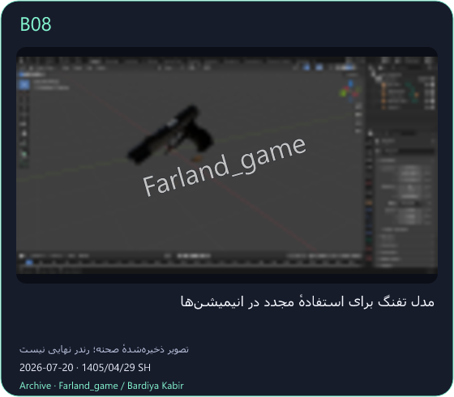

# B08 · مدل تفنگ برای استفادهٔ مجدد در انیمیشن‌ها
[English](https://github.com/FarlandGame/Animation-Portfolio/blob/main/sources/blender/en/B08.md) · [فارسی](https://github.com/FarlandGame/Animation-Portfolio/blob/main/sources/blender/fa/B08.md) · [日本語](https://github.com/FarlandGame/Animation-Portfolio/blob/main/sources/blender/ja/B08.md)

## روایت سازنده

فایل مدلی از تفنگ که برای استفادهٔ مجدد در انیمیشن‌ها نگه داشته شده تا هر بار به دانلود دوباره نیاز نباشد.

**آخرین تغییر فایل تحویلی:** 2026-07-20 · 1405/04/29 SH

تاریخ‌ها زمان آخرین تغییر نسخهٔ تحویلی فایل، به وقت تهران‌اند؛ تاریخ قطعی شروع ساخت یا پایان پروژه نیستند.

**نام فایل تحویلی:** `untitled.blend`

**نسخهٔ ثبت‌شده در فایل اصلی:** 4.3

## فقط پیش‌نمایش و اطلاعات منبع

یک مدل دانلودشدهٔ اسلحه است و مدل‌سازیِ تألیفی بردیا معرفی نمی‌شود. منبع و مجوز بازنشر مستقل آن هنوز مشخص نیست؛ این صفحه پیش‌نمایش دارد و بستهٔ مدل ارائه نمی‌کند.

نام اصلی را حفظ کنید: **بردیا علیزاده، ملقب به کبیر / Farland_game**. بخش‌های تألیفیِ واجد شرایط با **CC BY-NC 4.0** منتشر می‌شوند: استفادهٔ غیرتجاری، پیوند مجوز و مشخص‌کردن تغییرات لازم است. نام خود را برای تغییراتتان اضافه کنید و کار اولیه را به نام خود نزنید. منابع دیگران شرایط خودشان را دارند.

[راهنمای بازکردن، ادامه‌دادن و حفظ نام سازنده](https://github.com/FarlandGame/Animation-Portfolio/blob/main/sources/blender/fa/guide.md) · [Third-party credits](https://github.com/FarlandGame/Animation-Portfolio/blob/main/sources/blender/THIRD-PARTY.md) · [همهٔ فایل‌های آرشیو](https://github.com/FarlandGame/Animation-Portfolio/blob/main/sources/blender/fa/index.md)
