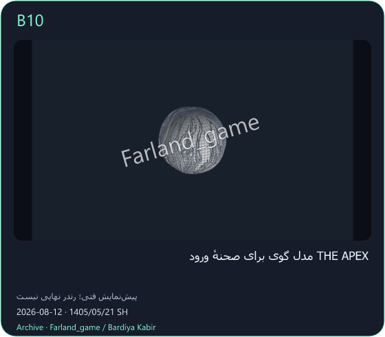

# B10 · مدل گوی برای صحنهٔ ورود THE APEX
[English](https://github.com/FarlandGame/Animation-Portfolio/blob/main/sources/blender/en/B10.md) · [فارسی](https://github.com/FarlandGame/Animation-Portfolio/blob/main/sources/blender/fa/B10.md) · [日本語](https://github.com/FarlandGame/Animation-Portfolio/blob/main/sources/blender/ja/B10.md)

## روایت سازنده

گوی یا آبجکتی که برای استفاده در تصویر ورود سرور در پروژهٔ B11 به کار رفته است.

**آخرین تغییر فایل تحویلی:** 2026-08-12 · 1405/05/21 SH

تاریخ‌ها زمان آخرین تغییر نسخهٔ تحویلی فایل، به وقت تهران‌اند؛ تاریخ قطعی شروع ساخت یا پایان پروژه نیستند.

**نام فایل تحویلی:** `crystal-ball-with-roots-and-vegetation_2K_f5c5d7ac-356d-4af3-94b9-7a3ccb0ba10a.blend`

**نسخهٔ ثبت‌شده در فایل اصلی:** 4.5

## فقط پیش‌نمایش و اطلاعات منبع

مدلِ **Dennis Hafemann** از Blendkit است؛ شناسه‌های داخل فایل با منبع اصلی تطبیق دارند. برای دریافت مدل، از صفحهٔ سازنده و شرایط همان منبع استفاده کنید.

[Crystal Ball With Roots And Vegetation · Dennis Hafemann](https://www.blendkit.com/asset-gallery-detail/982768a1-12a9-4783-93c6-771bb34691d9/)

نام اصلی را حفظ کنید: **بردیا علیزاده، ملقب به کبیر / Farland_game**. بخش‌های تألیفیِ واجد شرایط با **CC BY-NC 4.0** منتشر می‌شوند: استفادهٔ غیرتجاری، پیوند مجوز و مشخص‌کردن تغییرات لازم است. نام خود را برای تغییراتتان اضافه کنید و کار اولیه را به نام خود نزنید. منابع دیگران شرایط خودشان را دارند.

[راهنمای بازکردن، ادامه‌دادن و حفظ نام سازنده](https://github.com/FarlandGame/Animation-Portfolio/blob/main/sources/blender/fa/guide.md) · [Third-party credits](https://github.com/FarlandGame/Animation-Portfolio/blob/main/sources/blender/THIRD-PARTY.md) · [همهٔ فایل‌های آرشیو](https://github.com/FarlandGame/Animation-Portfolio/blob/main/sources/blender/fa/index.md)
