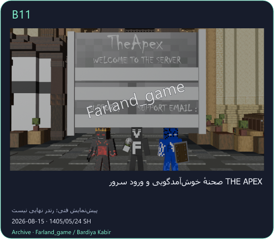

# B11 · صحنهٔ خوش‌آمدگویی و ورود سرور THE APEX
[English](https://github.com/FarlandGame/Animation-Portfolio/blob/main/sources/blender/en/B11.md) · [فارسی](https://github.com/FarlandGame/Animation-Portfolio/blob/main/sources/blender/fa/B11.md) · [日本語](https://github.com/FarlandGame/Animation-Portfolio/blob/main/sources/blender/ja/B11.md)

## روایت سازنده

صحنه‌ای برای تصویر ورود سرور THE APEX؛ کاراکتر بردیا گوی در دست دارد، کاراکتر آبی ارمیا سپر دارد و کاراکتر علی شمشیر در دست دارد.

**آخرین تغییر فایل تحویلی:** 2026-08-15 · 1405/05/24 SH

تاریخ‌ها زمان آخرین تغییر نسخهٔ تحویلی فایل، به وقت تهران‌اند؛ تاریخ قطعی شروع ساخت یا پایان پروژه نیستند.

**نام فایل تحویلی:** `Untitled.blend`

**نسخهٔ ثبت‌شده در فایل اصلی:** 5.2

### [دانلود بستهٔ فایل قابل‌ویرایش · RAR · 66.9 MB](https://github.com/FarlandGame/Animation-Portfolio/releases/download/blender-source-archive-2026-11/B11-blender-source-snapshot.rar)

نسخهٔ عمومی با بلندر ۵٫۲ ذخیره شده است. سازگاری با نسخه‌های قدیمی‌تر و رندر نهاییِ بی‌نقص تأیید نشده است.

این‌ها نسخه‌های جداگانهٔ آماده‌شده برای انتشارند. فایل‌های اصلی سازنده تغییر نکرده‌اند. بافت‌های تصویریِ موجود داخل نسخه بسته‌بندی شده‌اند؛ نیمه‌تمام‌بودن، منابع گم‌شده و حذف حرکت‌های متعلق به سرویس دیگر، صریحاً توضیح داده شده‌اند.

`SHA-256: 5bfc808cf532a0920e52c3f46405217c030fc9a66e0f5c783369b31b55d21611`

## منابع و تغییرات نسخهٔ عمومی

**ارجاع‌های تصویریِ پیدا‌نشده:** در این بررسی موردی گزارش نشده است

**حرکت‌های قابل‌شناسایی Mixamo که حذف شدند:** در این بررسی موردی گزارش نشده است

**موسیقیِ کنارگذاشته‌شده از این نسخه:** در این بررسی موردی گزارش نشده است

**صدای حفظ‌شده:** در این بررسی موردی گزارش نشده است

نام قلم‌های خارجی: 17

`CHILLER.TTF`, `CHILLER.TTF`, `CHILLER.TTF`, `CHILLER.TTF`, `CHILLER.TTF`, `CHILLER.TTF`, `CHILLER.TTF`, `CHILLER.TTF`, `CHILLER.TTF`, `CHILLER.TTF`, `CHILLER.TTF`, `CHILLER.TTF`, `CHILLER.TTF`, `CHILLER.TTF`, `CHILLER.TTF`, `CHILLER.TTF`, `CHILLER.TTF`

### نسخهٔ ذخیرهٔ قبلی

ذخیرهٔ قبلی در پوشهٔ versions داخل بسته قرار دارد و خودبه‌خود پروژه‌ای مستقل شمرده نمی‌شود. هش‌ها و تاریخ فایل‌های تحویلی داخل دانلود ثبت شده‌اند.

نام اصلی را حفظ کنید: **بردیا علیزاده، ملقب به کبیر / Farland_game**. بخش‌های تألیفیِ واجد شرایط با **CC BY-NC 4.0** منتشر می‌شوند: استفادهٔ غیرتجاری، پیوند مجوز و مشخص‌کردن تغییرات لازم است. نام خود را برای تغییراتتان اضافه کنید و کار اولیه را به نام خود نزنید. منابع دیگران شرایط خودشان را دارند.

[راهنمای بازکردن، ادامه‌دادن و حفظ نام سازنده](https://github.com/FarlandGame/Animation-Portfolio/blob/main/sources/blender/fa/guide.md) · [Third-party credits](https://github.com/FarlandGame/Animation-Portfolio/blob/main/sources/blender/THIRD-PARTY.md) · [همهٔ فایل‌های آرشیو](https://github.com/FarlandGame/Animation-Portfolio/blob/main/sources/blender/fa/index.md)
