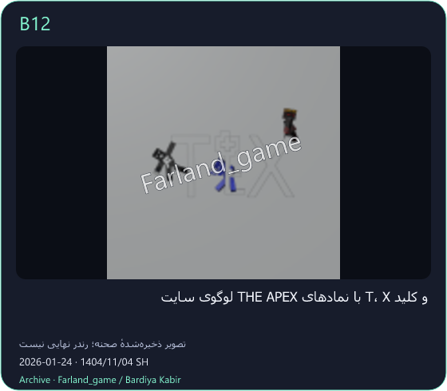

# B12 · لوگوی سایت THE APEX با نمادهای T، X و کلید
[English](https://github.com/FarlandGame/Animation-Portfolio/blob/main/sources/blender/en/B12.md) · [فارسی](https://github.com/FarlandGame/Animation-Portfolio/blob/main/sources/blender/fa/B12.md) · [日本語](https://github.com/FarlandGame/Animation-Portfolio/blob/main/sources/blender/ja/B12.md)

## روایت سازنده

لوگوی کامل‌شده‌ای برای سایت THE APEX. حرف T از واژهٔ THE و حرف X از واژهٔ APEX گرفته شده‌اند. کلید، نماد اتاق‌فرار بودن بازی است.

**آخرین تغییر فایل تحویلی:** 2026-01-24 · 1404/11/04 SH

تاریخ‌ها زمان آخرین تغییر نسخهٔ تحویلی فایل، به وقت تهران‌اند؛ تاریخ قطعی شروع ساخت یا پایان پروژه نیستند.

**نام فایل تحویلی:** `Lego.blend`

**نسخهٔ ثبت‌شده در فایل اصلی:** 4.3

### [دانلود بستهٔ فایل قابل‌ویرایش · ZIP · 1.9 MB](https://github.com/FarlandGame/Animation-Portfolio/releases/download/blender-source-archive-2026-11/B12-blender-source-snapshot.zip)

نسخهٔ عمومی با بلندر ۵٫۲ ذخیره شده است. سازگاری با نسخه‌های قدیمی‌تر و رندر نهاییِ بی‌نقص تأیید نشده است.

این‌ها نسخه‌های جداگانهٔ آماده‌شده برای انتشارند. فایل‌های اصلی سازنده تغییر نکرده‌اند. بافت‌های تصویریِ موجود داخل نسخه بسته‌بندی شده‌اند؛ نیمه‌تمام‌بودن، منابع گم‌شده و حذف حرکت‌های متعلق به سرویس دیگر، صریحاً توضیح داده شده‌اند.

`SHA-256: f3db66df704d9ca2e579658224cc6d781163b1a43ced122e4edf6ef2217470c5`

## منابع و تغییرات نسخهٔ عمومی

**ارجاع‌های تصویریِ پیدا‌نشده:** در این بررسی موردی گزارش نشده است

**حرکت‌های قابل‌شناسایی Mixamo که حذف شدند:** در این بررسی موردی گزارش نشده است

**موسیقیِ کنارگذاشته‌شده از این نسخه:** در این بررسی موردی گزارش نشده است

**صدای حفظ‌شده:** در این بررسی موردی گزارش نشده است

**نام قلم‌های خارجی:** در این بررسی موردی گزارش نشده است

### نسخهٔ ذخیرهٔ قبلی

ذخیرهٔ قبلی در پوشهٔ versions داخل بسته قرار دارد و خودبه‌خود پروژه‌ای مستقل شمرده نمی‌شود. هش‌ها و تاریخ فایل‌های تحویلی داخل دانلود ثبت شده‌اند.

نام اصلی را حفظ کنید: **بردیا علیزاده، ملقب به کبیر / Farland_game**. بخش‌های تألیفیِ واجد شرایط با **CC BY-NC 4.0** منتشر می‌شوند: استفادهٔ غیرتجاری، پیوند مجوز و مشخص‌کردن تغییرات لازم است. نام خود را برای تغییراتتان اضافه کنید و کار اولیه را به نام خود نزنید. منابع دیگران شرایط خودشان را دارند.

[راهنمای بازکردن، ادامه‌دادن و حفظ نام سازنده](https://github.com/FarlandGame/Animation-Portfolio/blob/main/sources/blender/fa/guide.md) · [Third-party credits](https://github.com/FarlandGame/Animation-Portfolio/blob/main/sources/blender/THIRD-PARTY.md) · [همهٔ فایل‌های آرشیو](https://github.com/FarlandGame/Animation-Portfolio/blob/main/sources/blender/fa/index.md)
