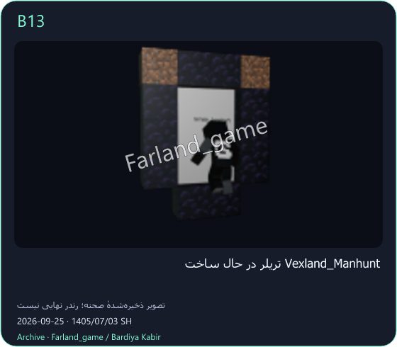

# B13 · تریلر در حال ساخت Vexland_Manhunt
[English](https://github.com/FarlandGame/Animation-Portfolio/blob/main/sources/blender/en/B13.md) · [فارسی](https://github.com/FarlandGame/Animation-Portfolio/blob/main/sources/blender/fa/B13.md) · [日本語](https://github.com/FarlandGame/Animation-Portfolio/blob/main/sources/blender/ja/B13.md) · [Русский](https://github.com/FarlandGame/Animation-Portfolio/blob/main/sources/blender/ru/B13.md)

## روایت سازنده

تریلری انیمیشنی برای پلاگین Vexland_Manhunt که قرار بوده طولانی باشد. بردیا پس از ساخت بخشی از آن و مطرح‌شدن نگرانی دربارهٔ کپی‌رایت موسیقی، مدتی آن را کنار گذاشت، اما اکنون همچنان روی پروژه کار می‌کند و قصد تکمیل آن را دارد. انتشار نسخهٔ فعلیِ در حال ساخت را مجاز دانسته است.

**آخرین تغییر فایل تحویلی:** 2026-09-25 · 1405/07/03 SH

تاریخ‌ها زمان آخرین تغییر نسخهٔ تحویلی فایل، به وقت تهران‌اند؛ تاریخ قطعی شروع ساخت یا پایان پروژه نیستند.

**نام فایل تحویلی:** `Part_1.blend`

**نسخهٔ ثبت‌شده در فایل اصلی:** 5.2

### [دانلود بستهٔ فایل قابل‌ویرایش · RAR · 72.9 MB](https://github.com/FarlandGame/Animation-Portfolio/releases/download/blender-source-archive-2026-11/B13-blender-source-snapshot.rar)

نسخهٔ عمومی با بلندر ۵٫۲ ذخیره شده است. سازگاری با نسخه‌های قدیمی‌تر و رندر نهاییِ بی‌نقص تأیید نشده است.

این‌ها نسخه‌های جداگانهٔ آماده‌شده برای انتشارند. فایل‌های اصلی سازنده تغییر نکرده‌اند. بافت‌های تصویریِ موجود داخل نسخه بسته‌بندی شده‌اند؛ نیمه‌تمام‌بودن، منابع گم‌شده و حذف حرکت‌های متعلق به سرویس دیگر، صریحاً توضیح داده شده‌اند.

`SHA-256: a257e5fe68be046f3540b58cbc88d3fe4cd61cbda5df43b78a9d3f8a9ab5dc5e`

## منابع و تغییرات نسخهٔ عمومی

**ارجاع‌های تصویریِ پیدا‌نشده:** در این بررسی موردی گزارش نشده است

حرکت‌های قابل‌شناسایی Mixamo که حذف شدند: 15

`SimplePlayer.arma.001|mixamo.com|Layer0.001`, `SimplePlayer.arma.001|mixamo.com|Layer0.002`, `SimplePlayer.arma.002|mixamo.com|Layer0`, `SimplePlayer.arma.003|mixamo.com|Layer0`, `SimplePlayer.arma.004|mixamo.com|Layer0.002`, `SimplePlayer.arma|mixamo.com|Layer0`, `SimplePlayer.arma|mixamo.com|Layer0.001`, `SimplePlayer.arma|mixamo.com|Layer0.002`, `SimplePlayer.arma|mixamo.com|Layer0.003`, `SimplePlayer.arma|mixamo.com|Layer0.004`, `SimplePlayer.arma|mixamo.com|Layer0.005`, `SimplePlayer.arma|mixamo.com|Layer0.006`, `SimplePlayer.arma|mixamo.com|Layer0.007`, `SimplePlayer.arma|mixamo.com|Layer0.008`, `SimplePlayer.arma|mixamo.com|Layer0.009`

**موسیقیِ کنارگذاشته‌شده از این نسخه:** در این بررسی موردی گزارش نشده است

**صدای حفظ‌شده:** `LIKE YOU~   ANATHEMA-000.mp3`

نام قلم‌های خارجی: 47

`Minecraft.ttf`, `Minecraft.ttf`, `Minecraft.ttf`, `Minecraft.ttf`, `Minecraft.ttf`, `Minecraft.ttf`, `Minecraft.ttf`, `Minecraft.ttf`, `Minecraft.ttf`, `Minecraft.ttf`, `Minecraft.ttf`, `Minecraft.ttf`, `Minecraft.ttf`, `Minecraft.ttf`, `Minecraft.ttf`, `Minecraft.ttf`, `Minecraft.ttf`, `Minecraft.ttf`, `Minecraft.ttf`, `Minecraft.ttf`, `Minecraft.ttf`, `Minecraft.ttf`, `Minecraft.ttf`, `Minecraft.ttf`, `Minecraft.ttf`, `Minecraft.ttf`, `Minecraft.ttf`, `Minecraft.ttf`, `Minecraft.ttf`, `Minecraft.ttf`, `Minecraft.ttf`, `Minecraft.ttf`, `Minecraft.ttf`, `Minecraft.ttf`, `Minecraft.ttf`, `Minecraft.ttf`, `Minecraft.ttf`, `Minecraft.ttf`, `Minecraft.ttf`, `Minecraft.ttf`, `Minecraft.ttf`, `Minecraft.ttf`, `Minecraft.ttf`, `Minecraft.ttf`, `Minecraft.ttf`, `Minecraft.ttf`, `Minecraft.ttf`

### نسخهٔ ذخیرهٔ قبلی

ذخیرهٔ قبلی در پوشهٔ versions داخل بسته قرار دارد و خودبه‌خود پروژه‌ای مستقل شمرده نمی‌شود. هش‌ها و تاریخ فایل‌های تحویلی داخل دانلود ثبت شده‌اند.

نام اصلی را حفظ کنید: **بردیا علیزاده، ملقب به کبیر / Farland_game**. بخش‌های تألیفیِ واجد شرایط با **CC BY-NC 4.0** منتشر می‌شوند: استفادهٔ غیرتجاری، پیوند مجوز و مشخص‌کردن تغییرات لازم است. نام خود را برای تغییراتتان اضافه کنید و کار اولیه را به نام خود نزنید. منابع دیگران شرایط خودشان را دارند.

[راهنمای بازکردن، ادامه‌دادن و حفظ نام سازنده](https://github.com/FarlandGame/Animation-Portfolio/blob/main/sources/blender/fa/guide.md) · [Third-party credits](https://github.com/FarlandGame/Animation-Portfolio/blob/main/sources/blender/THIRD-PARTY.md) · [همهٔ فایل‌های آرشیو](https://github.com/FarlandGame/Animation-Portfolio/blob/main/sources/blender/fa/index.md)
