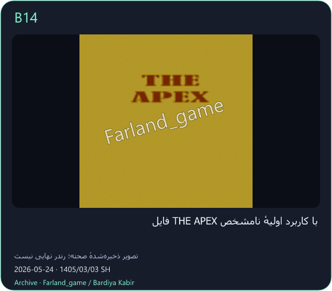

# B14 · فایل THE APEX با کاربرد اولیهٔ نامشخص
[English](https://github.com/FarlandGame/Animation-Portfolio/blob/main/sources/blender/en/B14.md) · [فارسی](https://github.com/FarlandGame/Animation-Portfolio/blob/main/sources/blender/fa/B14.md) · [日本語](https://github.com/FarlandGame/Animation-Portfolio/blob/main/sources/blender/ja/B14.md) · [Русский](https://github.com/FarlandGame/Animation-Portfolio/blob/main/sources/blender/ru/B14.md)

## روایت سازنده

سازنده کاربرد دقیق این فایل را به یاد ندارد. نوشتهٔ THE APEX در تصویر دیده می‌شود و او احتمال می‌دهد فایل به بنر، نام‌نوشته یا انیمیشنی مربوط بوده باشد. این احتمال‌ها به‌عنوان کاربرد قطعی معرفی نمی‌شوند.

**آخرین تغییر فایل تحویلی:** 2026-05-24 · 1405/03/03 SH

تاریخ‌ها زمان آخرین تغییر نسخهٔ تحویلی فایل، به وقت تهران‌اند؛ تاریخ قطعی شروع ساخت یا پایان پروژه نیستند.

**نام فایل تحویلی:** `untitled.blend`

**نسخهٔ ثبت‌شده در فایل اصلی:** 4.3

### [دانلود بستهٔ فایل قابل‌ویرایش · ZIP · 1.9 MB](https://github.com/FarlandGame/Animation-Portfolio/releases/download/blender-source-archive-2026-11/B14-blender-source-snapshot.zip)

نسخهٔ عمومی با بلندر ۵٫۲ ذخیره شده است. سازگاری با نسخه‌های قدیمی‌تر و رندر نهاییِ بی‌نقص تأیید نشده است.

این‌ها نسخه‌های جداگانهٔ آماده‌شده برای انتشارند. فایل‌های اصلی سازنده تغییر نکرده‌اند. بافت‌های تصویریِ موجود داخل نسخه بسته‌بندی شده‌اند؛ نیمه‌تمام‌بودن، منابع گم‌شده و حذف حرکت‌های متعلق به سرویس دیگر، صریحاً توضیح داده شده‌اند.

`SHA-256: a0c3d830f6935e54361c1d3750dd8b7c7ff640c7c00b3fac18b4dc99b1098a1d`

## منابع و تغییرات نسخهٔ عمومی

**ارجاع‌های تصویریِ پیدا‌نشده:** `neow karakter.png`, `neow karakter.png.001`

**حرکت‌های قابل‌شناسایی Mixamo که حذف شدند:** در این بررسی موردی گزارش نشده است

**موسیقیِ کنارگذاشته‌شده از این نسخه:** `MUTILATOR (SUPER SLOWED).mp3`

**صدای حفظ‌شده:** در این بررسی موردی گزارش نشده است

**نام قلم‌های خارجی:** `BERNHC.TTF`, `BERNHC.TTF`

### نسخهٔ ذخیرهٔ قبلی

ذخیرهٔ قبلی در پوشهٔ versions داخل بسته قرار دارد و خودبه‌خود پروژه‌ای مستقل شمرده نمی‌شود. هش‌ها و تاریخ فایل‌های تحویلی داخل دانلود ثبت شده‌اند.

نام اصلی را حفظ کنید: **بردیا علیزاده، ملقب به کبیر / Farland_game**. بخش‌های تألیفیِ واجد شرایط با **CC BY-NC 4.0** منتشر می‌شوند: استفادهٔ غیرتجاری، پیوند مجوز و مشخص‌کردن تغییرات لازم است. نام خود را برای تغییراتتان اضافه کنید و کار اولیه را به نام خود نزنید. منابع دیگران شرایط خودشان را دارند.

[راهنمای بازکردن، ادامه‌دادن و حفظ نام سازنده](https://github.com/FarlandGame/Animation-Portfolio/blob/main/sources/blender/fa/guide.md) · [Third-party credits](https://github.com/FarlandGame/Animation-Portfolio/blob/main/sources/blender/THIRD-PARTY.md) · [همهٔ فایل‌های آرشیو](https://github.com/FarlandGame/Animation-Portfolio/blob/main/sources/blender/fa/index.md)
