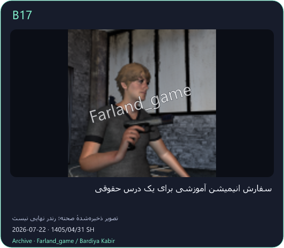

# B17 · سفارش انیمیشن آموزشی برای یک درس حقوقی
[English](https://github.com/FarlandGame/Animation-Portfolio/blob/main/sources/blender/en/B17.md) · [فارسی](https://github.com/FarlandGame/Animation-Portfolio/blob/main/sources/blender/fa/B17.md) · [日本語](https://github.com/FarlandGame/Animation-Portfolio/blob/main/sources/blender/ja/B17.md)

## روایت سازنده

یک سفارش پولی برای توضیح یک مثال در درس حقوق، برای یکی از استادان مادر بردیا که وکیل است. در داستان، شخصی قصد شلیک به فرد روبه‌رو را دارد اما به‌دلیل لرزش دست، شلیک به سمت راست منحرف می‌شود. بردیا این موقعیت را برای آموزش به انیمیشن تبدیل کرد.

**آخرین تغییر فایل تحویلی:** 2026-07-22 · 1405/04/31 SH

تاریخ‌ها زمان آخرین تغییر نسخهٔ تحویلی فایل، به وقت تهران‌اند؛ تاریخ قطعی شروع ساخت یا پایان پروژه نیستند.

**نام فایل تحویلی:** `untitled.blend`

**نسخهٔ ثبت‌شده در فایل اصلی:** 4.3

### دانلود بستهٔ فایل قابل‌ویرایش · RAR × 3 · 275.8 MB

**هر سه بخش را دانلود کنید** و در یک پوشه بگذارید؛ سپس **part1.rar** را استخراج کنید. این‌ها سه بخشِ یک بستهٔ کامل‌اند، نه سه پروژهٔ جدا.

[B17-blender-source-snapshot.part1.rar · 104.9 MB](https://github.com/FarlandGame/Animation-Portfolio/releases/download/blender-source-archive-2026-11/B17-blender-source-snapshot.part1.rar)

`SHA-256: e6060bdb5592d2ff7cf276bc44ba98a5453dc636948cdacc0e4e6eb376ed4932`

[B17-blender-source-snapshot.part2.rar · 104.9 MB](https://github.com/FarlandGame/Animation-Portfolio/releases/download/blender-source-archive-2026-11/B17-blender-source-snapshot.part2.rar)

`SHA-256: 53b08abbb30fc42e1be58310b618f3c7e9f7e2d95d17f21f321b3ae718739890`

[B17-blender-source-snapshot.part3.rar · 66.0 MB](https://github.com/FarlandGame/Animation-Portfolio/releases/download/blender-source-archive-2026-11/B17-blender-source-snapshot.part3.rar)

`SHA-256: 0b8a6c875cd0de09cbef6ecf8f5eb24ea6ff17c5bcb6c42511c3333cadb41789`

نسخهٔ عمومی با بلندر ۵٫۲ ذخیره شده است. سازگاری با نسخه‌های قدیمی‌تر و رندر نهاییِ بی‌نقص تأیید نشده است.

این‌ها نسخه‌های جداگانهٔ آماده‌شده برای انتشارند. فایل‌های اصلی سازنده تغییر نکرده‌اند. بافت‌های تصویریِ موجود داخل نسخه بسته‌بندی شده‌اند؛ نیمه‌تمام‌بودن، منابع گم‌شده و حذف حرکت‌های متعلق به سرویس دیگر، صریحاً توضیح داده شده‌اند.

## منابع و تغییرات نسخهٔ عمومی

**ارجاع‌های تصویریِ پیدا‌نشده:** `Map #1`

حرکت‌های قابل‌شناسایی Mixamo که حذف شدند: 6

`Armature.001|mixamo.com|Layer0`, `Armature.002|mixamo.com|Layer0`, `Armature.003|mixamo.com|Layer0`, `Armature.003|mixamo.com|Layer0.001`, `Armature.003|mixamo.com|Layer0.004`, `Armature|mixamo.com|Layer0`

**موسیقیِ کنارگذاشته‌شده از این نسخه:** در این بررسی موردی گزارش نشده است

**صدای حفظ‌شده:** در این بررسی موردی گزارش نشده است

**نام قلم‌های خارجی:** در این بررسی موردی گزارش نشده است

### نسخهٔ ذخیرهٔ قبلی

ذخیرهٔ قبلی در پوشهٔ versions داخل بسته قرار دارد و خودبه‌خود پروژه‌ای مستقل شمرده نمی‌شود. هش‌ها و تاریخ فایل‌های تحویلی داخل دانلود ثبت شده‌اند.

نام اصلی را حفظ کنید: **بردیا علیزاده، ملقب به کبیر / Farland_game**. بخش‌های تألیفیِ واجد شرایط با **CC BY-NC 4.0** منتشر می‌شوند: استفادهٔ غیرتجاری، پیوند مجوز و مشخص‌کردن تغییرات لازم است. نام خود را برای تغییراتتان اضافه کنید و کار اولیه را به نام خود نزنید. منابع دیگران شرایط خودشان را دارند.

[راهنمای بازکردن، ادامه‌دادن و حفظ نام سازنده](https://github.com/FarlandGame/Animation-Portfolio/blob/main/sources/blender/fa/guide.md) · [Third-party credits](https://github.com/FarlandGame/Animation-Portfolio/blob/main/sources/blender/THIRD-PARTY.md) · [همهٔ فایل‌های آرشیو](https://github.com/FarlandGame/Animation-Portfolio/blob/main/sources/blender/fa/index.md)
