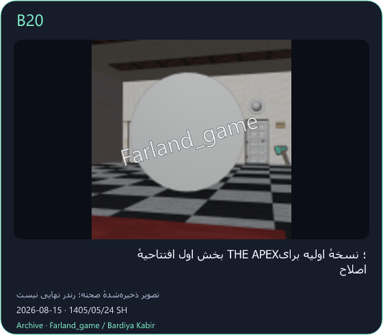

# B20 · بخش اول افتتاحیهٔ THE APEX؛ نسخهٔ اولیه برای اصلاح
[English](https://github.com/FarlandGame/Animation-Portfolio/blob/main/sources/blender/en/B20.md) · [فارسی](https://github.com/FarlandGame/Animation-Portfolio/blob/main/sources/blender/fa/B20.md) · [日本語](https://github.com/FarlandGame/Animation-Portfolio/blob/main/sources/blender/ja/B20.md) · [Русский](https://github.com/FarlandGame/Animation-Portfolio/blob/main/sources/blender/ru/B20.md)

## روایت سازنده

بخش اول از سه بخشِ انیمیشن آغازین THE APEX، پروژهٔ داستانی و اتاق‌فرار ماینکرفت با ایده و داستان بردیا. قرار بوده افتتاحیه هنگام شروع بازی از طریق پلاگین پخش شود. نسخهٔ اولیهٔ این بخش رندر شده، اما بردیا قصد دارد حرکت راه‌رفتن و صداگذاری اولیه را اصلاح کند. به روایت او، پروژه حدود ۱۱ هزار فریم داشت و رندر روی لپ‌تاپش حدود ۸۰ روز طول کشید. این تجربه بخش مهمی از یادگیری او دربارهٔ رندر و انتقال پروژه برای کار با سیستم‌های دیگر شد.

**آخرین تغییر فایل تحویلی:** 2026-08-15 · 1405/05/24 SH

تاریخ‌ها زمان آخرین تغییر نسخهٔ تحویلی فایل، به وقت تهران‌اند؛ تاریخ قطعی شروع ساخت یا پایان پروژه نیستند.

**نام فایل تحویلی:** `untitled.blend`

**نسخهٔ ثبت‌شده در فایل اصلی:** 5.2

### [دانلود بستهٔ فایل قابل‌ویرایش · ZIP · 22.8 MB](https://github.com/FarlandGame/Animation-Portfolio/releases/download/blender-source-archive-2026-11/B20-blender-source-snapshot.zip)

نسخهٔ عمومی با بلندر ۵٫۲ ذخیره شده است. سازگاری با نسخه‌های قدیمی‌تر و رندر نهاییِ بی‌نقص تأیید نشده است.

این‌ها نسخه‌های جداگانهٔ آماده‌شده برای انتشارند. فایل‌های اصلی سازنده تغییر نکرده‌اند. بافت‌های تصویریِ موجود داخل نسخه بسته‌بندی شده‌اند؛ نیمه‌تمام‌بودن، منابع گم‌شده و حذف حرکت‌های متعلق به سرویس دیگر، صریحاً توضیح داده شده‌اند.

`SHA-256: bf55ce633544410d7c8e53cd88c9835cafdc7a54ede6bcd409887dc2e141289f`

## منابع و تغییرات نسخهٔ عمومی

**ارجاع‌های تصویریِ پیدا‌نشده:** در این بررسی موردی گزارش نشده است

**حرکت‌های قابل‌شناسایی Mixamo که حذف شدند:** در این بررسی موردی گزارش نشده است

**موسیقیِ کنارگذاشته‌شده از این نسخه:** در این بررسی موردی گزارش نشده است

صدای حفظ‌شده: 12

`1.aac`, `1.mp3`, `2.aac`, `2.mp3`, `3.aac`, `3.mp3`, `4.aac`, `bardia 1.mp3`, `bardiya 2.mp3`, `bardiya 5.mp3`, `bardiya 6.mp3`, `bardiya 8.mp3`

نام قلم‌های خارجی: 13

`AGENCYB.TTF`, `AGENCYB.TTF`, `AGENCYB.TTF`, `AGENCYB.TTF`, `AGENCYB.TTF`, `AGENCYB.TTF`, `AGENCYB.TTF`, `AGENCYB.TTF`, `AGENCYB.TTF`, `AGENCYB.TTF`, `AGENCYB.TTF`, `AGENCYB.TTF`, `AGENCYB.TTF`

### نسخهٔ ذخیرهٔ قبلی

ذخیرهٔ قبلی در پوشهٔ versions داخل بسته قرار دارد و خودبه‌خود پروژه‌ای مستقل شمرده نمی‌شود. هش‌ها و تاریخ فایل‌های تحویلی داخل دانلود ثبت شده‌اند.

نام اصلی را حفظ کنید: **بردیا علیزاده، ملقب به کبیر / Farland_game**. بخش‌های تألیفیِ واجد شرایط با **CC BY-NC 4.0** منتشر می‌شوند: استفادهٔ غیرتجاری، پیوند مجوز و مشخص‌کردن تغییرات لازم است. نام خود را برای تغییراتتان اضافه کنید و کار اولیه را به نام خود نزنید. منابع دیگران شرایط خودشان را دارند.

[راهنمای بازکردن، ادامه‌دادن و حفظ نام سازنده](https://github.com/FarlandGame/Animation-Portfolio/blob/main/sources/blender/fa/guide.md) · [Third-party credits](https://github.com/FarlandGame/Animation-Portfolio/blob/main/sources/blender/THIRD-PARTY.md) · [همهٔ فایل‌های آرشیو](https://github.com/FarlandGame/Animation-Portfolio/blob/main/sources/blender/fa/index.md)
