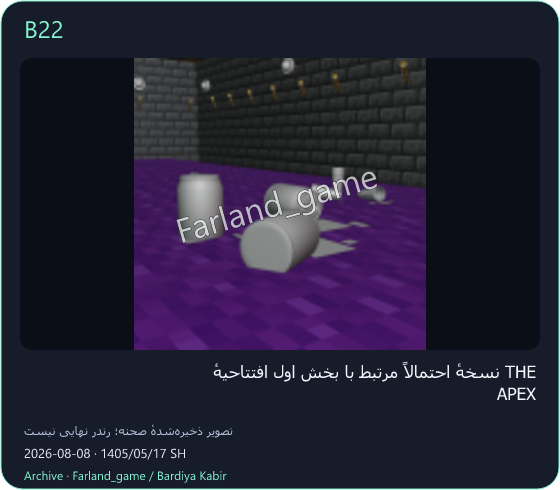

# B22 · نسخهٔ احتمالاً مرتبط با بخش اول افتتاحیهٔ THE APEX
[English](https://github.com/FarlandGame/Animation-Portfolio/blob/main/sources/blender/en/B22.md) · [فارسی](https://github.com/FarlandGame/Animation-Portfolio/blob/main/sources/blender/fa/B22.md) · [日本語](https://github.com/FarlandGame/Animation-Portfolio/blob/main/sources/blender/ja/B22.md)

## روایت سازنده

بردیا احتمال می‌دهد این فایل نسخه‌ای دیگر از همان بخش اول افتتاحیهٔ THE APEX در B20 باشد و آن را پروژه‌ای مستقل معرفی نمی‌کند. در بررسی فایل‌ها، بازهٔ فریم هر دو یکسان است اما تعداد اجزا و منابعشان فرق دارد؛ B22 صداهای ذخیره‌شدهٔ B20 را ندارد. هر دو نسخه برای بررسی و نگهداری باقی می‌مانند.

**آخرین تغییر فایل تحویلی:** 2026-08-08 · 1405/05/17 SH

تاریخ‌ها زمان آخرین تغییر نسخهٔ تحویلی فایل، به وقت تهران‌اند؛ تاریخ قطعی شروع ساخت یا پایان پروژه نیستند.

**نام فایل تحویلی:** `Untitled.blend`

**نسخهٔ ثبت‌شده در فایل اصلی:** 5.2

### [دانلود بستهٔ فایل قابل‌ویرایش · ZIP · 10.8 MB](https://github.com/FarlandGame/Animation-Portfolio/releases/download/blender-source-archive-2026-11/B22-blender-source-snapshot.zip)

نسخهٔ عمومی با بلندر ۵٫۲ ذخیره شده است. سازگاری با نسخه‌های قدیمی‌تر و رندر نهاییِ بی‌نقص تأیید نشده است.

این‌ها نسخه‌های جداگانهٔ آماده‌شده برای انتشارند. فایل‌های اصلی سازنده تغییر نکرده‌اند. بافت‌های تصویریِ موجود داخل نسخه بسته‌بندی شده‌اند؛ نیمه‌تمام‌بودن، منابع گم‌شده و حذف حرکت‌های متعلق به سرویس دیگر، صریحاً توضیح داده شده‌اند.

`SHA-256: d493ddc937d37a90274634a7ce5f37396d48c9eb1d758732e6528408e7f199e4`

## منابع و تغییرات نسخهٔ عمومی

**ارجاع‌های تصویریِ پیدا‌نشده:** در این بررسی موردی گزارش نشده است

**حرکت‌های قابل‌شناسایی Mixamo که حذف شدند:** در این بررسی موردی گزارش نشده است

**موسیقیِ کنارگذاشته‌شده از این نسخه:** در این بررسی موردی گزارش نشده است

**صدای حفظ‌شده:** در این بررسی موردی گزارش نشده است

نام قلم‌های خارجی: 13

`AGENCYB.TTF`, `AGENCYB.TTF`, `AGENCYB.TTF`, `AGENCYB.TTF`, `AGENCYB.TTF`, `AGENCYB.TTF`, `AGENCYB.TTF`, `AGENCYB.TTF`, `AGENCYB.TTF`, `AGENCYB.TTF`, `AGENCYB.TTF`, `AGENCYB.TTF`, `AGENCYB.TTF`

### نسخهٔ ذخیرهٔ قبلی

ذخیرهٔ قبلی در پوشهٔ versions داخل بسته قرار دارد و خودبه‌خود پروژه‌ای مستقل شمرده نمی‌شود. هش‌ها و تاریخ فایل‌های تحویلی داخل دانلود ثبت شده‌اند.

**فایل‌های مرتبط:** [B20](https://github.com/FarlandGame/Animation-Portfolio/blob/main/sources/blender/fa/B20.md)

نام اصلی را حفظ کنید: **بردیا علیزاده، ملقب به کبیر / Farland_game**. بخش‌های تألیفیِ واجد شرایط با **CC BY-NC 4.0** منتشر می‌شوند: استفادهٔ غیرتجاری، پیوند مجوز و مشخص‌کردن تغییرات لازم است. نام خود را برای تغییراتتان اضافه کنید و کار اولیه را به نام خود نزنید. منابع دیگران شرایط خودشان را دارند.

[راهنمای بازکردن، ادامه‌دادن و حفظ نام سازنده](https://github.com/FarlandGame/Animation-Portfolio/blob/main/sources/blender/fa/guide.md) · [Third-party credits](https://github.com/FarlandGame/Animation-Portfolio/blob/main/sources/blender/THIRD-PARTY.md) · [همهٔ فایل‌های آرشیو](https://github.com/FarlandGame/Animation-Portfolio/blob/main/sources/blender/fa/index.md)
