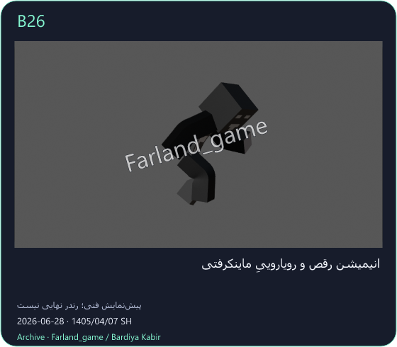

# B26 · انیمیشن رقص و رویاروییِ ماینکرفتی
[English](https://github.com/FarlandGame/Animation-Portfolio/blob/main/sources/blender/en/B26.md) · [فارسی](https://github.com/FarlandGame/Animation-Portfolio/blob/main/sources/blender/fa/B26.md) · [日本語](https://github.com/FarlandGame/Animation-Portfolio/blob/main/sources/blender/ja/B26.md) · [Русский](https://github.com/FarlandGame/Animation-Portfolio/blob/main/sources/blender/ru/B26.md)

## روایت سازنده

فایل خودِ انیمیشنی است که پوسترش در B25 ساخته شد. بردیا می‌رقصد، ارمیا و علی ظاهر می‌شوند و کاراکترها در یک رویارویی کارتونی بدون خون‌ریزی دیده می‌شوند. بردیا می‌گوید خروجی فیلم و پوسترش قبلاً منتشر شده‌اند. برای ساخت این اثر، حرکت‌ها از مجموعهٔ آمادهٔ B27 به این صحنه منتقل و اسکین‌ها تغییر داده می‌شدند؛ همهٔ حرکت‌ها ساختهٔ بردیا از صفر نیستند.

**آخرین تغییر فایل تحویلی:** 2026-06-28 · 1405/04/07 SH

تاریخ‌ها زمان آخرین تغییر نسخهٔ تحویلی فایل، به وقت تهران‌اند؛ تاریخ قطعی شروع ساخت یا پایان پروژه نیستند.

**نام فایل تحویلی:** `untitled.blend`

**نسخهٔ ثبت‌شده در فایل اصلی:** 4.3

### [دانلود بستهٔ فایل قابل‌ویرایش · ZIP · 8.3 MB](https://github.com/FarlandGame/Animation-Portfolio/releases/download/blender-source-archive-2026-11/B26-blender-source-snapshot.zip)

نسخهٔ عمومی با بلندر ۵٫۲ ذخیره شده است. سازگاری با نسخه‌های قدیمی‌تر و رندر نهاییِ بی‌نقص تأیید نشده است.

این‌ها نسخه‌های جداگانهٔ آماده‌شده برای انتشارند. فایل‌های اصلی سازنده تغییر نکرده‌اند. بافت‌های تصویریِ موجود داخل نسخه بسته‌بندی شده‌اند؛ نیمه‌تمام‌بودن، منابع گم‌شده و حذف حرکت‌های متعلق به سرویس دیگر، صریحاً توضیح داده شده‌اند.

`SHA-256: ef003ffe7af600658a31d7b4985e5a6b1925a16eb1576b0afbc81f7a40c52a0c`

## منابع و تغییرات نسخهٔ عمومی

**ارجاع‌های تصویریِ پیدا‌نشده:** `GunGS_Albedo.tga.png`, `GunGS_Roughness.tga.png`

حرکت‌های قابل‌شناسایی Mixamo که حذف شدند: 34

`SimplePlayer.arma.004|mixamo.com|Layer0`, `SimplePlayer.arma.005|mixamo.com|Layer0`, `SimplePlayer.arma.006|mixamo.com|Layer0`, `SimplePlayer.arma.006|mixamo.com|Layer0.001`, `SimplePlayer.arma.007|mixamo.com|Layer0`, `SimplePlayer.arma.008|mixamo.com|Layer0`, `SimplePlayer.arma.009|mixamo.com|Layer0`, `SimplePlayer.arma.010|mixamo.com|Layer0`, `SimplePlayer.arma.010|mixamo.com|Layer0.001`, `SimplePlayer.arma.011|mixamo.com|Layer0`, `SimplePlayer.arma.012|mixamo.com|Layer0`, `SimplePlayer.arma.012|mixamo.com|Layer0.001`, `SimplePlayer.arma.013|mixamo.com|Layer0`, `SimplePlayer.arma.014|mixamo.com|Layer0`, `SimplePlayer.arma.014|mixamo.com|Layer0.001`, `SimplePlayer.arma.016|mixamo.com|Layer0`, `SimplePlayer.arma.017|mixamo.com|Layer0`, `SimplePlayer.arma.018|mixamo.com|Layer0`, `SimplePlayer.arma.019|mixamo.com|Layer0`, `SimplePlayer.arma.019|mixamo.com|Layer0.001`, `SimplePlayer.arma.020|mixamo.com|Layer0`, `SimplePlayer.arma.021|mixamo.com|Layer0`, `SimplePlayer.arma.022|mixamo.com|Layer0`, `SimplePlayer.arma.024|mixamo.com|Layer0`, `SimplePlayer.arma.025|mixamo.com|Layer0`, `SimplePlayer.arma.025|mixamo.com|Layer0.001`, `SimplePlayer.arma.026|mixamo.com|Layer0`, `SimplePlayer.arma.027|mixamo.com|Layer0`, `SimplePlayer.arma.028|mixamo.com|Layer0`, `SimplePlayer.arma.029|mixamo.com|Layer0`, `SimplePlayer.arma.034|mixamo.com|Layer0`, `SimplePlayer.arma.034|mixamo.com|Layer0.001`, `SimplePlayer.arma.034|mixamo.com|Layer0.002`, `SimplePlayer.arma.034|mixamo.com|Layer0.003`

**موسیقیِ کنارگذاشته‌شده از این نسخه:** `dança zip (Super Slowed).m4a.001`

**صدای حفظ‌شده:** در این بررسی موردی گزارش نشده است

**نام قلم‌های خارجی:** در این بررسی موردی گزارش نشده است

### نسخهٔ ذخیرهٔ قبلی

ذخیرهٔ قبلی در پوشهٔ versions داخل بسته قرار دارد و خودبه‌خود پروژه‌ای مستقل شمرده نمی‌شود. هش‌ها و تاریخ فایل‌های تحویلی داخل دانلود ثبت شده‌اند.

## خروجی قبلاً منتشرشده

ارتباط پوستر و فایل فیلم را سازنده تأیید کرده؛ مقایسهٔ تصویری نیز با فریم ویدئوی main-06 و پوستر رنگی موجود هم‌خوان است.

[▶ main-06](https://github.com/FarlandGame/Animation-Portfolio/blob/main/collections/fa/main.md#main-06) · [THE APEX](https://github.com/FarlandGame/Animation-Portfolio/blob/main/assets/section-covers/the-apex-color.png)

**فایل‌های مرتبط:** [B25](https://github.com/FarlandGame/Animation-Portfolio/blob/main/sources/blender/fa/B25.md) · [B27](https://github.com/FarlandGame/Animation-Portfolio/blob/main/sources/blender/fa/B27.md)

نام اصلی را حفظ کنید: **بردیا علیزاده، ملقب به کبیر / Farland_game**. بخش‌های تألیفیِ واجد شرایط با **CC BY-NC 4.0** منتشر می‌شوند: استفادهٔ غیرتجاری، پیوند مجوز و مشخص‌کردن تغییرات لازم است. نام خود را برای تغییراتتان اضافه کنید و کار اولیه را به نام خود نزنید. منابع دیگران شرایط خودشان را دارند.

[راهنمای بازکردن، ادامه‌دادن و حفظ نام سازنده](https://github.com/FarlandGame/Animation-Portfolio/blob/main/sources/blender/fa/guide.md) · [Third-party credits](https://github.com/FarlandGame/Animation-Portfolio/blob/main/sources/blender/THIRD-PARTY.md) · [همهٔ فایل‌های آرشیو](https://github.com/FarlandGame/Animation-Portfolio/blob/main/sources/blender/fa/index.md)
