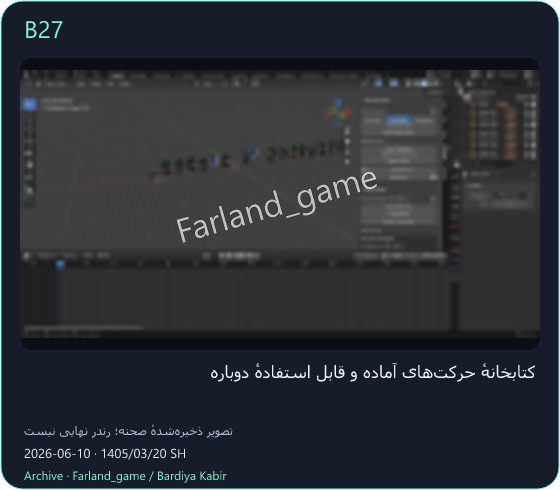

# B27 · کتابخانهٔ حرکت‌های آماده و قابل استفادهٔ دوباره
[English](https://github.com/FarlandGame/Animation-Portfolio/blob/main/sources/blender/en/B27.md) · [فارسی](https://github.com/FarlandGame/Animation-Portfolio/blob/main/sources/blender/fa/B27.md) · [日本語](https://github.com/FarlandGame/Animation-Portfolio/blob/main/sources/blender/ja/B27.md) · [Русский](https://github.com/FarlandGame/Animation-Portfolio/blob/main/sources/blender/ru/B27.md)

## روایت سازنده

مجموعه‌ای کاری برای جلوگیری از ساخت یا دانلود دوبارهٔ حرکت‌ها، به‌ویژه برای استفاده در B26. بعضی حرکت‌ها را بردیا ساخته، بعضی با الگو گرفتن از ویدئوها ساخته شده‌اند و بعضی از Mixamo دانلود شده‌اند. او بخش‌های لازم را به پروژهٔ اصلی کپی و اسکین کاراکتر را عوض می‌کرد. این مجموعه اثر کاملاً تألیفیِ یک نفر معرفی نمی‌شود؛ فایل‌های خام Mixamo تابع شرایط همان سرویس‌اند.

**آخرین تغییر فایل تحویلی:** 2026-06-10 · 1405/03/20 SH

تاریخ‌ها زمان آخرین تغییر نسخهٔ تحویلی فایل، به وقت تهران‌اند؛ تاریخ قطعی شروع ساخت یا پایان پروژه نیستند.

**نام فایل تحویلی:** `untitled.blend`

**نسخهٔ ثبت‌شده در فایل اصلی:** 4.3

## فقط پیش‌نمایش و اطلاعات منبع

سازنده دیگر نمی‌تواند حرکت‌های خودش و دانلودهای Mixamo را در این مجموعه از هم جدا کند. مطابق پاسخ او، معرفی و پیش‌نمایش منتشر می‌شود و فایل خامِ مخلوط برای دانلود ارائه نمی‌شود.

[Mixamo](https://www.mixamo.com/) · [Distribution information](https://community.adobe.com/questions-696/mixamo-faq-licensing-royalties-ownership-eula-and-tos-589400)

**فایل‌های مرتبط:** [B26](https://github.com/FarlandGame/Animation-Portfolio/blob/main/sources/blender/fa/B26.md)

نام اصلی را حفظ کنید: **بردیا علیزاده، ملقب به کبیر / Farland_game**. بخش‌های تألیفیِ واجد شرایط با **CC BY-NC 4.0** منتشر می‌شوند: استفادهٔ غیرتجاری، پیوند مجوز و مشخص‌کردن تغییرات لازم است. نام خود را برای تغییراتتان اضافه کنید و کار اولیه را به نام خود نزنید. منابع دیگران شرایط خودشان را دارند.

[راهنمای بازکردن، ادامه‌دادن و حفظ نام سازنده](https://github.com/FarlandGame/Animation-Portfolio/blob/main/sources/blender/fa/guide.md) · [Third-party credits](https://github.com/FarlandGame/Animation-Portfolio/blob/main/sources/blender/THIRD-PARTY.md) · [همهٔ فایل‌های آرشیو](https://github.com/FarlandGame/Animation-Portfolio/blob/main/sources/blender/fa/index.md)
