# پشت‌صحنهٔ فایل‌های بلندر 🎬
[English](https://github.com/FarlandGame/Animation-Portfolio/blob/main/sources/blender/en/index.md) · [فارسی](https://github.com/FarlandGame/Animation-Portfolio/blob/main/sources/blender/fa/index.md) · [日本語](https://github.com/FarlandGame/Animation-Portfolio/blob/main/sources/blender/ja/index.md)

آرشیو تجربه‌های قدیمی‌تر، صحنه‌های نیمه‌تمام و ایده‌های در حال رشدِ **بردیا علیزاده، ملقب به کبیر / Farland_game**. اکنون پروژه‌های جدیدترم را در اولویت گذاشته‌ام، اما شاید بعضی از این کارها را تکمیل کنم. شما هم می‌توانید با حفظ نام من، بخش‌های تألیفی را برای استفادهٔ غیرتجاری یاد بگیرید، تغییر بدهید و ادامه دهید.

> رندر شاید استراحت بخواهد؛ ایده‌ها ظاهراً مرخصی ندارند! 🍿🖥️

۲۸ فایل فهرست‌شده · ۲۵ بستهٔ آمادهٔ دانلود · همراه نسخهٔ ذخیرهٔ قبلی، هرجا موجود بوده است. شماره‌ها شناسهٔ آرشیو هستند؛ ترتیب زمانی یا ادعای ۲۸ فیلم مستقل و کامل نیستند.

[راهنمای بازکردن، ادامه‌دادن و حفظ نام سازنده](https://github.com/FarlandGame/Animation-Portfolio/blob/main/sources/blender/fa/guide.md) · [CC BY-NC 4.0](https://creativecommons.org/licenses/by-nc/4.0/) · [رزومه](https://github.com/FarlandGame)

تاریخ‌ها زمان آخرین تغییر نسخهٔ تحویلی فایل، به وقت تهران‌اند؛ تاریخ قطعی شروع ساخت یا پایان پروژه نیستند.

## مرور ۲۸ فایل ثبت‌شده

| | |
|:--:|:--:|
| <a href="https://github.com/FarlandGame/Animation-Portfolio/blob/main/sources/blender/fa/B01.md">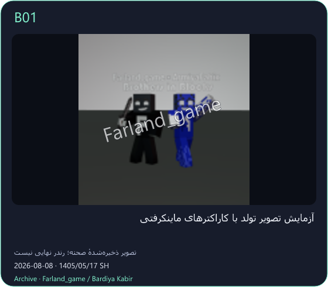</a> [B01 · آزمایش تصویر تولد با کاراکترهای ماینکرفتی](https://github.com/FarlandGame/Animation-Portfolio/blob/main/sources/blender/fa/B01.md) | <a href="https://github.com/FarlandGame/Animation-Portfolio/blob/main/sources/blender/fa/B02.md">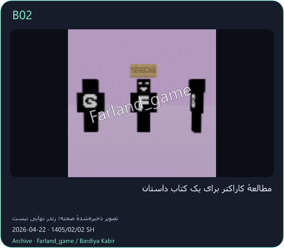</a> [B02 · مطالعهٔ کاراکتر برای یک کتاب داستان](https://github.com/FarlandGame/Animation-Portfolio/blob/main/sources/blender/fa/B02.md) |

| | |
|:--:|:--:|
| <a href="https://github.com/FarlandGame/Animation-Portfolio/blob/main/sources/blender/fa/B03.md">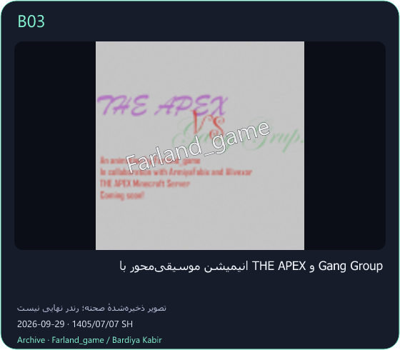</a> [B03 · انیمیشن موسیقی‌محور با THE APEX و Gang Group](https://github.com/FarlandGame/Animation-Portfolio/blob/main/sources/blender/fa/B03.md) | <a href="https://github.com/FarlandGame/Animation-Portfolio/blob/main/sources/blender/fa/B04.md">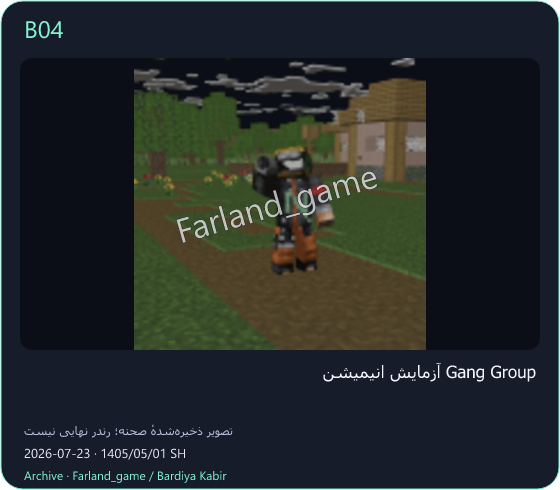</a> [B04 · آزمایش انیمیشن Gang Group](https://github.com/FarlandGame/Animation-Portfolio/blob/main/sources/blender/fa/B04.md) |

| | |
|:--:|:--:|
| <a href="https://github.com/FarlandGame/Animation-Portfolio/blob/main/sources/blender/fa/B05.md">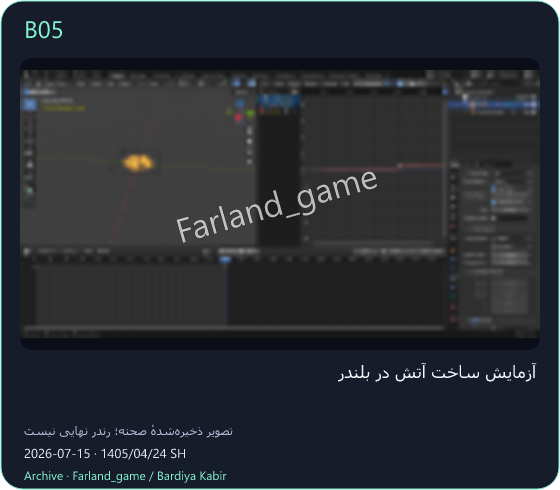</a> [B05 · آزمایش ساخت آتش در بلندر](https://github.com/FarlandGame/Animation-Portfolio/blob/main/sources/blender/fa/B05.md) | <a href="https://github.com/FarlandGame/Animation-Portfolio/blob/main/sources/blender/fa/B06.md">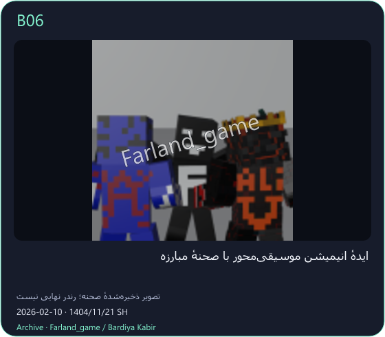</a> [B06 · ایدهٔ انیمیشن موسیقی‌محور با صحنهٔ مبارزه](https://github.com/FarlandGame/Animation-Portfolio/blob/main/sources/blender/fa/B06.md) |

| | |
|:--:|:--:|
| <a href="https://github.com/FarlandGame/Animation-Portfolio/blob/main/sources/blender/fa/B07.md">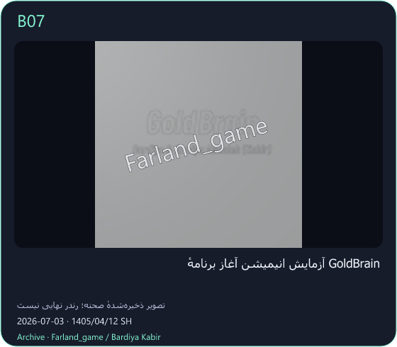</a> [B07 · آزمایش انیمیشن آغاز برنامهٔ GoldBrain](https://github.com/FarlandGame/Animation-Portfolio/blob/main/sources/blender/fa/B07.md) | <a href="https://github.com/FarlandGame/Animation-Portfolio/blob/main/sources/blender/fa/B08.md">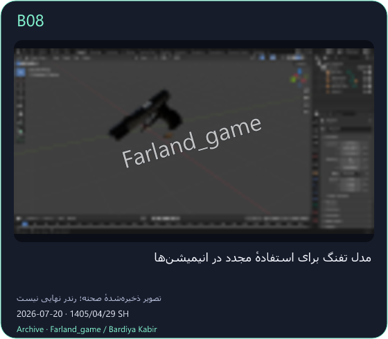</a> [B08 · مدل تفنگ برای استفادهٔ مجدد در انیمیشن‌ها](https://github.com/FarlandGame/Animation-Portfolio/blob/main/sources/blender/fa/B08.md) |

| | |
|:--:|:--:|
| <a href="https://github.com/FarlandGame/Animation-Portfolio/blob/main/sources/blender/fa/B09.md">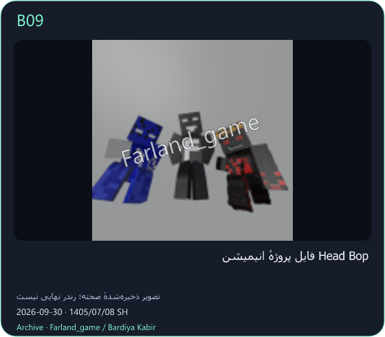</a> [B09 · فایل پروژهٔ انیمیشن Head Bop](https://github.com/FarlandGame/Animation-Portfolio/blob/main/sources/blender/fa/B09.md) | <a href="https://github.com/FarlandGame/Animation-Portfolio/blob/main/sources/blender/fa/B10.md">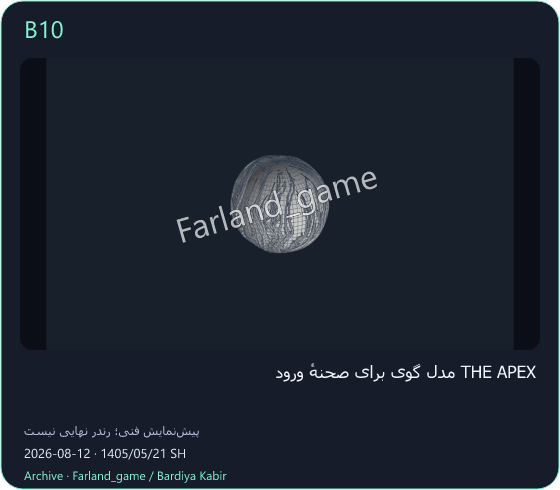</a> [B10 · مدل گوی برای صحنهٔ ورود THE APEX](https://github.com/FarlandGame/Animation-Portfolio/blob/main/sources/blender/fa/B10.md) |

| | |
|:--:|:--:|
| <a href="https://github.com/FarlandGame/Animation-Portfolio/blob/main/sources/blender/fa/B11.md">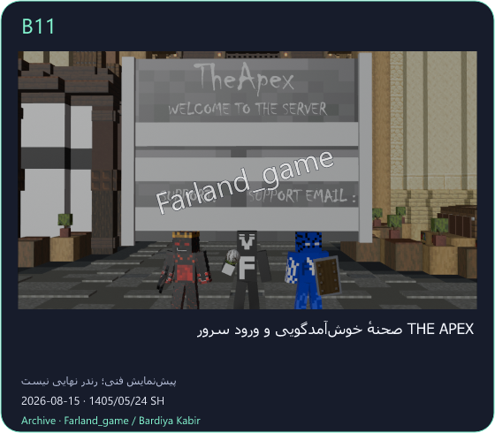</a> [B11 · صحنهٔ خوش‌آمدگویی و ورود سرور THE APEX](https://github.com/FarlandGame/Animation-Portfolio/blob/main/sources/blender/fa/B11.md) | <a href="https://github.com/FarlandGame/Animation-Portfolio/blob/main/sources/blender/fa/B12.md">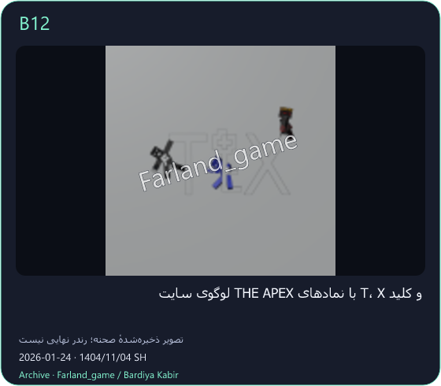</a> [B12 · لوگوی سایت THE APEX با نمادهای T، X و کلید](https://github.com/FarlandGame/Animation-Portfolio/blob/main/sources/blender/fa/B12.md) |

| | |
|:--:|:--:|
| <a href="https://github.com/FarlandGame/Animation-Portfolio/blob/main/sources/blender/fa/B13.md">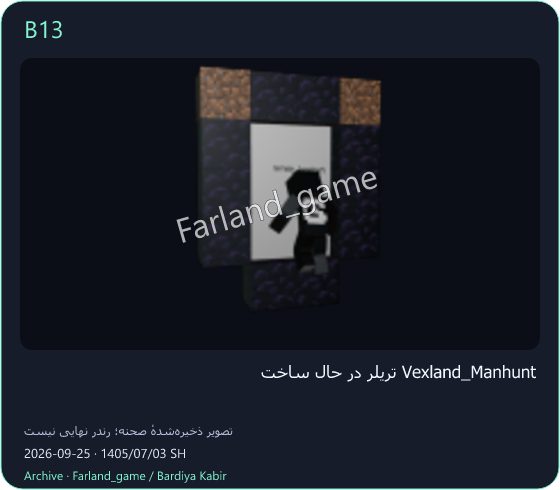</a> [B13 · تریلر در حال ساخت Vexland_Manhunt](https://github.com/FarlandGame/Animation-Portfolio/blob/main/sources/blender/fa/B13.md) | <a href="https://github.com/FarlandGame/Animation-Portfolio/blob/main/sources/blender/fa/B14.md">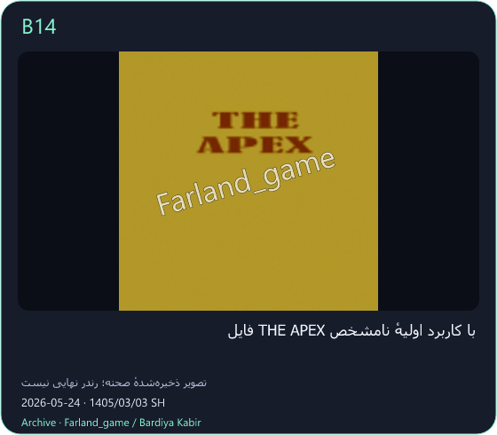</a> [B14 · فایل THE APEX با کاربرد اولیهٔ نامشخص](https://github.com/FarlandGame/Animation-Portfolio/blob/main/sources/blender/fa/B14.md) |

| | |
|:--:|:--:|
| <a href="https://github.com/FarlandGame/Animation-Portfolio/blob/main/sources/blender/fa/B15.md">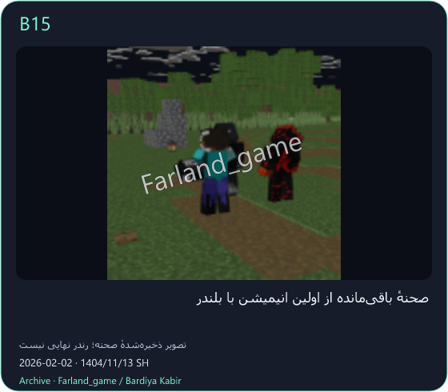</a> [B15 · صحنهٔ باقی‌مانده از اولین انیمیشن با بلندر](https://github.com/FarlandGame/Animation-Portfolio/blob/main/sources/blender/fa/B15.md) | <a href="https://github.com/FarlandGame/Animation-Portfolio/blob/main/sources/blender/fa/B16.md">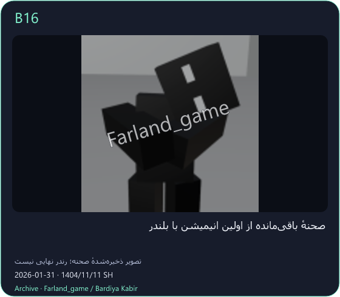</a> [B16 · صحنهٔ باقی‌مانده از اولین انیمیشن با بلندر](https://github.com/FarlandGame/Animation-Portfolio/blob/main/sources/blender/fa/B16.md) |

| | |
|:--:|:--:|
| <a href="https://github.com/FarlandGame/Animation-Portfolio/blob/main/sources/blender/fa/B17.md">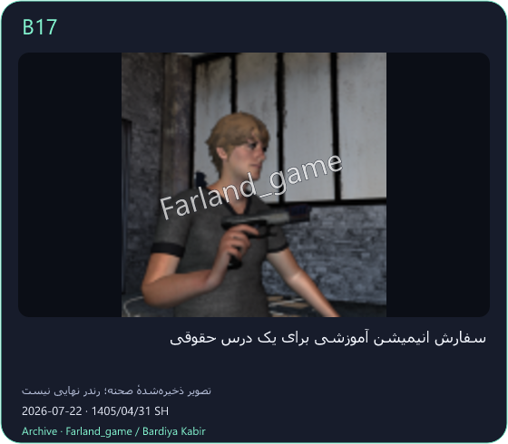</a> [B17 · سفارش انیمیشن آموزشی برای یک درس حقوقی](https://github.com/FarlandGame/Animation-Portfolio/blob/main/sources/blender/fa/B17.md) | <a href="https://github.com/FarlandGame/Animation-Portfolio/blob/main/sources/blender/fa/B18.md">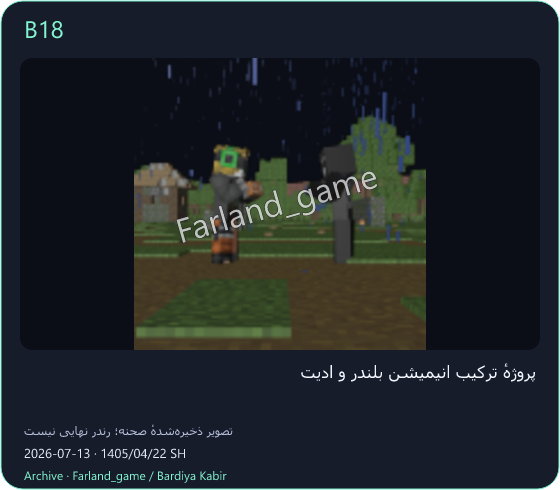</a> [B18 · پروژهٔ ترکیب انیمیشن بلندر و ادیت](https://github.com/FarlandGame/Animation-Portfolio/blob/main/sources/blender/fa/B18.md) |

| | |
|:--:|:--:|
| <a href="https://github.com/FarlandGame/Animation-Portfolio/blob/main/sources/blender/fa/B19.md">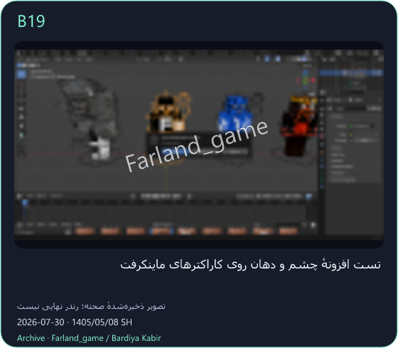</a> [B19 · تست افزونهٔ چشم و دهان روی کاراکترهای ماینکرفت](https://github.com/FarlandGame/Animation-Portfolio/blob/main/sources/blender/fa/B19.md) | <a href="https://github.com/FarlandGame/Animation-Portfolio/blob/main/sources/blender/fa/B20.md">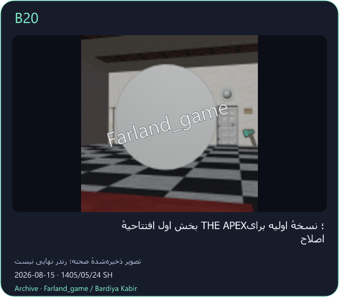</a> [B20 · بخش اول افتتاحیهٔ THE APEX؛ نسخهٔ اولیه برای اصلاح](https://github.com/FarlandGame/Animation-Portfolio/blob/main/sources/blender/fa/B20.md) |

| | |
|:--:|:--:|
| <a href="https://github.com/FarlandGame/Animation-Portfolio/blob/main/sources/blender/fa/B21.md">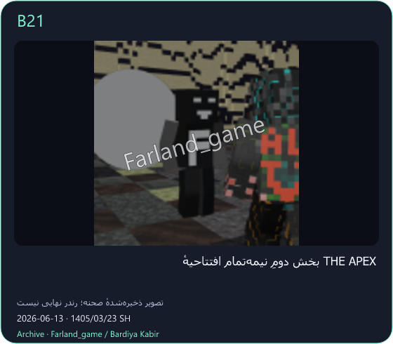</a> [B21 · بخش دومِ نیمه‌تمام افتتاحیهٔ THE APEX](https://github.com/FarlandGame/Animation-Portfolio/blob/main/sources/blender/fa/B21.md) | <a href="https://github.com/FarlandGame/Animation-Portfolio/blob/main/sources/blender/fa/B22.md">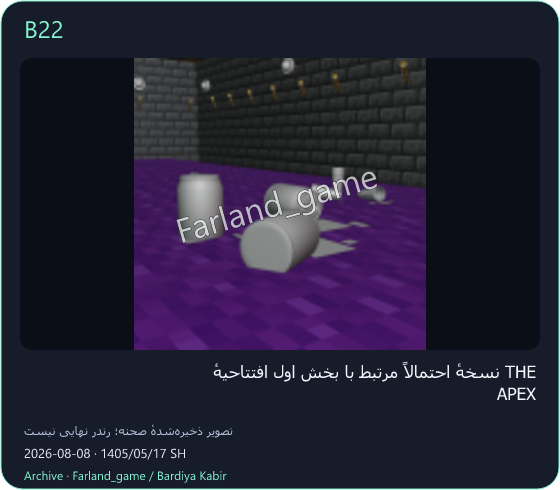</a> [B22 · نسخهٔ احتمالاً مرتبط با بخش اول افتتاحیهٔ THE APEX](https://github.com/FarlandGame/Animation-Portfolio/blob/main/sources/blender/fa/B22.md) |

| | |
|:--:|:--:|
| <a href="https://github.com/FarlandGame/Animation-Portfolio/blob/main/sources/blender/fa/B23.md">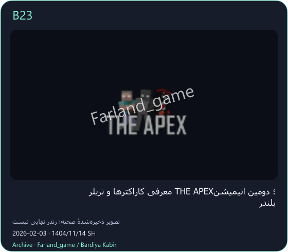</a> [B23 · معرفی کاراکترها و تریلر THE APEX؛ دومین انیمیشن بلندر](https://github.com/FarlandGame/Animation-Portfolio/blob/main/sources/blender/fa/B23.md) | <a href="https://github.com/FarlandGame/Animation-Portfolio/blob/main/sources/blender/fa/B24.md">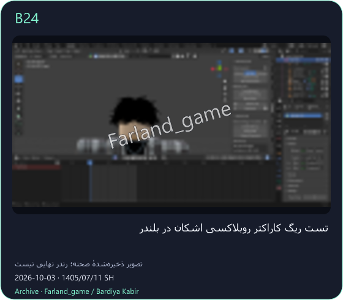</a> [B24 · تست ریگ کاراکتر روبلاکسی اشکان در بلندر](https://github.com/FarlandGame/Animation-Portfolio/blob/main/sources/blender/fa/B24.md) |

| | |
|:--:|:--:|
| <a href="https://github.com/FarlandGame/Animation-Portfolio/blob/main/sources/blender/fa/B25.md">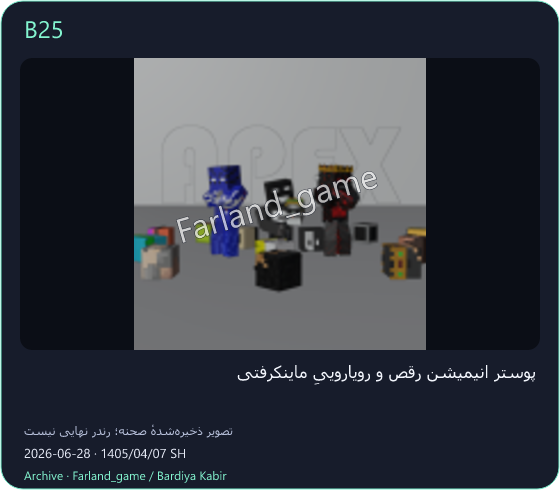</a> [B25 · پوستر انیمیشن رقص و رویاروییِ ماینکرفتی](https://github.com/FarlandGame/Animation-Portfolio/blob/main/sources/blender/fa/B25.md) | <a href="https://github.com/FarlandGame/Animation-Portfolio/blob/main/sources/blender/fa/B26.md">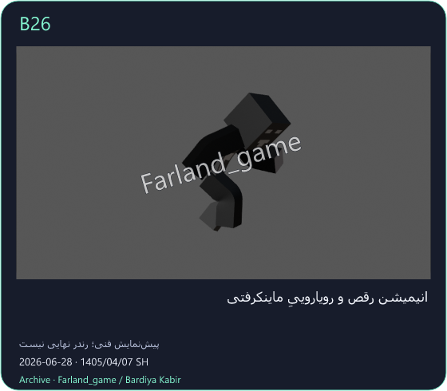</a> [B26 · انیمیشن رقص و رویاروییِ ماینکرفتی](https://github.com/FarlandGame/Animation-Portfolio/blob/main/sources/blender/fa/B26.md) |

| | |
|:--:|:--:|
| <a href="https://github.com/FarlandGame/Animation-Portfolio/blob/main/sources/blender/fa/B27.md">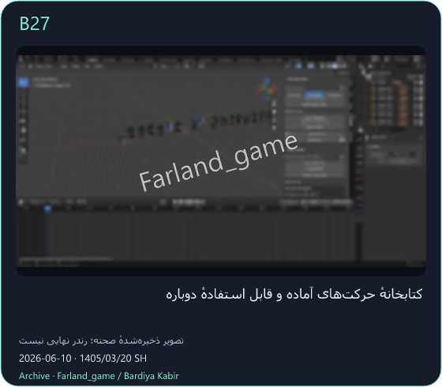</a> [B27 · کتابخانهٔ حرکت‌های آماده و قابل استفادهٔ دوباره](https://github.com/FarlandGame/Animation-Portfolio/blob/main/sources/blender/fa/B27.md) | <a href="https://github.com/FarlandGame/Animation-Portfolio/blob/main/sources/blender/fa/B28.md">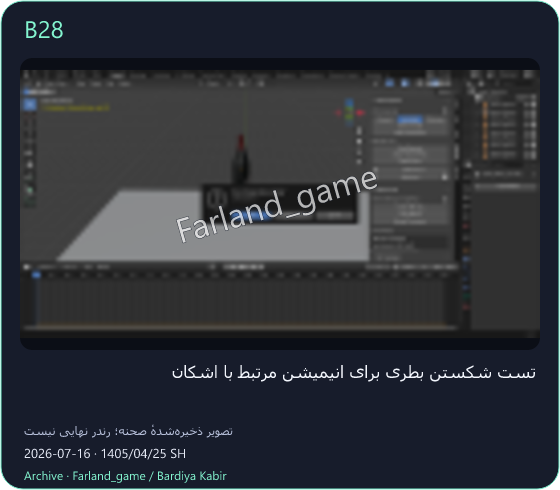</a> [B28 · تست شکستن بطری برای انیمیشن مرتبط با اشکان](https://github.com/FarlandGame/Animation-Portfolio/blob/main/sources/blender/fa/B28.md) |
