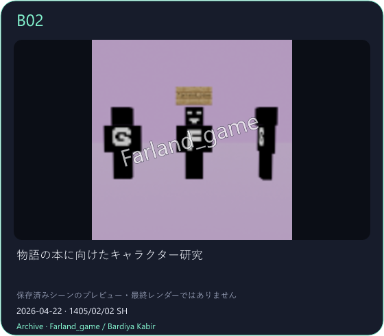

# B02 · 物語の本に向けたキャラクター研究
[English](https://github.com/FarlandGame/Animation-Portfolio/blob/main/sources/blender/en/B02.md) · [فارسی](https://github.com/FarlandGame/Animation-Portfolio/blob/main/sources/blender/fa/B02.md) · [日本語](https://github.com/FarlandGame/Animation-Portfolio/blob/main/sources/blender/ja/B02.md) · [Русский](https://github.com/FarlandGame/Animation-Portfolio/blob/main/sources/blender/ru/B02.md)

## 制作者の話

Bardiyaは、物語の本に使うため、キャラクターを複数の角度から制作した。デッサンや作画の技術を伸ばしながら、挿絵の制作を続けたいと考えている。

**提供ファイルの最終更新日:** 2026-04-22 · 1405/02/02 SH

日付はテヘラン時間における提供ファイルの最終更新日です。制作開始日や完成日を確定するものではありません。

**提供されたファイル名:** `for book.blend`

**元ファイルに記録されたBlenderバージョン:** 4.3

### [準備済み制作ファイルをダウンロード · ZIP · 1.9 MB](https://github.com/FarlandGame/Animation-Portfolio/releases/download/blender-source-archive-2026-11/B02-blender-source-snapshot.zip)

公開コピーはBlender 5.2形式です。旧バージョンとの互換性や最終レンダリングの成功は保証しません。

公開用に別途準備したコピーです。制作者の元ファイルは変更していません。利用可能な画像テクスチャをパックし、未完成部分、欠落素材、除外した第三者モーションを明記しています。

`SHA-256: cf37f4d997c11c11605fcd41a299436e66ce5f943dd8e2d50ad6e64d713a7cfb`

## 素材と公開コピーの変更点

**見つからない画像の参照:** 今回の確認では報告なし

**除外した識別可能なMixamoアクション:** 今回の確認では報告なし

**このコピーに含めない音楽:** 今回の確認では報告なし

**残した音声:** 今回の確認では報告なし

**外部フォント名:** `Minecraft-Regular.otf`, `Minecraft-Regular.otf`

### 以前の保存版

以前の保存版はZIP内のversionsフォルダーに収録。独立した新作として数えてはいません。ダウンロードにはハッシュ値と提供ファイルの日付も記録しています。

元の作者名 **Bardiya Alizadeh（Kabir / Farland_game）** を残してください。対象となるオリジナル部分は **CC BY-NC 4.0**：非営利利用、ライセンスへのリンク、変更点の表示が必要です。自分の変更には別途クレジットを付けられます。第三者素材にはそれぞれの条件が適用されます。

[開き方・制作の続け方・クレジット](https://github.com/FarlandGame/Animation-Portfolio/blob/main/sources/blender/ja/guide.md) · [Third-party credits](https://github.com/FarlandGame/Animation-Portfolio/blob/main/sources/blender/THIRD-PARTY.md) · [アーカイブ一覧](https://github.com/FarlandGame/Animation-Portfolio/blob/main/sources/blender/ja/index.md)
