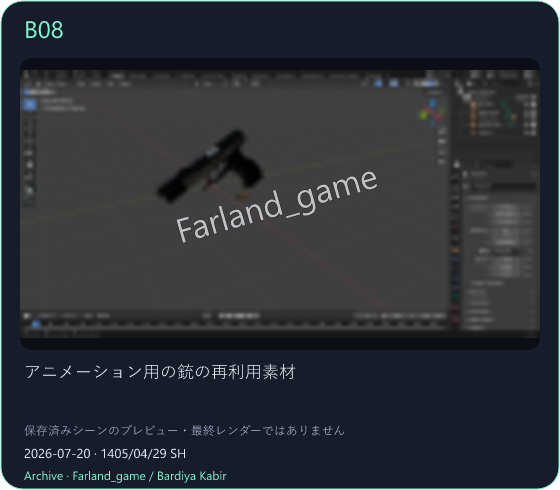

# B08 · アニメーション用の銃の再利用素材
[English](https://github.com/FarlandGame/Animation-Portfolio/blob/main/sources/blender/en/B08.md) · [فارسی](https://github.com/FarlandGame/Animation-Portfolio/blob/main/sources/blender/fa/B08.md) · [日本語](https://github.com/FarlandGame/Animation-Portfolio/blob/main/sources/blender/ja/B08.md)

## 制作者の話

アニメーションで繰り返し使用するために保存してある銃のモデル。使うたびに再ダウンロードする必要をなくすための素材ファイル。

**提供ファイルの最終更新日:** 2026-07-20 · 1405/04/29 SH

日付はテヘラン時間における提供ファイルの最終更新日です。制作開始日や完成日を確定するものではありません。

**提供されたファイル名:** `untitled.blend`

**元ファイルに記録されたBlenderバージョン:** 4.3

## プレビューと提供元情報のみ

ダウンロードして保存した銃の小道具で、本人のオリジナルモデルとはしていません。単体での再配布条件を特定できていないため、モデルZIPではなくプレビューを掲載しています。

元の作者名 **Bardiya Alizadeh（Kabir / Farland_game）** を残してください。対象となるオリジナル部分は **CC BY-NC 4.0**：非営利利用、ライセンスへのリンク、変更点の表示が必要です。自分の変更には別途クレジットを付けられます。第三者素材にはそれぞれの条件が適用されます。

[開き方・制作の続け方・クレジット](https://github.com/FarlandGame/Animation-Portfolio/blob/main/sources/blender/ja/guide.md) · [Third-party credits](https://github.com/FarlandGame/Animation-Portfolio/blob/main/sources/blender/THIRD-PARTY.md) · [アーカイブ一覧](https://github.com/FarlandGame/Animation-Portfolio/blob/main/sources/blender/ja/index.md)
