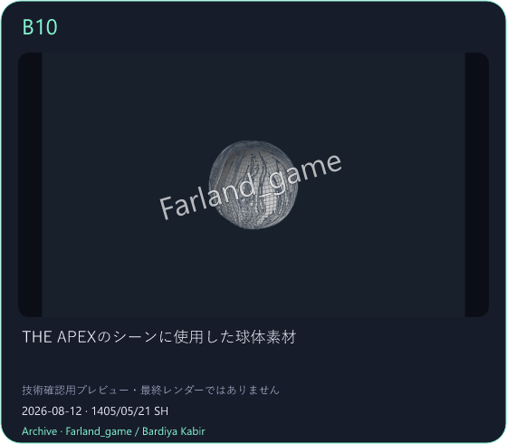

# B10 · THE APEXのシーンに使用した球体素材
[English](https://github.com/FarlandGame/Animation-Portfolio/blob/main/sources/blender/en/B10.md) · [فارسی](https://github.com/FarlandGame/Animation-Portfolio/blob/main/sources/blender/fa/B10.md) · [日本語](https://github.com/FarlandGame/Animation-Portfolio/blob/main/sources/blender/ja/B10.md) · [Русский](https://github.com/FarlandGame/Animation-Portfolio/blob/main/sources/blender/ru/B10.md)

## 制作者の話

B11のTHE APEXサーバー入場用画像に使われた球体の素材。

**提供ファイルの最終更新日:** 2026-08-12 · 1405/05/21 SH

日付はテヘラン時間における提供ファイルの最終更新日です。制作開始日や完成日を確定するものではありません。

**提供されたファイル名:** `crystal-ball-with-roots-and-vegetation_2K_f5c5d7ac-356d-4af3-94b9-7a3ccb0ba10a.blend`

**元ファイルに記録されたBlenderバージョン:** 4.5

## プレビューと提供元情報のみ

**Dennis Hafemann**によるBlendkit素材。埋め込まれた素材IDが提供元と一致しています。モデルは作者のページから取得し、そのロイヤリティフリー条件に従ってください。

[Crystal Ball With Roots And Vegetation · Dennis Hafemann](https://www.blendkit.com/asset-gallery-detail/982768a1-12a9-4783-93c6-771bb34691d9/)

元の作者名 **Bardiya Alizadeh（Kabir / Farland_game）** を残してください。対象となるオリジナル部分は **CC BY-NC 4.0**：非営利利用、ライセンスへのリンク、変更点の表示が必要です。自分の変更には別途クレジットを付けられます。第三者素材にはそれぞれの条件が適用されます。

[開き方・制作の続け方・クレジット](https://github.com/FarlandGame/Animation-Portfolio/blob/main/sources/blender/ja/guide.md) · [Third-party credits](https://github.com/FarlandGame/Animation-Portfolio/blob/main/sources/blender/THIRD-PARTY.md) · [アーカイブ一覧](https://github.com/FarlandGame/Animation-Portfolio/blob/main/sources/blender/ja/index.md)
