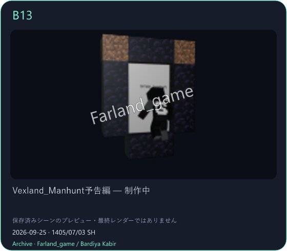

# B13 · Vexland_Manhunt予告編 — 制作中
[English](https://github.com/FarlandGame/Animation-Portfolio/blob/main/sources/blender/en/B13.md) · [فارسی](https://github.com/FarlandGame/Animation-Portfolio/blob/main/sources/blender/fa/B13.md) · [日本語](https://github.com/FarlandGame/Animation-Portfolio/blob/main/sources/blender/ja/B13.md) · [Русский](https://github.com/FarlandGame/Animation-Portfolio/blob/main/sources/blender/ru/B13.md)

## 制作者の話

Vexland_Manhuntプラグイン用のアニメーション予告編。もともとは長い作品を予定していた。一部を制作した後、音楽の著作権に関する懸念もあり一時中断したが、現在も制作を続け、完成を目指している。作者は制作途中の現行版を公開することを許可している。

**提供ファイルの最終更新日:** 2026-09-25 · 1405/07/03 SH

日付はテヘラン時間における提供ファイルの最終更新日です。制作開始日や完成日を確定するものではありません。

**提供されたファイル名:** `Part_1.blend`

**元ファイルに記録されたBlenderバージョン:** 5.2

### [準備済み制作ファイルをダウンロード · RAR · 72.9 MB](https://github.com/FarlandGame/Animation-Portfolio/releases/download/blender-source-archive-2026-11/B13-blender-source-snapshot.rar)

公開コピーはBlender 5.2形式です。旧バージョンとの互換性や最終レンダリングの成功は保証しません。

公開用に別途準備したコピーです。制作者の元ファイルは変更していません。利用可能な画像テクスチャをパックし、未完成部分、欠落素材、除外した第三者モーションを明記しています。

`SHA-256: a257e5fe68be046f3540b58cbc88d3fe4cd61cbda5df43b78a9d3f8a9ab5dc5e`

## 素材と公開コピーの変更点

**見つからない画像の参照:** 今回の確認では報告なし

除外した識別可能なMixamoアクション: 15

`SimplePlayer.arma.001|mixamo.com|Layer0.001`, `SimplePlayer.arma.001|mixamo.com|Layer0.002`, `SimplePlayer.arma.002|mixamo.com|Layer0`, `SimplePlayer.arma.003|mixamo.com|Layer0`, `SimplePlayer.arma.004|mixamo.com|Layer0.002`, `SimplePlayer.arma|mixamo.com|Layer0`, `SimplePlayer.arma|mixamo.com|Layer0.001`, `SimplePlayer.arma|mixamo.com|Layer0.002`, `SimplePlayer.arma|mixamo.com|Layer0.003`, `SimplePlayer.arma|mixamo.com|Layer0.004`, `SimplePlayer.arma|mixamo.com|Layer0.005`, `SimplePlayer.arma|mixamo.com|Layer0.006`, `SimplePlayer.arma|mixamo.com|Layer0.007`, `SimplePlayer.arma|mixamo.com|Layer0.008`, `SimplePlayer.arma|mixamo.com|Layer0.009`

**このコピーに含めない音楽:** 今回の確認では報告なし

**残した音声:** `LIKE YOU~   ANATHEMA-000.mp3`

外部フォント名: 47

`Minecraft.ttf`, `Minecraft.ttf`, `Minecraft.ttf`, `Minecraft.ttf`, `Minecraft.ttf`, `Minecraft.ttf`, `Minecraft.ttf`, `Minecraft.ttf`, `Minecraft.ttf`, `Minecraft.ttf`, `Minecraft.ttf`, `Minecraft.ttf`, `Minecraft.ttf`, `Minecraft.ttf`, `Minecraft.ttf`, `Minecraft.ttf`, `Minecraft.ttf`, `Minecraft.ttf`, `Minecraft.ttf`, `Minecraft.ttf`, `Minecraft.ttf`, `Minecraft.ttf`, `Minecraft.ttf`, `Minecraft.ttf`, `Minecraft.ttf`, `Minecraft.ttf`, `Minecraft.ttf`, `Minecraft.ttf`, `Minecraft.ttf`, `Minecraft.ttf`, `Minecraft.ttf`, `Minecraft.ttf`, `Minecraft.ttf`, `Minecraft.ttf`, `Minecraft.ttf`, `Minecraft.ttf`, `Minecraft.ttf`, `Minecraft.ttf`, `Minecraft.ttf`, `Minecraft.ttf`, `Minecraft.ttf`, `Minecraft.ttf`, `Minecraft.ttf`, `Minecraft.ttf`, `Minecraft.ttf`, `Minecraft.ttf`, `Minecraft.ttf`

### 以前の保存版

以前の保存版はZIP内のversionsフォルダーに収録。独立した新作として数えてはいません。ダウンロードにはハッシュ値と提供ファイルの日付も記録しています。

元の作者名 **Bardiya Alizadeh（Kabir / Farland_game）** を残してください。対象となるオリジナル部分は **CC BY-NC 4.0**：非営利利用、ライセンスへのリンク、変更点の表示が必要です。自分の変更には別途クレジットを付けられます。第三者素材にはそれぞれの条件が適用されます。

[開き方・制作の続け方・クレジット](https://github.com/FarlandGame/Animation-Portfolio/blob/main/sources/blender/ja/guide.md) · [Third-party credits](https://github.com/FarlandGame/Animation-Portfolio/blob/main/sources/blender/THIRD-PARTY.md) · [アーカイブ一覧](https://github.com/FarlandGame/Animation-Portfolio/blob/main/sources/blender/ja/index.md)
