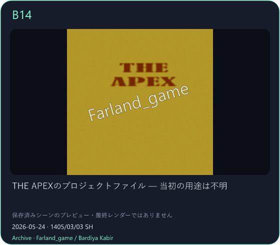

# B14 · THE APEXのプロジェクトファイル — 当初の用途は不明
[English](https://github.com/FarlandGame/Animation-Portfolio/blob/main/sources/blender/en/B14.md) · [فارسی](https://github.com/FarlandGame/Animation-Portfolio/blob/main/sources/blender/fa/B14.md) · [日本語](https://github.com/FarlandGame/Animation-Portfolio/blob/main/sources/blender/ja/B14.md) · [Русский](https://github.com/FarlandGame/Animation-Portfolio/blob/main/sources/blender/ru/B14.md)

## 制作者の話

作者は、このファイルを最初に何のために作ったのか正確には覚えていない。プレビューにはTHE APEXの文字があり、バナー、タイトルデザイン、アニメーションのいずれかに関係していた可能性があるという。具体的な用途は未確認。

**提供ファイルの最終更新日:** 2026-05-24 · 1405/03/03 SH

日付はテヘラン時間における提供ファイルの最終更新日です。制作開始日や完成日を確定するものではありません。

**提供されたファイル名:** `untitled.blend`

**元ファイルに記録されたBlenderバージョン:** 4.3

### [準備済み制作ファイルをダウンロード · ZIP · 1.9 MB](https://github.com/FarlandGame/Animation-Portfolio/releases/download/blender-source-archive-2026-11/B14-blender-source-snapshot.zip)

公開コピーはBlender 5.2形式です。旧バージョンとの互換性や最終レンダリングの成功は保証しません。

公開用に別途準備したコピーです。制作者の元ファイルは変更していません。利用可能な画像テクスチャをパックし、未完成部分、欠落素材、除外した第三者モーションを明記しています。

`SHA-256: a0c3d830f6935e54361c1d3750dd8b7c7ff640c7c00b3fac18b4dc99b1098a1d`

## 素材と公開コピーの変更点

**見つからない画像の参照:** `neow karakter.png`, `neow karakter.png.001`

**除外した識別可能なMixamoアクション:** 今回の確認では報告なし

**このコピーに含めない音楽:** `MUTILATOR (SUPER SLOWED).mp3`

**残した音声:** 今回の確認では報告なし

**外部フォント名:** `BERNHC.TTF`, `BERNHC.TTF`

### 以前の保存版

以前の保存版はZIP内のversionsフォルダーに収録。独立した新作として数えてはいません。ダウンロードにはハッシュ値と提供ファイルの日付も記録しています。

元の作者名 **Bardiya Alizadeh（Kabir / Farland_game）** を残してください。対象となるオリジナル部分は **CC BY-NC 4.0**：非営利利用、ライセンスへのリンク、変更点の表示が必要です。自分の変更には別途クレジットを付けられます。第三者素材にはそれぞれの条件が適用されます。

[開き方・制作の続け方・クレジット](https://github.com/FarlandGame/Animation-Portfolio/blob/main/sources/blender/ja/guide.md) · [Third-party credits](https://github.com/FarlandGame/Animation-Portfolio/blob/main/sources/blender/THIRD-PARTY.md) · [アーカイブ一覧](https://github.com/FarlandGame/Animation-Portfolio/blob/main/sources/blender/ja/index.md)
