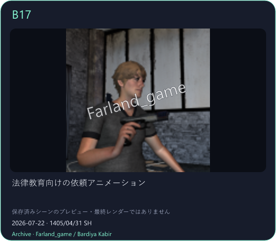

# B17 · 法律教育向けの依頼アニメーション
[English](https://github.com/FarlandGame/Animation-Portfolio/blob/main/sources/blender/en/B17.md) · [فارسی](https://github.com/FarlandGame/Animation-Portfolio/blob/main/sources/blender/fa/B17.md) · [日本語](https://github.com/FarlandGame/Animation-Portfolio/blob/main/sources/blender/ja/B17.md) · [Русский](https://github.com/FarlandGame/Animation-Portfolio/blob/main/sources/blender/ru/B17.md)

## 制作者の話

弁護士であるBardiyaの母親の教授の一人に向けて制作した、法律の授業用の有償依頼アニメーション。登場人物が正面の相手に発砲しようとするが、手が震えて右方向にそれてしまうという事例を、授業で説明するため映像化した。

**提供ファイルの最終更新日:** 2026-07-22 · 1405/04/31 SH

日付はテヘラン時間における提供ファイルの最終更新日です。制作開始日や完成日を確定するものではありません。

**提供されたファイル名:** `untitled.blend`

**元ファイルに記録されたBlenderバージョン:** 4.3

### 準備済み制作ファイルをダウンロード · RAR × 3 · 275.8 MB

**3つの分割ファイルをすべて**同じフォルダーへダウンロードし、**part1.rar**から展開してください。独立した3作品ではなく、1つの完全な配布パッケージです。

[B17-blender-source-snapshot.part1.rar · 104.9 MB](https://github.com/FarlandGame/Animation-Portfolio/releases/download/blender-source-archive-2026-11/B17-blender-source-snapshot.part1.rar)

`SHA-256: e6060bdb5592d2ff7cf276bc44ba98a5453dc636948cdacc0e4e6eb376ed4932`

[B17-blender-source-snapshot.part2.rar · 104.9 MB](https://github.com/FarlandGame/Animation-Portfolio/releases/download/blender-source-archive-2026-11/B17-blender-source-snapshot.part2.rar)

`SHA-256: 53b08abbb30fc42e1be58310b618f3c7e9f7e2d95d17f21f321b3ae718739890`

[B17-blender-source-snapshot.part3.rar · 66.0 MB](https://github.com/FarlandGame/Animation-Portfolio/releases/download/blender-source-archive-2026-11/B17-blender-source-snapshot.part3.rar)

`SHA-256: 0b8a6c875cd0de09cbef6ecf8f5eb24ea6ff17c5bcb6c42511c3333cadb41789`

公開コピーはBlender 5.2形式です。旧バージョンとの互換性や最終レンダリングの成功は保証しません。

公開用に別途準備したコピーです。制作者の元ファイルは変更していません。利用可能な画像テクスチャをパックし、未完成部分、欠落素材、除外した第三者モーションを明記しています。

## 素材と公開コピーの変更点

**見つからない画像の参照:** `Map #1`

除外した識別可能なMixamoアクション: 6

`Armature.001|mixamo.com|Layer0`, `Armature.002|mixamo.com|Layer0`, `Armature.003|mixamo.com|Layer0`, `Armature.003|mixamo.com|Layer0.001`, `Armature.003|mixamo.com|Layer0.004`, `Armature|mixamo.com|Layer0`

**このコピーに含めない音楽:** 今回の確認では報告なし

**残した音声:** 今回の確認では報告なし

**外部フォント名:** 今回の確認では報告なし

### 以前の保存版

以前の保存版はZIP内のversionsフォルダーに収録。独立した新作として数えてはいません。ダウンロードにはハッシュ値と提供ファイルの日付も記録しています。

元の作者名 **Bardiya Alizadeh（Kabir / Farland_game）** を残してください。対象となるオリジナル部分は **CC BY-NC 4.0**：非営利利用、ライセンスへのリンク、変更点の表示が必要です。自分の変更には別途クレジットを付けられます。第三者素材にはそれぞれの条件が適用されます。

[開き方・制作の続け方・クレジット](https://github.com/FarlandGame/Animation-Portfolio/blob/main/sources/blender/ja/guide.md) · [Third-party credits](https://github.com/FarlandGame/Animation-Portfolio/blob/main/sources/blender/THIRD-PARTY.md) · [アーカイブ一覧](https://github.com/FarlandGame/Animation-Portfolio/blob/main/sources/blender/ja/index.md)
