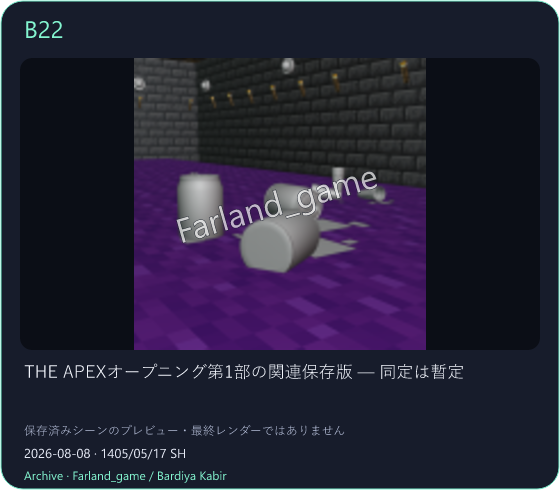

# B22 · THE APEXオープニング第1部の関連保存版 — 同定は暫定
[English](https://github.com/FarlandGame/Animation-Portfolio/blob/main/sources/blender/en/B22.md) · [فارسی](https://github.com/FarlandGame/Animation-Portfolio/blob/main/sources/blender/fa/B22.md) · [日本語](https://github.com/FarlandGame/Animation-Portfolio/blob/main/sources/blender/ja/B22.md)

## 制作者の話

Bardiyaは、これを独立した作品ではなく、B20と同じTHE APEXオープニング第1部の別の保存版かもしれないと考えている。ファイルの確認ではフレーム範囲は同じだが、オブジェクトや素材の数が異なり、B22にはB20の保存音声データが含まれていなかった。比較と保存のため、両方を残している。

**提供ファイルの最終更新日:** 2026-08-08 · 1405/05/17 SH

日付はテヘラン時間における提供ファイルの最終更新日です。制作開始日や完成日を確定するものではありません。

**提供されたファイル名:** `Untitled.blend`

**元ファイルに記録されたBlenderバージョン:** 5.2

### [準備済み制作ファイルをダウンロード · ZIP · 10.8 MB](https://github.com/FarlandGame/Animation-Portfolio/releases/download/blender-source-archive-2026-11/B22-blender-source-snapshot.zip)

公開コピーはBlender 5.2形式です。旧バージョンとの互換性や最終レンダリングの成功は保証しません。

公開用に別途準備したコピーです。制作者の元ファイルは変更していません。利用可能な画像テクスチャをパックし、未完成部分、欠落素材、除外した第三者モーションを明記しています。

`SHA-256: d493ddc937d37a90274634a7ce5f37396d48c9eb1d758732e6528408e7f199e4`

## 素材と公開コピーの変更点

**見つからない画像の参照:** 今回の確認では報告なし

**除外した識別可能なMixamoアクション:** 今回の確認では報告なし

**このコピーに含めない音楽:** 今回の確認では報告なし

**残した音声:** 今回の確認では報告なし

外部フォント名: 13

`AGENCYB.TTF`, `AGENCYB.TTF`, `AGENCYB.TTF`, `AGENCYB.TTF`, `AGENCYB.TTF`, `AGENCYB.TTF`, `AGENCYB.TTF`, `AGENCYB.TTF`, `AGENCYB.TTF`, `AGENCYB.TTF`, `AGENCYB.TTF`, `AGENCYB.TTF`, `AGENCYB.TTF`

### 以前の保存版

以前の保存版はZIP内のversionsフォルダーに収録。独立した新作として数えてはいません。ダウンロードにはハッシュ値と提供ファイルの日付も記録しています。

**関連ファイル:** [B20](https://github.com/FarlandGame/Animation-Portfolio/blob/main/sources/blender/ja/B20.md)

元の作者名 **Bardiya Alizadeh（Kabir / Farland_game）** を残してください。対象となるオリジナル部分は **CC BY-NC 4.0**：非営利利用、ライセンスへのリンク、変更点の表示が必要です。自分の変更には別途クレジットを付けられます。第三者素材にはそれぞれの条件が適用されます。

[開き方・制作の続け方・クレジット](https://github.com/FarlandGame/Animation-Portfolio/blob/main/sources/blender/ja/guide.md) · [Third-party credits](https://github.com/FarlandGame/Animation-Portfolio/blob/main/sources/blender/THIRD-PARTY.md) · [アーカイブ一覧](https://github.com/FarlandGame/Animation-Portfolio/blob/main/sources/blender/ja/index.md)
