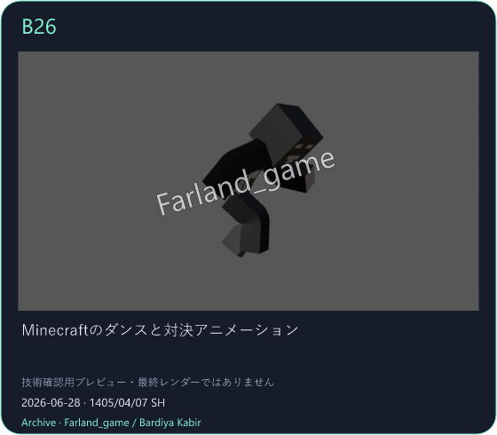

# B26 · Minecraftのダンスと対決アニメーション
[English](https://github.com/FarlandGame/Animation-Portfolio/blob/main/sources/blender/en/B26.md) · [فارسی](https://github.com/FarlandGame/Animation-Portfolio/blob/main/sources/blender/fa/B26.md) · [日本語](https://github.com/FarlandGame/Animation-Portfolio/blob/main/sources/blender/ja/B26.md)

## 制作者の話

ポスター用シーンB25に対応するアニメーションの制作ファイル。BardiyaのダンスにArmiyaとAliが登場し、流血のないコミカルな対決が描かれる。本人によると、書き出した映像とポスターはすでに公開済み。B27の再利用用モーションをこのシーンへコピーし、スキンを変えて使用しており、すべての動きをBardiyaがゼロから制作したという意味ではない。

**提供ファイルの最終更新日:** 2026-06-28 · 1405/04/07 SH

日付はテヘラン時間における提供ファイルの最終更新日です。制作開始日や完成日を確定するものではありません。

**提供されたファイル名:** `untitled.blend`

**元ファイルに記録されたBlenderバージョン:** 4.3

### [準備済み制作ファイルをダウンロード · ZIP · 8.3 MB](https://github.com/FarlandGame/Animation-Portfolio/releases/download/blender-source-archive-2026-11/B26-blender-source-snapshot.zip)

公開コピーはBlender 5.2形式です。旧バージョンとの互換性や最終レンダリングの成功は保証しません。

公開用に別途準備したコピーです。制作者の元ファイルは変更していません。利用可能な画像テクスチャをパックし、未完成部分、欠落素材、除外した第三者モーションを明記しています。

`SHA-256: ef003ffe7af600658a31d7b4985e5a6b1925a16eb1576b0afbc81f7a40c52a0c`

## 素材と公開コピーの変更点

**見つからない画像の参照:** `GunGS_Albedo.tga.png`, `GunGS_Roughness.tga.png`

除外した識別可能なMixamoアクション: 34

`SimplePlayer.arma.004|mixamo.com|Layer0`, `SimplePlayer.arma.005|mixamo.com|Layer0`, `SimplePlayer.arma.006|mixamo.com|Layer0`, `SimplePlayer.arma.006|mixamo.com|Layer0.001`, `SimplePlayer.arma.007|mixamo.com|Layer0`, `SimplePlayer.arma.008|mixamo.com|Layer0`, `SimplePlayer.arma.009|mixamo.com|Layer0`, `SimplePlayer.arma.010|mixamo.com|Layer0`, `SimplePlayer.arma.010|mixamo.com|Layer0.001`, `SimplePlayer.arma.011|mixamo.com|Layer0`, `SimplePlayer.arma.012|mixamo.com|Layer0`, `SimplePlayer.arma.012|mixamo.com|Layer0.001`, `SimplePlayer.arma.013|mixamo.com|Layer0`, `SimplePlayer.arma.014|mixamo.com|Layer0`, `SimplePlayer.arma.014|mixamo.com|Layer0.001`, `SimplePlayer.arma.016|mixamo.com|Layer0`, `SimplePlayer.arma.017|mixamo.com|Layer0`, `SimplePlayer.arma.018|mixamo.com|Layer0`, `SimplePlayer.arma.019|mixamo.com|Layer0`, `SimplePlayer.arma.019|mixamo.com|Layer0.001`, `SimplePlayer.arma.020|mixamo.com|Layer0`, `SimplePlayer.arma.021|mixamo.com|Layer0`, `SimplePlayer.arma.022|mixamo.com|Layer0`, `SimplePlayer.arma.024|mixamo.com|Layer0`, `SimplePlayer.arma.025|mixamo.com|Layer0`, `SimplePlayer.arma.025|mixamo.com|Layer0.001`, `SimplePlayer.arma.026|mixamo.com|Layer0`, `SimplePlayer.arma.027|mixamo.com|Layer0`, `SimplePlayer.arma.028|mixamo.com|Layer0`, `SimplePlayer.arma.029|mixamo.com|Layer0`, `SimplePlayer.arma.034|mixamo.com|Layer0`, `SimplePlayer.arma.034|mixamo.com|Layer0.001`, `SimplePlayer.arma.034|mixamo.com|Layer0.002`, `SimplePlayer.arma.034|mixamo.com|Layer0.003`

**このコピーに含めない音楽:** `dança zip (Super Slowed).m4a.001`

**残した音声:** 今回の確認では報告なし

**外部フォント名:** 今回の確認では報告なし

### 以前の保存版

以前の保存版はZIP内のversionsフォルダーに収録。独立した新作として数えてはいません。ダウンロードにはハッシュ値と提供ファイルの日付も記録しています。

## 公開済みの出力

ポスターと映像の対応は制作者が確認済み。画像比較も既存のmain-06のフレームとカラーポスターに一致しています。

[▶ main-06](https://github.com/FarlandGame/Animation-Portfolio/blob/main/collections/ja/main.md#main-06) · [THE APEX](https://github.com/FarlandGame/Animation-Portfolio/blob/main/assets/section-covers/the-apex-color.png)

**関連ファイル:** [B25](https://github.com/FarlandGame/Animation-Portfolio/blob/main/sources/blender/ja/B25.md) · [B27](https://github.com/FarlandGame/Animation-Portfolio/blob/main/sources/blender/ja/B27.md)

元の作者名 **Bardiya Alizadeh（Kabir / Farland_game）** を残してください。対象となるオリジナル部分は **CC BY-NC 4.0**：非営利利用、ライセンスへのリンク、変更点の表示が必要です。自分の変更には別途クレジットを付けられます。第三者素材にはそれぞれの条件が適用されます。

[開き方・制作の続け方・クレジット](https://github.com/FarlandGame/Animation-Portfolio/blob/main/sources/blender/ja/guide.md) · [Third-party credits](https://github.com/FarlandGame/Animation-Portfolio/blob/main/sources/blender/THIRD-PARTY.md) · [アーカイブ一覧](https://github.com/FarlandGame/Animation-Portfolio/blob/main/sources/blender/ja/index.md)
