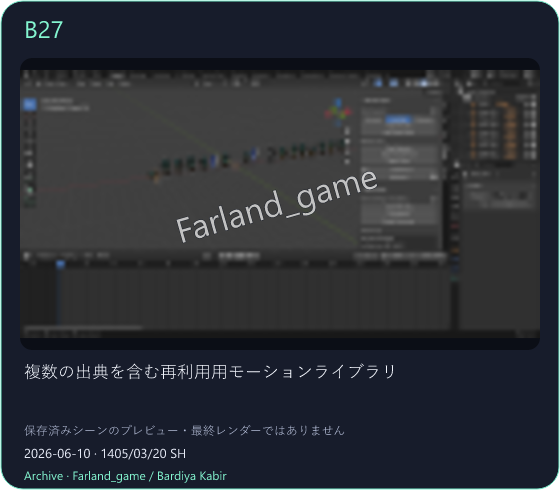

# B27 · 複数の出典を含む再利用用モーションライブラリ
[English](https://github.com/FarlandGame/Animation-Portfolio/blob/main/sources/blender/en/B27.md) · [فارسی](https://github.com/FarlandGame/Animation-Portfolio/blob/main/sources/blender/fa/B27.md) · [日本語](https://github.com/FarlandGame/Animation-Portfolio/blob/main/sources/blender/ja/B27.md)

## 制作者の話

特にB26で使うため、モーションの再制作や再ダウンロードを省く目的で保存した作業用ライブラリ。Bardiya自身の制作、動画を参考に再現した動き、Mixamoからのダウンロードが混在する。必要な部分を本編シーンにコピーし、キャラクターのスキンを変更していた。全体を本人の完全オリジナル素材集とはせず、Mixamoの生データには同サービスの配布条件が適用される。

**提供ファイルの最終更新日:** 2026-06-10 · 1405/03/20 SH

日付はテヘラン時間における提供ファイルの最終更新日です。制作開始日や完成日を確定するものではありません。

**提供されたファイル名:** `untitled.blend`

**元ファイルに記録されたBlenderバージョン:** 4.3

## プレビューと提供元情報のみ

この混合ライブラリでは本人の動きとMixamoのダウンロードを分離できないため、制作者の回答に従い、説明とプレビューのみを公開し、生のライブラリは配布していません。

[Mixamo](https://www.mixamo.com/) · [Distribution information](https://community.adobe.com/questions-696/mixamo-faq-licensing-royalties-ownership-eula-and-tos-589400)

**関連ファイル:** [B26](https://github.com/FarlandGame/Animation-Portfolio/blob/main/sources/blender/ja/B26.md)

元の作者名 **Bardiya Alizadeh（Kabir / Farland_game）** を残してください。対象となるオリジナル部分は **CC BY-NC 4.0**：非営利利用、ライセンスへのリンク、変更点の表示が必要です。自分の変更には別途クレジットを付けられます。第三者素材にはそれぞれの条件が適用されます。

[開き方・制作の続け方・クレジット](https://github.com/FarlandGame/Animation-Portfolio/blob/main/sources/blender/ja/guide.md) · [Third-party credits](https://github.com/FarlandGame/Animation-Portfolio/blob/main/sources/blender/THIRD-PARTY.md) · [アーカイブ一覧](https://github.com/FarlandGame/Animation-Portfolio/blob/main/sources/blender/ja/index.md)
